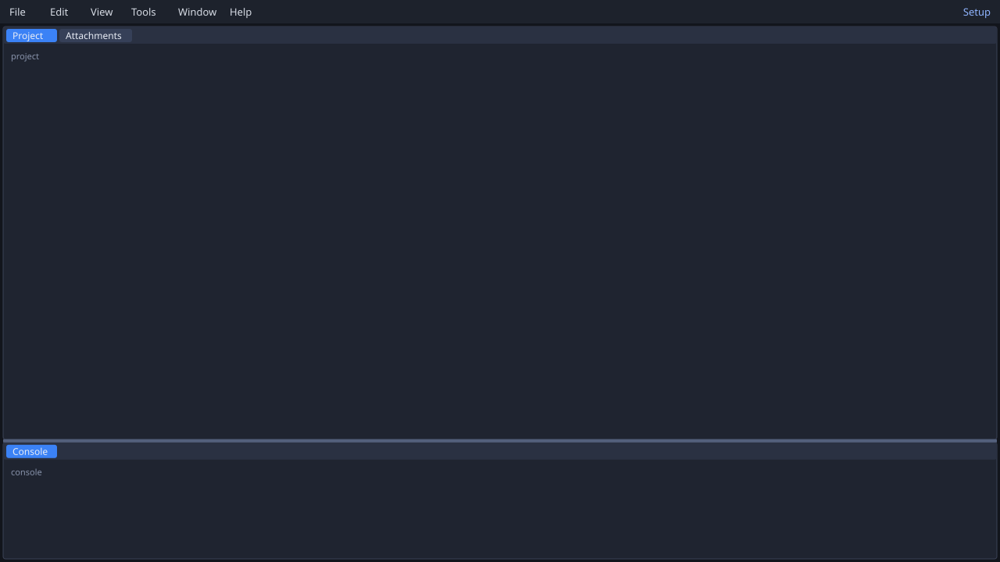

<p align="center">
  
</p>

# EH3D-PHOENIX-3DP
<p align="center">🇺🇸 <b>English</b> | <a href="README_spa.md">🇪🇸 Español</a> | <a href="README_fra.md">🇫🇷 Français</a> | <a href="README_ita.md">🇮🇹 Italiano</a> | <a href="README_deu.md">🇩🇪 Deutsch</a> | <a href="README_zho.md">🇨🇳 中文</a> | <a href="README_jpn.md">🇯🇵 日本語</a> | <a href="README_por.md">🇵🇹 Português</a></p>

### Prepare and send 3D prints: models, printer profiles, safe G-code and the link to your printers and to the EH3D server

<p align="center">
  
  
  
  
  
  
</p>

---

**Honesty check - what actually runs today:** a Rust workspace of eight libraries and a command line program (`phoenix-3dp`) with 650 tests that run on a computer. It reads STL, OBJ and 3MF models and checks them, holds a catalog of 120 printer profiles built from public data (none of them tried on a machine), writes G-code for the Marlin, Klipper, RepRapFirmware and Bambu dialects with temperature limits that refuse a value instead of cutting it down, and drives Moonraker and OctoPrint printers and the EH3D server, but only against simulators (in memory, and on a socket of this computer). It slices a closed model into flat layers with perimeters, a rectilinear infill and solid skins (a small slicer with grid and gyroid infill, bridges, plain supports, seams, variable width, a lift on travel, a skirt, a brim or a raft, a vase mode, slower short layers, retraction that follows the travel and an estimate of the time with acceleration; nothing for several materials yet); the window has not been built or looked at on a screen; nothing has run on a real printer.

---

> **Safety and security status:** this program does not control a machine by itself and is not a safety system. What it produces must be checked by a person before anything is run on a printer; nothing here has run on real hardware.

> **Names of third parties:** the names of printer makers, models and protocols (Bambu Lab, Prusa, Creality, Klipper, Moonraker, OctoPrint, Marlin and others) belong to their owners and are used only to say which machine or protocol is meant; this program is not made, approved or sponsored by them. It is written from public documentation and facts, not from the code, the texts, the icons or the profile files of any other slicer; its name, art and texts are its own.


## 📋 At a glance

| | |
|---|---|
| Version | `0.0.7` |
| Maturity | Functional |
| Tests | 650 |
| Stack | Rust |
| On real hardware | Not tried: nothing here has run on a printer, not even on a Bambu Lab A1 or a P1S. |

**Jump to:** [Overview](#-overview) · [Architecture](#-architecture) · [Quick start](#-quick-start) · [Testing](#-testing) · [Structure](#-repository-structure) · [Related](#-related-projects)

## 🚦 Project status

Each line is one part of this repository and the light says how far it is today. It is written from what the repository can show (tests, builds, runs), not from what is planned.

🟢 Done and verified · 🟡 Works, with known limits · 🟠 Partly done or not verified yet · 🔴 Not done or not working

| Area | State | What it means here |
|---|---|---|
| Core | 🟡 | units in nanometres, the mesh and its checks, the limits of the readers, a small JSON reader and a secret that never prints itself; tested on a computer with normal and damaged input. |
| Models and files | 🟡 | STL (text and binary), OBJ and basic 3MF are read with size limits and refusals that name what they found; the own 3MF package, binary STL, OBJ and the G-code file are written; the objects, plates and a few settings of the 3MF projects of other programs are read (read only); checked with fuzz tests, not with a collection of real files from other programs. |
| Printer profiles | 🟠 | 120 models from public data (volume, nozzles, dialect, ways of connecting, limits of the maker for the first 46, among them the Bambu Lab A1 and P1S, and the conservative limits of the program for the rest, which say so; the filaments of the database of printing materials of the suite (477, the generic profiles and the ones makers publish) checked against the printer and the nozzle, seven resins from the same database, and edits of a profile that say what changed); every one says `verified = false`, because none has been tried on a machine. |
| G-code | 🟡 | writers for the four dialects with a safe start and end; a temperature over the limit is refused and nothing is written; a checker finds the lines of a program that go past a limit; never run on a printer. |
| Printer drivers | 🟠 | Moonraker and OctoPrint over a transport, tried only against simulators of their protocols; Bambu LAN is a design marked experimental that does not connect. |
| Server link | 🟠 | the settings of the link and a client of the printer plugin of the server over the common client of the suite (login, renewal, retries, errors in eight languages), tried against a server in memory; never against the real server. |
| Slicer | 🟡 | flat layers of a closed mesh, perimeters, rectilinear, grid or gyroid infill, solid skins, bridges, plain supports, seams, variable width, G-code per dialect, a preview by layers as data and an estimate of the time with acceleration; checked with properties on shapes from a fixed seed (the plastic laid down is the volume of the part, nothing leaves the bed, no temperature goes past a limit); no print has come out of it on a printer. |
| Command line | 🟡 | `phoenix-3dp` (`printers`, `info`, `check-profile`, `convert`, `filaments`, `resins`, `slice`, `project`, `version`) runs the functions of the libraries and prints the result; every error comes back as a message and a non-zero exit code. |
| Tests | 🟡 | 650 tests pass (`cargo test --workspace`), with normal cases, edge cases, damaged input and a fixed seed wherever they are random. |
| Security | 🟡 | Plain safe Rust (`forbid(unsafe_code)`): a limit is a refusal and never a trim; the token never prints; nothing panics on the files it is given; no independent review. |
| Window | 🔴 | The four tabs (Prepare, Preview, Device, Project) are written with `--features gui`: lists of printers and filaments with filters, the plan by layers with a slider, the queue of the server with a start that needs a confirmation, an emergency stop, shortcuts that can be changed, a picture mode (`--shot`), a 3D view of the bed with the parts as shaded solids, a panel of the parts with auto-orient and arrange, slicing in the background with the estimates, temperature limits that can be edited and a dark and a light look; the panels sit in the docking frame of the suite (they can be taken away, put back, moved, floated and folded, with workspaces that have names, kept in the settings file, and a menu bar); the logic is tested without a screen, but the window has not been built or looked at on a screen yet. |
| Real hardware | 🔴 | Not tried: nothing here has run on a printer, not even on a Bambu Lab A1 or a P1S. |
| Documentation | 🟡 | README in eight languages, the changelog, the `docs/` folder (architecture, roadmap, what is not done yet, the server) and the two pictures drawn from `docs/`. |

## 🎯 Overview

* **The idea:** PHOENIX-3DP is the 3D printing program of the PHOENIX family. The EH3D server and its clients are the centre of the suite: this program is one more client of the server, and the stand-alone mode that talks straight to a printer is an option that is off by default.
* **The models** (`p3dp-formats`): STL (text and binary), OBJ and basic 3MF are read with limits on the size, the number of triangles and the contents of a ZIP package; what cannot be read is refused with the name of what was found. It writes binary STL, OBJ, its own 3MF package and G-code files. The projects saved as 3MF by other programs are read for their objects, plates and a few settings (read only, with limits against packages made to hurt).
* **The profiles** (`p3dp-profiles`): a catalog of 120 printer models, FDM and resin, written from public facts: volume, nozzles, dialect, ways of connecting, multi-material system and the highest temperatures (the figure of the maker for the first 46 models, the conservative limits of the program for the others, and each profile says which). The filaments (477: the generic profiles, which keep their old identifiers such as `generic-pla`, and the ones makers publish) come from the database of printing materials of the suite (`eh3d-printmaterials`), are searched by maker, material or name, and are checked against the printer and the nozzle: a pair that does not fit is refused with the reasons. Seven generic resins of the same database (standard, water-washable, tough, flexible, castable, clear and high-detail) come with the exposures and the lift of their kind as starting points. A profile can be edited from the command line: the result is checked as a whole, an edited profile is no longer `verified`, and a temperature limit raised past the figure of the maker (the bed of a Bambu Lab A1 mini, 80 C, raised by hand to 100 C) is allowed and told. Every profile says whether it has been tried on a machine; none has.
* **The G-code** (`p3dp-gcode`): writers for Marlin, Klipper, RepRapFirmware and Bambu, each with a header, a start and an end that are safe; a temperature or a move that is not allowed is refused, never cut down. A checker reads any program and finds the lines that go past the limits of a model.
* **The link** (`p3dp-link`): one driver trait, one normalized state (fifteen states, temperatures, job, alerts) and one list of commands; Moonraker and OctoPrint are implemented over a transport (a plain HTTP one written with the standard library, with limits of time and size, tried against a socket of this computer) and tested against an in-memory simulator of each protocol; Bambu LAN is the design of its topics and messages, marked experimental.
* **The server** (`p3dp-server-bridge`): the settings `server_address`, `server_token`, `server_machine`, `server_timeout_s`, `server_retries` and `server_mdns`, and a client of the `printer3d` plugin of the server over the common client of the suite (`eh3d-serverclient`): jobs join the queue and wait for a person to start them, the limits of temperature are checked before anything is sent, and there is the stop; tested against a server in memory.
* **The slicer** (`p3dp-slicer`): flat layers of a closed mesh, perimeters, rectilinear, grid or gyroid infill with solid skins, bridges, plain supports, seams, variable width, a lift on travel, G-code for the dialects of the program through its writer and the preview by layers as data, with an estimate of the time that uses the acceleration; it refuses, never cuts down, what does not fit the bed, goes past a limit of temperature or is not a closed mesh.
* **The viewer** (`p3dp-viewer`): the model of the 3D viewer with no graphics code: an orbit camera with perspective, picking and a selection box on the plate, the range of layers and the lines of a plan for a graphics card. The drawing with wgpu is behind a feature, off by default, and has never been built.
* **Other files:** binary G-code (`bgcode`) and open packages of resin layers (`.sl1`) are read by their headers only, with an estimate of the time to expose; the closed formats of resin printers are refused with the reason. The thumbnails of a binary G-code file are listed and the largest can be taken out (`project FILE --thumbnail OUT`), and the figures and thumbnails in the comments of a plain G-code file (the filament used, the time, the layer height) are read the same way, from its start and its end only.
* **Not done yet:** the drawing of the 3D viewer (its model exists), a slicer for several materials, the Bambu LAN link and the other transports. The roadmap is in `docs/ROADMAP.md` and what is missing in `docs/NOT_YET.md`.

## 🧩 Role in EH3D

EH3D-PHOENIX-3DP is the 3D printing program of the PHOENIX family of the EH3D Fabrication Suite. Today it is a set of libraries and a command line; the window is built with `--features gui`. The server `eh3d-server` and its clients are the centre of the suite: the printers, the queue and the permissions are meant to live in the server (the `printer3d` plugin of the server handles them), and this program talks to it with the common settings of the suite. See [docs/SERVER.md](docs/SERVER.md).

## 🏛️ Architecture

<p align="center">
  
</p>


How the parts of this repository fit together: who uses it, what it holds and what it depends on. The picture is drawn from `docs/architecture.json` and checked against the code.

## 🖼️ Screenshots

<p align="center">
  
</p>

<p align="center">
  
</p>

<p align="center">
  
</p>

<p align="center">
  
</p>

<p align="center">
  
</p>

Drawings of the factory arrangement of each workspace, made from the model of the window (`cargo run --example workspace_pictures`): the menu bar and the groups of panels with their tabs. They are not photographs of the window; the photographs are taken with the picture mode of the program (`--shot --demo`, a model and a server made in memory, so nothing reaches a printer) by the workflow `Window pictures`.

## ✨ Features

* **A limit is a refusal:** a temperature or a move that is not allowed is an error that names the value and the limit, never a value cut down to fit; the writers, the drivers and the checker all follow it.
* **Nothing starts by itself:** the requests to the queue of the server say `auto_start: false` and ask for confirmation; raw G-code is off by default and, when on, is one line at a time under the same limits.
* **One state for every protocol:** fifteen normalized states, temperatures, job and alerts, with the raw text of the printer kept apart, so the rest of the program speaks one language.
* **Simulators for the tests:** each protocol has an in-memory simulator with faults on demand (no connection, time-out, 503), so retries, refusals and shutdowns are tested without a network.
* **A window like a slicer's:** tabs for Prepare, Preview, Device and Project; a 3D view of the bed with the parts as shaded solids; a panel for the printer, the filament and the process; the numbers of each part (place, turn, size), auto-orient and arrange; slicing in the background with the estimates at the bottom; a dark and a light look. The panels sit in the docking frame of the suite: they can be taken away, put back, moved, tabbed, floated and folded, the four tabs are workspaces (Prepare, Review, Run, Setup and Compact), the arrangement is kept in the settings file and a menu bar has File, Edit, View, Tools, Window and Help. The logic is tested without a screen; the window itself has not been looked at yet.
* **Clean room and own art:** written from public protocols, manuals and facts; no code, texts, icons or profile files of another slicer; every profile says `verified = false` until it has been tried.
* **Eight languages:** the texts of the program and the documentation exist in English, Spanish, German, French, Italian, Japanese, Chinese and European Portuguese.
* **No unsafe code:** `#![forbid(unsafe_code)]` in every crate.

## 🔒 Security & Safety

| Threat | Defense |
|---|---|
| A damaged, cut or hostile model file | sizes are checked before anything is allocated; the triangles, the vertices, the extent, the entries of a ZIP package and what they inflate to are limited, and a bomb is refused; fuzz tests cut valid files at every position and feed garbage, and none may panic |
| A package with a surprise inside (components, objects in other files, declared entities) | it is named and refused, never skipped; a declared XML entity is an error |
| A temperature past what the model allows | refused with the value and the limit; never cut down to the limit; the same rule in the writers, the drivers and the checker |
| A line of raw G-code that skips the limits | off by default; one line at a time; checked against the same limits as everything else |
| A file name or an id that goes into a path or a command | no folders, no `..`, no control characters, only known extensions, percent-encoding of what goes into a path |
| The token of the server or the key of a printer in a log or on a screen | held in a type that prints `***`; the settings are shown with the token hidden |
| A queue that starts a job by itself | the requests say `auto_start: false` and ask for confirmation; whether the server may start jobs on its own is the policy of the server |
| A flaky network | retries only where nothing could happen twice: a refused connection is tried again for any request, a time-out only for the requests that can be sent again, never for a POST |
| Unsafe memory use | plain safe Rust with `forbid(unsafe_code)` |

**What is not defended:** a program that was written cleanly is not a program that is safe to run. The limits are the ones that the makers state and have not been checked on a machine; the drivers have only met simulators; there has been no independent review. Report a vulnerability privately (see [SECURITY.md](SECURITY.md)).

## 🔌 Interfaces

The libraries are `p3dp_core`, `p3dp_formats`, `p3dp_profiles`, `p3dp_gcode`, `p3dp_link`, `p3dp_server_bridge`, `p3dp_slicer` and `p3dp_viewer`; the program is the library `eh3d_phoenix_3dp` and the command line `phoenix-3dp`. Each command prints its result on the standard output and reports an error on the standard error with a non-zero exit code (1 for a failure of what was asked, 2 for a mistake in the command). The only network access is the transport of the drivers and of the link to the server, and only to an address that is given.

```text
phoenix-3dp printers [--vendor NAME] [--tech fdm|msla] [--search TEXT]
phoenix-3dp info MODEL [--printer ID]
phoenix-3dp check-profile ID [--gcode FILE]
phoenix-3dp check-profile --file PROFILE [--gcode FILE]
phoenix-3dp check-profile ID|--file PROFILE --set "key=value;key=value" [--save FILE] [--force]
phoenix-3dp convert IN OUT [--printer ID] [--force]
phoenix-3dp filaments [--printer ID] [--nozzle MM] [--hardened]
phoenix-3dp resins [--kind KIND] [--printer ID] [--part-ml ML]
phoenix-3dp slice MODEL --printer ID [--settings FILE] [--filament ID] [--nozzle MM] [--hardened] [--report] [--out FILE.gcode] [--force]
phoenix-3dp project FILE.3mf|FILE.bgcode|FILE.gcode|FILE.sl1 [--thumbnail FILE] [--force] [--bottom-layers N] [--lift MM] [--light-power MW]
phoenix-3dp version
phoenix-3dp gui [SETTINGS] [--open MODEL] [--printer ID] [--shot FILE.png [--window TAB] [--size WxH] [--slice] [--demo] [--peek]]  the window (a build with --features gui)
```

## ⚙️ Configuration

The settings are one file of `key = value` lines (`--config FILE`): the limits of the readers (`limit_*`), the link to the server (`server_address`, `server_token`, `server_machine`, `server_timeout_s`, `server_retries`, `server_mdns`, `server_max_answer_mib`), `direct_mode` (stand-alone, off by default), `lang` and `default_printer`, the prices (`price_filament_per_kg`, `price_resin_per_litre`, `resin_waste_percent`), the report (`report_slowest_layers`, `report_short_layer_s`), the queue (`queue_refuse_duplicates`, `queue_max_waiting`) and how far a plain G-code file is searched (`limit_gcode_head_kib`, `limit_gcode_tail_kib`, `limit_gcode_thumbnails`). A printer profile is another file of the same kind (`examples/my-printer.cfg`). A key that is not known or a value out of range is an error that names its line; every default is conservative. See `examples/phoenix-3dp.cfg`. The window keeps its own choices in the same file: `theme` (`dark` or `light`), `grid_mm`, `arrange_gap_mm`, `arrange_on_add`, `ui_hints`, `peek_wall_alpha` (how opaque the walls of the preview are when you look inside), the arrangement of the panels in lines that start with `dock.` and, for each printer whose temperature limits were changed, `printer_limits_<id>`.

## 🚀 Quick start

You need a stable Rust toolchain (1.88 or newer). Clone EH3D-COMMON beside this repository first: the common client of the server is taken from there.

```bash
cargo build --release
cargo test --workspace
cargo run --release -- printers --search bambu
cargo run --release -- info examples/cube-20mm.stl --printer bambu-lab-a1
cargo run --release -- check-profile --file examples/my-printer.cfg --gcode examples/job-too-hot.gcode
cargo run --release -- convert examples/cube-20mm.stl cube.3mf --printer prusa-mk4s
cargo run --release --features gui -- gui   # the window
```

## 🧪 Testing

The suite has 650 tests (`cargo test --workspace`, run on Windows and Linux in the CI), with a fixed seed wherever they are random. They check the normal cases, the edge cases and damaged input: cut files, garbage and hostile headers never panic, and no temperature of any printer of the catalog goes past its limit. The CI also runs `cargo fmt --all --check`, `cargo clippy` with warnings as errors and `python -I tools/ci_validate.py`.

## 🏗️ Build & Release

The version lives in `Cargo.toml` and in `eh3d.project.json`; each version has its entry in [CHANGELOG.md](CHANGELOG.md). `build.bat` / `build.sh` build the program, `test.bat` / `test.sh` run the tests and `run.bat` / `run.sh` run it with a sample. Releases are published on GitHub. No release has been published yet.

## 📂 Repository Structure

<p align="center">
  
</p>

<details>
<summary>Text version of the tree</summary>

```text
EH3D-PHOENIX-3DP/
├── crates/
│   ├── p3dp-core/                               units, mesh and its checks, limits, JSON, settings
│   ├── p3dp-formats/                            STL, OBJ, 3MF, projects, bgcode, G-code comments, resin; writers, ZIP, PNG
│   ├── p3dp-profiles/                           printers from public facts, filaments, resins, the profile file and its edits
│   ├── p3dp-gcode/                              G-code writers for four dialects, the program checker
│   ├── p3dp-link/                               drivers, normalized state, TCP, simulators, Bambu LAN (protocol bytes, no connection)
│   ├── p3dp-server-bridge/                      settings of the server link, client of the printer plugin, rules and board of the queue
│   ├── p3dp-slicer/                             the slicer: layers, perimeters, infill, bridges, supports, skirt, brim, raft, G-code
│   └── p3dp-viewer/                             the model of the 3D viewer: camera, picking, layers, travel moves
├── src/
│   ├── lib.rs                                   the library of the program: what the command line and the window use
│   ├── main.rs                                  the command line and the start of the window
│   ├── cli.rs                                   the commands: printers, info, check-profile, convert, filaments, resins, slice, project, version
│   ├── app_state.rs                             the state of the window without a window: tabs, printer, model, reports, simulated device
│   ├── config.rs                                the settings file: limits, server link, language, default printer, prices, report and queue
│   ├── demo.rs                                  the demonstration model for the pictures: a goblet turned from a few radii
│   ├── device.rs                                the printers of the server, the queue and its rules, a confirmed start, the emergency stop
│   ├── i18n.rs                                  the texts of the program in the eight languages
│   ├── keys.rs                                  the keyboard shortcuts: the scheme of the family, an own scheme and the changes
│   ├── lists.rs                                 the lists of printers and of filaments with their filters
│   ├── limits_ui.rs                             editing and keeping the temperature limits of a printer, with the warnings of an edit
│   ├── look.rs                                  the colours, the mark and the drawings of the window and its layout by size
│   ├── objects.rs                               the parts on the bed: place, turn, scale, auto-orient, arrange, overlaps
│   ├── panels.rs                                the panels, workspaces and menus of the window as data, and the saving
│   ├── preflight.rs                             what to look at before printing, from the materials database
│   ├── preview.rs                               slicing from the window, the slider of layers, the plan on screen, the report
│   ├── project.rs                               the project: a model and its printer in the own 3MF package
│   ├── report.rs                                the words of the reports: slice, resin, thumbnails and profile edits, in the eight languages
│   ├── server_ui.rs                             the settings of the server, the state of the link and the login, over the panel of the suite
│   ├── shade.rs                                 the solid look of the 3D view: shaded polygons, the bed, the standard views and picking
│   ├── shot.rs                                  the picture mode of the window (--shot) and the PNG file it writes
│   ├── slice_job.rs                             slicing in the background and the estimate of the progress bar
│   ├── studio.rs                                the work table of the Prepare tab: parts, camera, background slice, estimates
│   ├── view.rs                                  the orbit camera that turns a mesh into lines for the preview
│   └── gui.rs                                   the window (egui, gui feature): bars, panels and 3D view; passes on what the person does
├── tests/
│   ├── end_to_end.rs                            tests from a model to a program to a simulated printer
│   ├── examples.rs                              tests that the files of examples/ work with the commands
│   ├── fuzz.rs                                  fuzz tests with a fixed seed: cut, damaged and hostile files
│   ├── readme.rs                                tests that the READMEs tell the truth: the number of tests and the commands
│   └── safety.rs                                tests that no temperature of any printer of the catalog goes past its limit
├── examples/
│   ├── cube-20mm.stl                            a 20 mm cube as a text STL
│   ├── cube-20mm.obj                            the same cube as an OBJ
│   ├── phoenix-3dp.cfg                          the settings file with every key and its default
│   ├── my-printer.cfg                           a printer profile written by hand (a Klipper machine)
│   ├── job-safe.gcode                           a program that keeps to the limits of that profile
│   └── job-too-hot.gcode                        a program that goes past them on two lines
├── docs/
│   ├── ARCHITECTURE.md                          the program crate by crate
│   ├── ROADMAP.md                               the nine steps from the base to a complete program
│   ├── NOT_YET.md                               what is not done yet and what each part needs
│   ├── SERVER.md                                how the program fits with the EH3D server
│   ├── architecture.json                        data of the Architecture picture
│   └── structure.json                           data of the Repository Structure picture
├── tools/                                       CI check, README check and the picture tools
├── images/                                      banner, the two diagrams and the drawings of the workspaces of the README
├── .github/                                     CI and release workflows, issue and pull-request templates
├── eh3d.project.json                            manifest: version, role, maturity and build command
├── Cargo.toml                                   the workspace and its crates
├── rust-toolchain.toml                          the pinned Rust toolchain
├── CHANGELOG.md                                 what changed in each version
├── SECURITY.md SUPPORT.md                       how to report a vulnerability and where to ask
└── CONTRIBUTING.md CODE_OF_CONDUCT.md LICENSE   how to contribute, the code of conduct and the licence
```

</details>

## 🗺️ Roadmap & Known limits

**Known limits today**

* The slicer is small: the supports are plain (no tree, no interface layers), the bridges are not tuned, there is nothing for several materials, and no print has come out of it on a printer.
* No printer has been connected, not even the Bambu Lab A1 or P1S; every profile says `verified = false`.
* The 3MF reader takes the mesh only (components and the production extension are refused); the projects of other programs are read for their objects, plates and settings and never changed.
* The drivers have a plain HTTP transport, tried only against a socket of this computer and the simulators; no TLS and no WebSocket push; Bambu LAN is a design that does not connect, and the cloud of Bambu is not part of it.
* The window has not been built or looked at on a screen.

**Next**

* H1: mesh geometry and a 3D viewer of its own.
* H2: a calibration cube printed on a real machine (the grid and gyroid infill, the seams, the variable width, the bridges and the plain supports are written and tested on shapes from a fixed seed).
* H3: the editor of profiles and the base window.
* H7: the other transports (WebSocket push, PrusaLink, Duet) and the Bambu LAN link.
* H8: try it on a Bambu Lab A1 and P1S and mark the profiles that work as verified. The whole plan is in `docs/ROADMAP.md`.

## 🌍 Languages

README and texts exist in English, Spanish, French, Italian, German, Chinese, Japanese and European Portuguese.

## 🔗 Related Projects

* [EH3D-COMMON](https://github.com/JuanenRac/EH3D-COMMON): the shared crates, among them the common client of the server
* [EH3D-SERVER](https://github.com/JuanenRac/EH3D-SERVER): the server of the suite, where the printers, the queue and the permissions are meant to live
* [EH3D-STUDIO](https://github.com/JuanenRac/EH3D-STUDIO): the configuration panel of the suite
* [EH3D-PHOENIX-LASER](https://github.com/JuanenRac/EH3D-PHOENIX-LASER): laser engraving and cutting, the sibling program of the same family
* [EH3D-PHOENIX-PNP](https://github.com/JuanenRac/EH3D-PHOENIX-PNP): pick and place, the sibling program of the same family
* [EH3D-SUITE-LAUNCHER](https://github.com/JuanenRac/EH3D-SUITE-LAUNCHER): the hub that finds and starts the programs of the suite

## 📚 Documentation

* [Changelog](CHANGELOG.md)
* [docs/ARCHITECTURE.md](docs/ARCHITECTURE.md): Architecture of the program, crate by crate
* [docs/ROADMAP.md](docs/ROADMAP.md): Roadmap: the nine steps from the base to a complete program
* [docs/NOT_YET.md](docs/NOT_YET.md): What is not done yet, and what each missing part needs
* [docs/SERVER.md](docs/SERVER.md): How the program fits with the EH3D server
* [docs/architecture.json](docs/architecture.json): Data of the two pictures

## 🤝 Contributing & Community

* Before a pull request run `cargo fmt --all --check`, `cargo clippy --workspace --all-targets -- -D warnings`, `cargo test --workspace` and `python -I tools/ci_validate.py`: all must pass. See [CONTRIBUTING.md](CONTRIBUTING.md) and the [code of conduct](CODE_OF_CONDUCT.md).
* The README exists in eight languages: a change to the text is made in all eight files, and the two pictures are drawn from `docs/architecture.json` and `docs/structure.json` by `tools/make_architecture.py` and `tools/make_structure.py`.
* Report a vulnerability privately: [SECURITY.md](SECURITY.md). Questions, ideas and reports: electrohobby3d@gmail.com ([SUPPORT.md](SUPPORT.md)).

## 👤 AUTHOR

**JuanenRac (Electro Hobby 3D)** · electrohobby3d@gmail.com

## 📜 LICENSE

Software: GPL-3.0-or-later. See [LICENSE](LICENSE). Hardware designs of the suite use CERN OHL-S.
