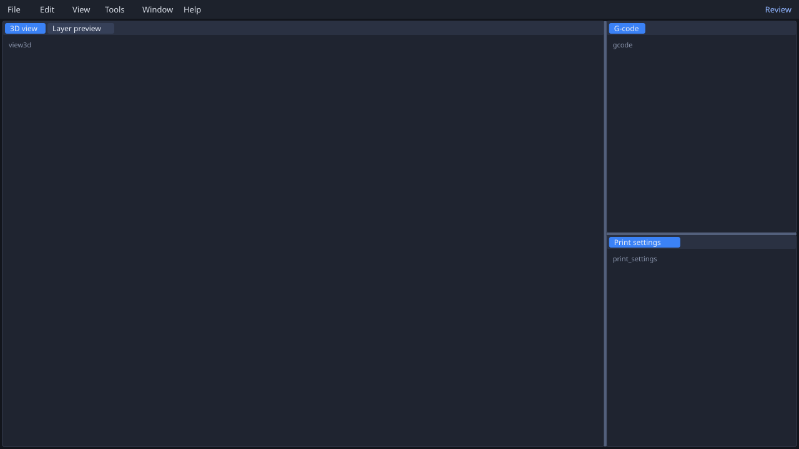
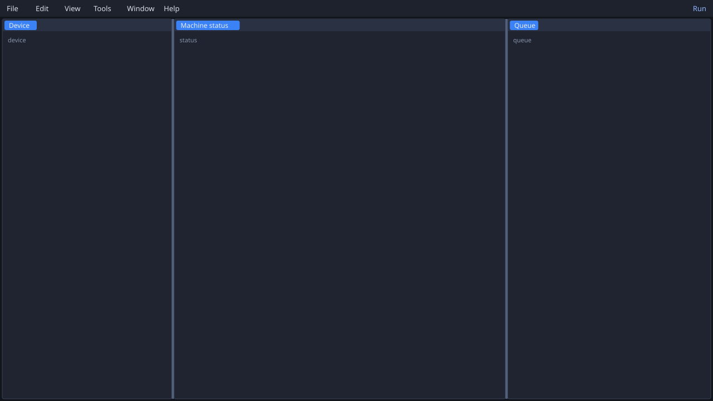
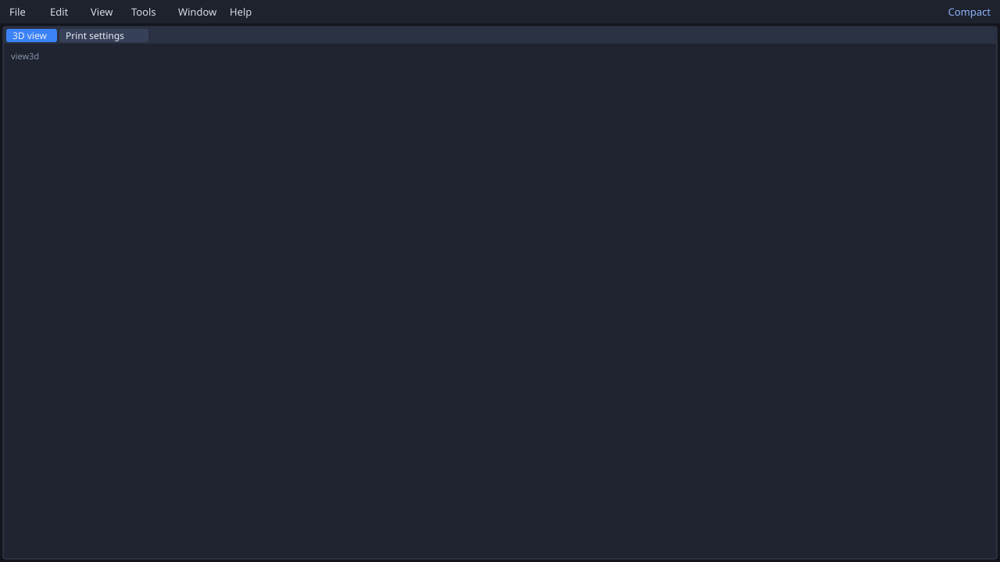

<p align="center">
  
</p>

# EH3D-PHOENIX-3DP
<p align="center"><a href="README.md">🇺🇸 English</a> | <a href="README_spa.md">🇪🇸 Español</a> | <a href="README_fra.md">🇫🇷 Français</a> | <a href="README_ita.md">🇮🇹 Italiano</a> | 🇩🇪 <b>Deutsch</b> | <a href="README_zho.md">🇨🇳 中文</a> | <a href="README_jpn.md">🇯🇵 日本語</a> | <a href="README_por.md">🇵🇹 Português</a></p>

### 3D-Drucke vorbereiten und senden: Modelle, Druckerprofile, sicherer G-Code und die Verbindung zu deinen Druckern und zum EH3D-Server

<p align="center">
  
  
  
  
  
  
</p>

---

**Ehrlichkeitscheck - was heute wirklich läuft:** ein Rust-Workspace mit acht Bibliotheken und einem Kommandozeilenprogramm (`phoenix-3dp`) mit 714 Tests, die auf einem Computer laufen. Es liest und prüft STL-, OBJ- und 3MF-Modelle, enthält einen Katalog von 120 Druckerprofilen aus öffentlichen Daten (keines an einer Maschine getestet), schreibt G-Code für die Dialekte Marlin, Klipper, RepRapFirmware und Bambu mit Temperaturgrenzen, die einen Wert ablehnen, statt ihn zu kappen, und steuert Moonraker- und OctoPrint-Drucker sowie den EH3D-Server, aber nur gegen Simulatoren (im Speicher und an einem Socket dieses Computers). Es zerlegt ein geschlossenes Modell in ebene Schichten mit Perimetern, geradliniger Füllung und massiven Außenhäuten (ein kleiner Slicer mit Gitter- und Gyroid-Füllung, Brücken, einfachen Stützen, Nähten, variabler Breite, Anheben beim Verfahren, Skirt, Brim oder Raft, einem Vasenmodus, langsameren kurzen Schichten, einem Rückzug nach der Länge der Fahrt und einer Zeitschätzung mit Beschleunigung; mehrere Materialien nach Höhe mit Reinigungsturm, Glätten der Oberseite, Pressure Advance, Schichten, deren Höhe der Form folgt, eine nach innen versetzte erste Schicht gegen den Elefantenfuß und eine Begrenzung des Durchflusses, aber noch kein Bemalen von Farben); das Fenster, der andockbare Rahmen der Suite mit fünf Arbeitsbereichen (mit `--features gui` gebaut), wurde von keiner Person auf einem Bildschirm angesehen; nichts lief an einem echten Drucker.

---

> **Sicherheitsstatus:** Dieses Programm steuert keine Maschine selbst und ist kein Sicherheitssystem. Was es erzeugt, muss ein Mensch prüfen, bevor etwas auf einem Drucker ausgeführt wird; nichts davon lief auf echter Hardware.

> **Namen Dritter:** Die Namen von Druckerherstellern, Modellen und Protokollen (Bambu Lab, Prusa, Creality, Klipper, Moonraker, OctoPrint, Marlin und andere) gehören ihren Inhabern und werden nur verwendet, um zu sagen, welche Maschine oder welches Protokoll gemeint ist; dieses Programm wurde nicht von ihnen hergestellt, genehmigt oder gesponsert. Es entsteht aus öffentlicher Dokumentation und Fakten, nicht aus Code, Texten, Symbolen oder Profildateien eines anderen Slicers; Name, Grafik und Texte sind eigen.


## 📋 Auf einen Blick

| | |
|---|---|
| Version | `0.0.8` |
| Reifegrad | Funktionsfähig |
| Tests | 714 |
| Technologie-Stack | Rust |
| Auf echter Hardware | Nicht getestet: nichts davon lief an einem Drucker, nicht einmal an einem Bambu Lab A1 oder P1S. |

**Springe zu:** [Überblick](#-überblick) · [Architektur](#-architektur) · [Schnellstart](#-schnellstart) · [Tests](#-tests) · [Struktur](#-struktur-des-repositorys) · [Verwandte](#-verwandte-projekte)

## 🚦 Projektstatus

Jede Zeile ist ein Teil dieses Repositorys, und die Ampel sagt, wie weit er heute ist. Sie beruht auf dem, was das Repository zeigen kann (Tests, Builds, Läufe), nicht auf dem, was geplant ist.

🟢 Fertig und überprüft · 🟡 Funktioniert, mit bekannten Grenzen · 🟠 Teilweise fertig oder noch nicht überprüft · 🔴 Nicht gemacht oder funktioniert nicht

| Bereich | Stand | Was das hier bedeutet |
|---|---|---|
| Kern | 🟡 | Einheiten in Nanometern, das Netz und seine Prüfungen, die Grenzen der Leser, ein kleiner JSON-Leser und ein Geheimnis, das sich nie ausgibt; am Computer mit normalen und beschädigten Eingaben getestet. |
| Modelle und Dateien | 🟡 | STL (Text und binär), OBJ und einfaches 3MF werden mit Größengrenzen und Ablehnungen gelesen, die nennen, was sie gefunden haben; das eigene 3MF-Paket, binäres STL, OBJ und die G-Code-Datei werden geschrieben; von den 3MF-Projekten anderer Programme werden Objekte, Platten und einige Einstellungen gelesen (nur lesend); mit Fuzz-Tests geprüft, nicht mit einer Sammlung echter Dateien anderer Programme. |
| Druckerprofile | 🟠 | 120 Modelle aus öffentlichen Daten (Bauraum, Düsen, Dialekt, Anbindungsarten, Grenzen des Herstellers bei den ersten 46, darunter Bambu Lab A1 und P1S, und die vorsichtigen Grenzen des Programms bei den übrigen, die das sagen; die Filamente der Datenbank der Druckmaterialien der Suite (477, die generischen Profile und die, die Hersteller veröffentlichen), gegen Drucker und Düse geprüft, sieben Harze derselben Datenbank und Änderungen eines Profils, die sagen, was sich geändert hat); alle sagen `verified = false`, weil keines an einer Maschine getestet wurde. |
| G-Code | 🟡 | Schreiber für die vier Dialekte mit sicherem Start und Ende; eine Temperatur über der Grenze wird abgelehnt und nichts geschrieben; eine Prüfung findet die Zeilen eines Programms, die eine Grenze überschreiten; nie an einem Drucker ausgeführt. |
| Druckertreiber | 🟠 | Moonraker und OctoPrint über einen Transport, nur gegen Simulatoren ihrer Protokolle getestet; der eigenständige Bambu-LAN-Treiber liest den Zustand und pausiert, setzt fort und stoppt einen Druck über einen gesicherten Kanal mit festgelegtem Zertifikat, nur gegen einen im Speicher nachgebauten Drucker getestet (einen TLS-Anschluss gibt es noch nicht, er verbindet also nicht). |
| Serververbindung | 🟠 | die Einstellungen der Verbindung und ein Client des Druckerplugins des Servers über den gemeinsamen Client der Suite (Anmeldung, Erneuerung, Wiederholungen, Fehler in acht Sprachen), gegen einen Server im Speicher getestet; nie gegen den echten Server. |
| Slicer | 🟡 | ebene Schichten eines geschlossenen Netzes, Perimeter, geradlinige, Gitter- oder Gyroid-Füllung, massive Außenhäute, Brücken, einfache Stützen, Nähte, variable Breite, G-Code je Dialekt, eine Vorschau nach Schichten als Daten und eine Zeitschätzung mit Beschleunigung; mit Eigenschaftstests an Formen aus festem Seed geprüft (das abgelegte Material entspricht dem Volumen des Teils, nichts verlässt das Bett, keine Temperatur überschreitet eine Grenze); noch kein Druck daraus auf einem Drucker. |
| Kommandozeile | 🟡 | `phoenix-3dp` (`printers`, `info`, `check-profile`, `convert`, `filaments`, `resins`, `slice`, `project`, `version`) führt die Funktionen der Bibliotheken aus und gibt das Ergebnis aus; jeder Fehler kommt als Meldung und mit einem Exit-Code ungleich null zurück. |
| Tests | 🟡 | 714 Tests bestehen (`cargo test --workspace`), mit Normalfällen, Grenzfällen, beschädigten Eingaben und festem Seed, wo Zufall im Spiel ist. |
| Sicherheit | 🟡 | Schlichtes sicheres Rust (`forbid(unsafe_code)`): eine Grenze ist eine Ablehnung und nie eine Kappung; das Token wird nie ausgegeben; nichts gerät bei den Dateien in Panik; keine unabhängige Prüfung. |
| Fenster | 🟠 | Mit `--features gui` geschrieben als andockbarer Rahmen der Suite, mit fünf Arbeitsbereichen (Vorbereiten, Prüfen, Ausführen, Einrichten und Kompakt), deren Bereiche sich entfernen, zurückholen, verschieben, als Reiter gruppieren, schweben lassen und einklappen lassen, und einer Menüleiste: Listen von Druckern und Filamenten mit Filtern, der Plan nach Schichten mit Schieberegler, die Warteschlange des Servers mit einem Start, der eine Bestätigung braucht, ein Not-Halt, änderbare Tastenkürzel, ein Bildmodus (`--shot`), eine 3D-Ansicht des Druckbetts mit schattierten Teilen, ein Teilebereich mit automatischem Ausrichten und Anordnen, Slicen im Hintergrund mit Schätzungen, bearbeitbare Temperaturgrenzen und ein dunkles und ein helles Aussehen; die Anordnung bleibt in der Einstellungsdatei; die Logik wird ohne Bildschirm getestet und das README zeigt aus dem Modell gezeichnete Bilder der Arbeitsbereiche, aber die Bereiche wurden nie auf einem Bildschirm gezeichnet und keine Person hat sie gesehen. |
| Echte Hardware | 🔴 | Nicht getestet: nichts davon lief an einem Drucker, nicht einmal an einem Bambu Lab A1 oder P1S. |
| Dokumentation | 🟡 | README in acht Sprachen, das Änderungsprotokoll, der Ordner `docs/` (Architektur, Roadmap, was noch nicht fertig ist, der Server) und die zwei aus `docs/` gezeichneten Bilder. |

## 🎯 Überblick

* **Die Idee:** PHOENIX-3DP ist das 3D-Druck-Programm der PHOENIX-Familie. Der EH3D-Server und seine Clients sind das Zentrum der Suite: Dieses Programm ist ein weiterer Client des Servers, und der eigenständige Modus, der direkt mit einem Drucker spricht, ist eine Option, die standardmäßig aus ist.
* **Die Modelle** (`p3dp-formats`): STL (Text und binär), OBJ und einfaches 3MF werden mit Grenzen für Größe, Dreiecksanzahl und Inhalt eines ZIP-Pakets gelesen; was sich nicht lesen lässt, wird mit dem Namen des Gefundenen abgelehnt. Geschrieben werden binäres STL, OBJ, das eigene 3MF-Paket und G-Code-Dateien. Als 3MF gespeicherte Projekte anderer Programme werden auf Objekte, Platten und einige Einstellungen gelesen (nur lesend, mit Grenzen gegen böswillige Pakete).
* **Die Profile** (`p3dp-profiles`): ein Katalog von 120 Druckermodellen, FDM und Resin, aus öffentlichen Fakten: Bauraum, Düsen, Dialekt, Anbindungsarten, Multimaterial-System und die höchsten Temperaturen (bei den ersten 46 Modellen die Angabe des Herstellers, bei den übrigen die vorsichtigen Grenzen des Programms, und jedes Profil sagt welche). Die Filamente (477: die generischen Profile, die ihre alten Kennungen wie `generic-pla` behalten, und die, die Hersteller veröffentlichen) kommen aus der Datenbank der Druckmaterialien der Suite (`eh3d-printmaterials`), lassen sich nach Hersteller, Material oder Name suchen und werden gegen Drucker und Düse geprüft: ein Paar, das nicht passt, wird mit den Gründen abgelehnt. Sieben generische Harze derselben Datenbank (Standard, wasserwaschbar, zäh, flexibel, gießbar, klar und hochdetailliert) bringen die Belichtungen und den Hub ihrer Art als Ausgangswerte mit. Ein Profil lässt sich über die Kommandozeile bearbeiten: das Ergebnis wird als Ganzes geprüft, ein bearbeitetes Profil ist nicht mehr `verified`, und eine über die Herstellerangabe hinaus angehobene Temperaturgrenze (das Bett eines Bambu Lab A1 mini, 80 C, von Hand auf 100 C) ist erlaubt und wird gemeldet. Jedes Profil sagt, ob es an einer Maschine getestet wurde; keines wurde es.
* **Der G-Code** (`p3dp-gcode`): Schreiber für Marlin, Klipper, RepRapFirmware und Bambu, jeweils mit sicherem Kopf, Start und Ende; eine nicht erlaubte Temperatur oder Bewegung wird abgelehnt, nie gekappt. Eine Prüfung liest jedes Programm und findet die Zeilen, die die Grenzen eines Modells überschreiten.
* **Die Verbindung** (`p3dp-link`): ein Treiber-Trait, ein normalisierter Zustand (fünfzehn Zustände, Temperaturen, Auftrag, Warnungen) und eine Liste von Befehlen; Moonraker und OctoPrint sind über einen Transport umgesetzt (ein einfacher HTTP-Transport mit der Standardbibliothek und mit Zeit- und Größengrenzen, an einem Socket dieses Computers erprobt) und gegen einen Speicher-Simulator jedes Protokolls getestet; Bambu LAN ist der Entwurf seiner Topics und Nachrichten, als experimentell gekennzeichnet.
* **Der Server** (`p3dp-server-bridge`): die Einstellungen `server_address`, `server_token`, `server_machine`, `server_timeout_s`, `server_retries` und `server_mdns` und ein Client des Plugins `printer3d` des Servers über den gemeinsamen Client der Suite (`eh3d-serverclient`): Aufträge kommen in die Warteschlange und warten, bis eine Person sie startet, die Temperaturgrenzen werden vor dem Senden geprüft, und es gibt den Stopp; gegen einen Server im Speicher getestet.
* **Der Slicer** (`p3dp-slicer`): ebene Schichten eines geschlossenen Netzes, Perimeter, geradlinige, Gitter- oder Gyroid-Füllung mit massiven Außenhäuten, Brücken, einfache Stützen, Nähte, variable Breite, Anheben beim Verfahren, Glätten der Oberseite, Pressure Advance, Schichten, deren Höhe der Form folgt, eine nach innen versetzte erste Schicht gegen den Elefantenfuß, eine Begrenzung des Durchflusses, mehrere Materialien nach Höhe mit Reinigungsturm, G-Code für die Dialekte des Programms über dessen Schreiber und die Vorschau nach Schichten als Daten, mit einer Zeitschätzung, die die Beschleunigung nutzt; er lehnt ab, kappt nie, was nicht aufs Bett passt, eine Temperaturgrenze überschreitet oder kein geschlossenes Netz ist.
* **Der Betrachter** (`p3dp-viewer`): das Modell des 3D-Betrachters ohne Grafikcode: eine Orbit-Kamera mit Perspektive, Auswahl per Klick und per Rahmen auf dem Bett, der Bereich der Schichten und die Linien eines Plans für eine Grafikkarte. Das Zeichnen mit wgpu steckt hinter einem Feature, ist standardmäßig aus und wurde nie gebaut.
* **Andere Dateien:** binärer G-Code (`bgcode`) und offene Pakete mit Harzschichten (`.sl1`) werden nur anhand ihrer Köpfe gelesen, mit einer Schätzung der Belichtungszeit; die geschlossenen Formate von Harzdruckern werden mit dem Grund abgelehnt. Die Vorschaubilder einer binären G-Code-Datei werden aufgelistet und das größte kann herausgeholt werden (`project DATEI --thumbnail AUSGABE`); die Werte und Vorschaubilder in den Kommentaren einer einfachen G-Code-Datei (verbrauchtes Filament, Zeit, Schichthöhe) werden genauso gelesen, nur von ihrem Anfang und ihrem Ende.
* **Noch nicht gemacht:** das Zeichnen des 3D-Betrachters (sein Modell gibt es), das Bemalen von Farben, die Bambu-LAN-Verbindung und die übrigen Transporte. Die Roadmap steht in `docs/ROADMAP.md`, was fehlt, in `docs/NOT_YET.md`.

## 🧩 Rolle in EH3D

EH3D-PHOENIX-3DP ist das 3D-Druck-Programm der PHOENIX-Familie der EH3D Fabrication Suite. Heute ist es eine Reihe von Bibliotheken und eine Kommandozeile; das Fenster wird mit `--features gui` gebaut. Der Server `eh3d-server` und seine Clients sind das Zentrum der Suite: Drucker, Warteschlange und Berechtigungen sollen im Server leben (dort bedient es das Plugin `printer3d`), und dieses Programm spricht mit ihm über die gemeinsamen Einstellungen der Suite. Siehe [docs/SERVER.md](docs/SERVER.md).

## 🏛️ Architektur

<p align="center">
  
</p>


Wie die Teile dieses Repositorys zusammenpassen: wer es nutzt, was es enthält und wovon es abhängt. Das Bild wird aus `docs/architecture.json` gezeichnet und gegen den Code geprüft.

## 🖼️ Screenshots

<p align="center">
  
</p>

<p align="center">
  
</p>

<p align="center">
  
</p>

<p align="center">
  
</p>

<p align="center">
  
</p>

Zeichnungen der Werksanordnung jedes Arbeitsbereichs, aus dem Modell des Fensters erzeugt (`cargo run --example workspace_pictures`): die Menüleiste und die Gruppen der Panels mit ihren Reitern. Es sind keine Fotos des Fensters; die Fotos entstehen mit dem Bildmodus des Programms (`--shot --demo`, ein Modell und ein Server aus dem Speicher, sodass nichts einen Drucker erreicht) durch den Workflow `Window pictures`.

## ✨ Funktionen

* **Eine Grenze ist eine Ablehnung:** eine nicht erlaubte Temperatur oder Bewegung ist ein Fehler, der Wert und Grenze nennt, nie ein zurechtgekappter Wert; Schreiber, Treiber und Prüfung halten sich daran.
* **Nichts startet von selbst:** die Anfragen an die Warteschlange des Servers sagen `auto_start: false` und verlangen eine Bestätigung; rohes G-Code ist standardmäßig aus und läuft, wenn an, Zeile für Zeile unter denselben Grenzen.
* **Ein Zustand für alle Protokolle:** fünfzehn normalisierte Zustände, Temperaturen, Auftrag und Warnungen, mit dem Originaltext des Druckers getrennt, sodass der Rest des Programms eine Sprache spricht.
* **Simulatoren für die Tests:** jedes Protokoll hat einen Speicher-Simulator mit Fehlern auf Abruf (keine Verbindung, Zeitüberschreitung, 503); so werden Wiederholungen, Ablehnungen und Abschaltungen ohne Netzwerk getestet.
* **Ein Fenster wie bei einem Slicer:** fünf Arbeitsbereiche (Vorbereiten, Prüfen, Ausführen, Einrichten und Kompakt) im andockbaren Rahmen der Suite; Bereiche für Drucker, Filament und Prozess; eine 3D-Ansicht des Druckbetts mit den Teilen als schattierten Körpern; die Zahlen jedes Teils (Platz, Drehung, Größe), automatisch ausrichten und anordnen; Slicen im Hintergrund mit den Schätzungen unten; ein dunkles und ein helles Aussehen. Die Bereiche lassen sich entfernen, zurückholen, verschieben, als Reiter gruppieren, schweben lassen und einklappen, die Anordnung steht in der Einstellungsdatei, und eine Menüleiste hat Datei, Bearbeiten, Ansicht, Werkzeuge, Fenster und Hilfe. Die Logik wird ohne Bildschirm getestet; das Fenster selbst wurde von keiner Person auf einem Bildschirm angesehen.
* **Clean Room und eigene Grafik:** aus öffentlichen Protokollen, Handbüchern und Fakten geschrieben; kein Code, Text, Symbol oder Profildatei eines anderen Slicers; jedes Profil sagt `verified = false`, bis es getestet wurde.
* **Acht Sprachen:** die Texte des Programms und die Dokumentation gibt es auf Englisch, Spanisch, Deutsch, Französisch, Italienisch, Japanisch, Chinesisch und europäischem Portugiesisch.
* **Kein unsicherer Code:** `#![forbid(unsafe_code)]` in jedem Crate.

## 🔒 Sicherheit und Schutz

| Bedrohung | Schutz |
|---|---|
| Eine beschädigte, abgeschnittene oder feindliche Modelldatei | Größen werden vor jeder Zuweisung geprüft; Dreiecke, Eckpunkte, Ausdehnung, Einträge eines ZIP-Pakets und ihre entpackte Größe sind begrenzt, eine Bombe wird abgelehnt; Fuzz-Tests schneiden gültige Dateien an jeder Stelle ab und füttern Müll, und nichts darf in Panik geraten |
| Ein Paket mit einer Überraschung (Komponenten, Objekte in anderen Dateien, deklarierte Entitäten) | es wird benannt und abgelehnt, nie übersprungen; eine deklarierte XML-Entität ist ein Fehler |
| Eine Temperatur über dem, was das Modell erlaubt | wird mit Wert und Grenze abgelehnt; nie auf die Grenze gekappt; dieselbe Regel in Schreibern, Treibern und Prüfung |
| Eine Zeile rohes G-Code, die die Grenzen umgeht | standardmäßig aus; Zeile für Zeile; gegen dieselben Grenzen wie alles andere geprüft |
| Ein Dateiname oder eine Kennung, die in einen Pfad oder Befehl gelangt | keine Ordner, kein `..`, keine Steuerzeichen, nur bekannte Endungen, Prozentkodierung dessen, was in einen Pfad kommt |
| Das Token des Servers oder der Schlüssel eines Druckers in einem Log oder auf einem Bildschirm | in einem Typ gehalten, der `***` ausgibt; die Einstellungen werden mit verborgenem Token gezeigt |
| Eine Warteschlange, die einen Auftrag von selbst startet | die Anfragen sagen `auto_start: false` und verlangen Bestätigung; ob der Server Aufträge selbst starten darf, ist seine Richtlinie |
| Ein wackeliges Netzwerk | Wiederholung nur, wo nichts doppelt geschehen könnte: eine abgelehnte Verbindung wird für jede Anfrage wiederholt, eine Zeitüberschreitung nur bei Anfragen, die erneut gesendet werden dürfen, nie bei einem POST |
| Unsichere Speichernutzung | schlichtes sicheres Rust mit `forbid(unsafe_code)` |

**Was nicht verteidigt wird:** ein sauber geschriebenes Programm ist noch kein Programm, das sicher auszuführen ist. Die Grenzen sind die, die die Hersteller nennen, und wurden an keiner Maschine geprüft; die Treiber kennen nur Simulatoren; es gab keine unabhängige Prüfung. Melde eine Schwachstelle privat (siehe [SECURITY.md](SECURITY.md)).

## 🔌 Schnittstellen

Die Bibliotheken sind `p3dp_core`, `p3dp_formats`, `p3dp_profiles`, `p3dp_gcode`, `p3dp_link`, `p3dp_server_bridge`, `p3dp_slicer` und `p3dp_viewer`; das Programm ist die Bibliothek `eh3d_phoenix_3dp` und die Kommandozeile `phoenix-3dp`. Jeder Befehl gibt sein Ergebnis auf der Standardausgabe aus und meldet einen Fehler auf der Fehlerausgabe mit einem Exit-Code ungleich null (1 bei Misserfolg des Gewünschten, 2 bei einem Fehler im Befehl). Der einzige Netzwerkzugriff ist der Transport der Treiber und der Serververbindung, und nur auf eine angegebene Adresse.

```text
phoenix-3dp printers [--vendor NAME] [--tech fdm|msla] [--search TEXT]
phoenix-3dp info MODEL [--printer ID]
phoenix-3dp check-profile ID [--gcode FILE]
phoenix-3dp check-profile --file PROFILE [--gcode FILE]
phoenix-3dp check-profile ID|--file PROFILE --set "key=value;key=value" [--save FILE] [--force]
phoenix-3dp convert IN OUT [--printer ID] [--force]
phoenix-3dp filaments [--printer ID] [--nozzle MM] [--hardened]
phoenix-3dp resins [--kind KIND] [--printer ID] [--part-ml ML]
phoenix-3dp slice MODEL --printer ID [--settings FILE] [--filament ID] [--nozzle MM] [--hardened] [--report] [--out FILE.gcode] [--force]
phoenix-3dp project FILE.3mf|FILE.bgcode|FILE.gcode|FILE.sl1 [--thumbnail FILE] [--force] [--bottom-layers N] [--lift MM] [--light-power MW]
phoenix-3dp version
phoenix-3dp gui [SETTINGS] [--open MODEL] [--printer ID] [--shot FILE.png [--window TAB] [--size WxH] [--slice] [--demo] [--peek]]  the window (a build with --features gui)
```

## ⚙️ Konfiguration

Die Einstellungen sind eine Datei mit Zeilen `Schlüssel = Wert` (`--config DATEI`): die Grenzen der Leser (`limit_*`), die Verbindung zum Server (`server_address`, `server_token`, `server_machine`, `server_timeout_s`, `server_retries`, `server_mdns`, `server_max_answer_mib`), `direct_mode` (eigenständig, standardmäßig aus), `lang` und `default_printer`, die Preise (`price_filament_per_kg`, `price_resin_per_litre`, `resin_waste_percent`), der Bericht (`report_slowest_layers`, `report_short_layer_s`), die Warteschlange (`queue_refuse_duplicates`, `queue_max_waiting`) und wie weit eine einfache G-Code-Datei durchsucht wird (`limit_gcode_head_kib`, `limit_gcode_tail_kib`, `limit_gcode_thumbnails`). Ein Druckerprofil ist eine weitere Datei derselben Art (`examples/my-printer.cfg`). Ein unbekannter Schlüssel oder ein Wert außerhalb des Bereichs ist ein Fehler, der seine Zeile nennt; alle Vorgaben sind vorsichtig. Siehe `examples/phoenix-3dp.cfg`. Das Fenster hält seine eigenen Entscheidungen in derselben Datei fest: `theme` (`dark` oder `light`), `grid_mm`, `arrange_gap_mm`, `arrange_on_add`, `ui_hints`, `peek_wall_alpha` (wie undurchsichtig die Wände der Vorschau sind, wenn man hineinsieht), die Anordnung der Bereiche in Zeilen, die mit `dock.` beginnen, und für jeden Drucker, dessen Temperaturgrenzen geändert wurden, `printer_limits_<id>`.

## 🚀 Schnellstart

Du brauchst eine stabile Rust-Toolchain (1.88 oder neuer). Klone zuerst EH3D-COMMON neben dieses Repository: von dort kommt der gemeinsame Client des Servers.

```bash
cargo build --release
cargo test --workspace
cargo run --release -- printers --search bambu
cargo run --release -- info examples/cube-20mm.stl --printer bambu-lab-a1
cargo run --release -- check-profile --file examples/my-printer.cfg --gcode examples/job-too-hot.gcode
cargo run --release -- convert examples/cube-20mm.stl cube.3mf --printer prusa-mk4s
cargo run --release --features gui -- gui   # the window
```

## 🧪 Tests

Die Suite hat 714 Tests (`cargo test --workspace`, in der CI unter Windows und Linux ausgeführt), mit festem Seed, wo Zufall im Spiel ist. Sie prüfen die Normalfälle, die Grenzfälle und beschädigte Eingaben: abgeschnittene Dateien, Müll und feindliche Header lösen nie eine Panik aus, und keine Temperatur eines Druckers des Katalogs überschreitet ihre Grenze. Die CI führt außerdem `cargo fmt --all --check`, `cargo clippy` mit Warnungen als Fehler und `python -I tools/ci_validate.py` aus.

## 🏗️ Build und Veröffentlichung

Die Version steht in `Cargo.toml` und in `eh3d.project.json`; jede Version hat ihren Eintrag in [CHANGELOG.md](CHANGELOG.md). `build.bat` / `build.sh` bauen das Programm, `test.bat` / `test.sh` führen die Tests aus und `run.bat` / `run.sh` starten es mit einem Beispiel. Veröffentlichungen erscheinen auf GitHub mit fertigen Programmen für Windows (64 und 32 Bit), Linux (64 Bit) und macOS (Apple Silicon und Intel): jedes Paket, `phoenix-3dp-<Version>-<System>.zip` oder `.tar.gz`, kommt mit seinen Dateien `.sha256` und `.sig`.

## 📂 Struktur des Repositorys

<p align="center">
  
</p>

<details>
<summary>Textversion des Baums</summary>

```text
EH3D-PHOENIX-3DP/
├── crates/
│   ├── p3dp-core/                               Einheiten, Netz und Prüfungen, Grenzen, JSON, Einstellungen
│   ├── p3dp-formats/                            Leser für STL, OBJ, 3MF, Projekte, bgcode, G-Code-Kommentare und Harz; Schreiber, ZIP, PNG
│   ├── p3dp-profiles/                           Drucker aus öffentlichen Fakten, Filamente, Harze, die Profildatei und ihre Änderungen
│   ├── p3dp-gcode/                              G-Code-Schreiber für vier Dialekte, die Programmprüfung
│   ├── p3dp-link/                               Treiber, normierter Zustand, TCP, Simulatoren, Bambu LAN (Protokollbytes, keine Verbindung)
│   ├── p3dp-server-bridge/                      Einstellungen der Serververbindung, Client des Plugins, Regeln und Übersicht der Warteschlange
│   ├── p3dp-slicer/                             der Slicer: Schichten, Umfänge, Füllung, Brücken, Stützen, Skirt, Brim, Raft, G-Code
│   └── p3dp-viewer/                             das Modell des 3D-Betrachters: Kamera, Auswahl, Schichten, Leerfahrten
├── src/
│   ├── lib.rs                                   die Bibliothek des Programms: was Kommandozeile und Fenster nutzen
│   ├── main.rs                                  die Kommandozeile und der Start des Fensters
│   ├── cli.rs                                   die Befehle: printers, info, check-profile, convert, filaments, resins, slice, project, version
│   ├── app_state.rs                             der Zustand des Fensters ohne Fenster: Reiter, Drucker, Modell, Berichte, simuliertes Gerät
│   ├── config.rs                                die Einstellungsdatei: Grenzen, Serververbindung, Sprache, Standarddrucker, Preise, Bericht und Warteschlange
│   ├── demo.rs                                  das Demomodell für die Bilder: ein aus wenigen Radien gedrehter Pokal
│   ├── device.rs                                die Drucker des Servers, die Warteschlange und ihre Regeln, ein bestätigter Start, der Not-Halt
│   ├── i18n.rs                                  die Texte des Programms in den acht Sprachen
│   ├── keys.rs                                  die Tastenkürzel: das Schema der Familie, ein eigenes und die Änderungen
│   ├── lists.rs                                 die Listen der Drucker und der Filamente mit ihren Filtern
│   ├── limits_ui.rs                             die Temperaturgrenzen eines Druckers bearbeiten und behalten, mit den Hinweisen zu einer Änderung
│   ├── look.rs                                  die Farben, das Zeichen und die Zeichnungen des Fensters und seine Anordnung nach Größe
│   ├── objects.rs                               die Teile auf dem Druckbett: platzieren, drehen, skalieren, ausrichten, anordnen
│   ├── panels.rs                                die Bereiche, Arbeitsbereiche und Menüs des Fensters als Daten
│   ├── preflight.rs                             was vor dem Drucken zu prüfen ist, aus der Materialdatenbank
│   ├── preview.rs                               Slicen im Fenster, der Schichtenregler, der Plan auf dem Bildschirm, der Bericht
│   ├── project.rs                               das Projekt: ein Modell und sein Drucker im eigenen 3MF-Paket
│   ├── report.rs                                die Worte der Berichte: Slicing, Harz, Vorschaubilder und Profiländerungen, in den acht Sprachen
│   ├── server_ui.rs                             die Einstellungen des Servers, der Zustand der Verbindung und die Anmeldung über das Panel der Suite
│   ├── shade.rs                                 das massive Aussehen der 3D-Ansicht: schattierte Polygone, das Druckbett, die Standardansichten und das Auswählen
│   ├── shot.rs                                  der Bildmodus des Fensters (--shot) und die PNG-Datei, die er schreibt
│   ├── slice_job.rs                             Slicen im Hintergrund und die Schätzung des Fortschrittsbalkens
│   ├── studio.rs                                der Arbeitstisch von Vorbereiten: Teile, Kamera, Slicen im Hintergrund, Schätzungen
│   ├── view.rs                                  die Orbit-Kamera, die ein Netz in Linien für die Vorschau umwandelt
│   └── gui.rs                                   das Fenster (egui, Feature gui): Leisten, Bereiche und 3D-Ansicht; gibt weiter, was die Person tut
├── tests/
│   ├── end_to_end.rs                            Tests von einem Modell über ein Programm zu einem simulierten Drucker
│   ├── examples.rs                              Tests, dass die Dateien in examples/ mit den Befehlen funktionieren
│   ├── fuzz.rs                                  Fuzz-Tests mit festem Seed: abgeschnittene, beschädigte und feindliche Dateien
│   ├── readme.rs                                Tests, dass die READMEs die Wahrheit sagen: Zahl der Tests und Befehle
│   ├── safety.rs                                Tests, dass keine Temperatur eines Druckers des Katalogs ihre Grenze überschreitet
│   └── reqs.rs                                  Tests des Anforderungsregisters
├── examples/
│   ├── cube-20mm.stl                            ein 20-mm-Würfel als Text-STL
│   ├── cube-20mm.obj                            derselbe Würfel als OBJ
│   ├── phoenix-3dp.cfg                          die Einstellungsdatei mit allen Schlüsseln und Vorgaben
│   ├── my-printer.cfg                           ein von Hand geschriebenes Druckerprofil (eine Klipper-Maschine)
│   ├── job-safe.gcode                           ein Programm, das die Grenzen dieses Profils einhält
│   └── job-too-hot.gcode                        ein Programm, das sie in zwei Zeilen überschreitet
├── docs/
│   ├── REQUIREMENTS.md                          das Register der Anforderungen: Stand, Nachweis und Test jeder einzelnen
│   ├── SCOPE.md                                 wofür es da ist, was es nicht tut und was es nie entscheidet
│   ├── STATUS.md                                was es gibt, was fehlt und was offen ist
│   ├── ARCHITECTURE.md                          das Programm Crate für Crate
│   ├── ROADMAP.md                               die neun Schritte von der Basis zum vollständigen Programm
│   ├── NOT_YET.md                               was noch nicht gemacht ist und was jeder Teil braucht
│   ├── SERVER.md                                wie das Programm zum EH3D-Server passt
│   ├── architecture.json                        Daten des Architektur-Bildes
│   └── structure.json                           Daten des Struktur-Bildes
├── tools/                                       CI-Prüfung, README-Prüfung und die Bildwerkzeuge
├── images/                                      Banner, die zwei Diagramme und die Zeichnungen der Arbeitsbereiche des README
├── .github/                                     CI- und Release-Workflows, Vorlagen für Issues und Pull Requests
├── eh3d.project.json                            Manifest: Version, Rolle, Reifegrad und Build-Befehl
├── Cargo.toml                                   der Workspace und seine Crates
├── rust-toolchain.toml                          die festgelegte Rust-Toolchain
├── CHANGELOG.md                                 was sich in jeder Version geändert hat
├── AGENTS.md                                    die Regeln für alle, die das Repository ändern
├── SECURITY.md SUPPORT.md                       wie man eine Schwachstelle meldet und wo man fragt
└── CONTRIBUTING.md CODE_OF_CONDUCT.md LICENSE   wie man beiträgt, der Verhaltenskodex und die Lizenz
```

</details>

## 🗺️ Roadmap und bekannte Grenzen

**Bekannte Grenzen heute**

* Der Slicer ist klein: die Stützen sind einfach (kein Baum, keine Zwischenschichten), die Brücken sind nicht feinabgestimmt, mehrere Materialien nur nach Höhe (kein Bemalen von Farben, keine Versätze der Köpfe eines Werkzeugwechslers), und es ist noch kein Druck daraus auf einem Drucker entstanden.
* Es wurde kein Drucker angeschlossen, nicht einmal der Bambu Lab A1 oder P1S; jedes Profil sagt `verified = false`.
* Der 3MF-Leser nimmt nur das Netz (Komponenten und die Produktionserweiterung werden abgelehnt); Projekte anderer Programme werden auf Objekte, Platten und Einstellungen gelesen und nie verändert.
* Die Treiber haben einen einfachen HTTP-Transport, nur an einem Socket dieses Computers und an den Simulatoren erprobt; kein TLS und kein WebSocket-Push; Bambu LAN läuft über den Server, der das TLS mit festgelegtem Zertifikat hält (nur am Server im Speicher erprobt), und das Programm öffnet kein eigenes, und die Bambu-Cloud gehört nicht dazu.
* Das Fenster (fünf Arbeitsbereiche im andockbaren Rahmen der Suite) wurde von keiner Person auf einem Bildschirm angesehen; die Bilder im README sind aus seinem Modell gezeichnet.

**Als Nächstes**

* H1: das Zeichnen des 3D-Betrachters mit wgpu (sein Modell gibt es) und die Reparatur von Netzen.
* H2: ein Kalibrierwürfel, auf einer echten Maschine gedruckt (Gitter- und Gyroid-Füllung, Nähte, variable Breite, Brücken und einfache Stützen sind geschrieben und an Formen aus festem Seed getestet).
* H3: der Profileditor mit Vererbung und der Abgleich der Profile mit dem Server.
* H4 bis H6: adaptive Schichthöhe, der Rest der Qualitätseinstellungen, Baumstützen und fortgeschrittene Füllung sowie das Bemalen von Farben und die Köpfe eines Werkzeugwechslers.
* H7: die übrigen Transporte (WebSocket-Push, PrusaLink, Duet), die direkte Bambu-LAN-Verbindung (ihr TLS ist das des Servers).
* H8: Profile mit Nachweis von echten Maschinen (ein Bambu Lab A1 und ein P1S sind die ersten geplanten), geführte Kalibrierungen und eine Simulation von Kollisionen. Der ganze Plan steht in `docs/ROADMAP.md`.

## 🌍 Sprachen

README und Texte gibt es auf Englisch, Spanisch, Französisch, Italienisch, Deutsch, Chinesisch, Japanisch und europäischem Portugiesisch.

## 🔗 Verwandte Projekte

* [EH3D-COMMON](https://github.com/JuanenRac/EH3D-COMMON): die gemeinsamen Crates, darunter der gemeinsame Client des Servers
* [EH3D-SERVER](https://github.com/JuanenRac/EH3D-SERVER): der Server der Suite, in dem Drucker, Warteschlange und Berechtigungen leben sollen
* [EH3D-STUDIO](https://github.com/JuanenRac/EH3D-STUDIO): das Konfigurationspanel der Suite
* [EH3D-PHOENIX-LASER](https://github.com/JuanenRac/EH3D-PHOENIX-LASER): Lasergravur und -schnitt, das Schwesterprogramm derselben Familie
* [EH3D-PHOENIX-PNP](https://github.com/JuanenRac/EH3D-PHOENIX-PNP): Bestückung (Pick and Place), das Schwesterprogramm derselben Familie
* [EH3D-SUITE-LAUNCHER](https://github.com/JuanenRac/EH3D-SUITE-LAUNCHER): der Hub, der die Programme der Suite findet und startet

## 📚 Dokumentation

* [Änderungsprotokoll](CHANGELOG.md)
* [Umfang](docs/SCOPE.md): wofür das Programm da ist, was es nicht tut und was es nie entscheidet.
* [Anforderungen](docs/REQUIREMENTS.md): das Register der Fähigkeiten, der Stand jeder einzelnen und der Test, der sie zeigt.
* [Stand](docs/STATUS.md): was es gibt, was fehlt und was noch offen ist.
* [Noch nicht](docs/NOT_YET.md): gute Ideen, die in dieser Version fehlen.
* [Regeln für Änderungen am Repository](AGENTS.md): die Regeln für alle, die das Repository ändern.
* [docs/ARCHITECTURE.md](docs/ARCHITECTURE.md): Architektur des Programms, Crate für Crate
* [docs/ROADMAP.md](docs/ROADMAP.md): Roadmap: die neun Schritte von der Basis zum vollständigen Programm
* [docs/SERVER.md](docs/SERVER.md): Wie das Programm zum EH3D-Server passt
* [docs/architecture.json](docs/architecture.json): Daten der beiden Bilder

## 🤝 Mitwirken und Community

* Vor einem Pull Request `cargo fmt --all --check`, `cargo clippy --workspace --all-targets -- -D warnings`, `cargo test --workspace` und `python -I tools/ci_validate.py` ausführen: alles muss bestehen. Siehe [CONTRIBUTING.md](CONTRIBUTING.md) und den [Verhaltenskodex](CODE_OF_CONDUCT.md).
* Die README gibt es in acht Sprachen: Eine Textänderung erfolgt in allen acht Dateien, und die zwei Bilder werden aus `docs/architecture.json` und `docs/structure.json` mit `tools/make_architecture.py` und `tools/make_structure.py` gezeichnet.
* Eine Schwachstelle privat melden: [SECURITY.md](SECURITY.md). Fragen, Ideen und Berichte: electrohobby3d@gmail.com ([SUPPORT.md](SUPPORT.md)).

## 👤 AUTOR

**JuanenRac (Electro Hobby 3D)** · electrohobby3d@gmail.com

## 📜 LIZENZ

Software: GPL-3.0-or-later. Siehe [LICENSE](LICENSE). Die Hardware-Entwürfe der Suite verwenden die CERN OHL-S.
