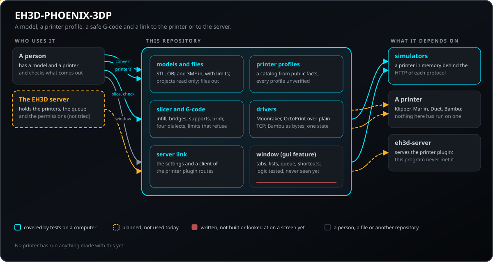
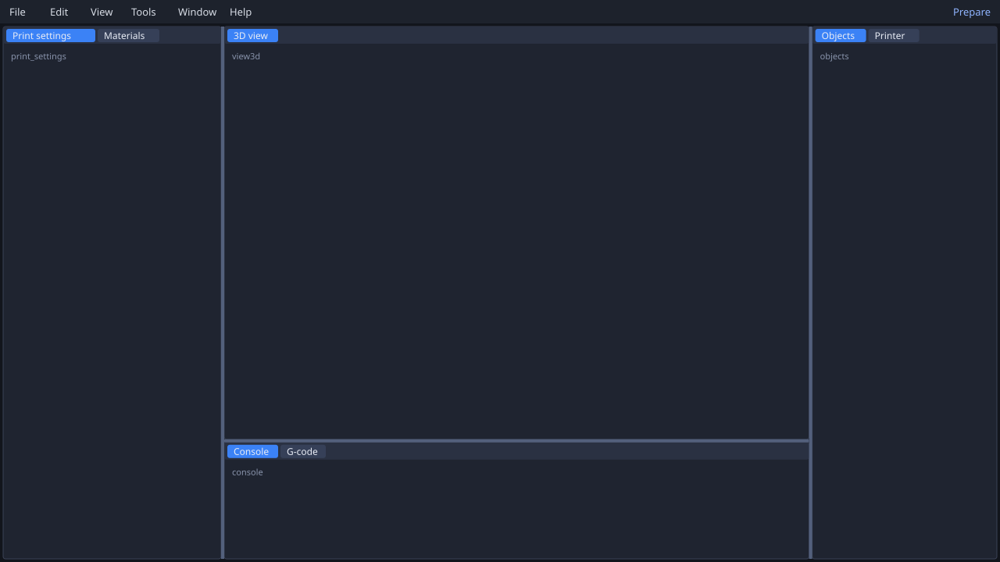

<p align="center">
  
</p>

# EH3D-PHOENIX-3DP
<p align="center"><a href="README.md">🇺🇸 English</a> | <a href="README_spa.md">🇪🇸 Español</a> | <a href="README_fra.md">🇫🇷 Français</a> | <a href="README_ita.md">🇮🇹 Italiano</a> | <a href="README_deu.md">🇩🇪 Deutsch</a> | <a href="README_zho.md">🇨🇳 中文</a> | 🇯🇵 <b>日本語</b> | <a href="README_por.md">🇵🇹 Português</a></p>

### 3D プリントの準備と送信：モデル、プリンター プロファイル、安全な G コード、プリンターおよび EH3D サーバーとの接続

<p align="center">
  
  
  
  
  
  
</p>

---

**正直さの確認 - 現在実際に動くもの：** 8 つのライブラリと、コマンドライン プログラム（`phoenix-3dp`）からなる Rust ワークスペースで、コンピューター上で動くテストが 659 本あります。STL・OBJ・3MF のモデルを読み込んで検査し、公開情報から作った 120 件のプリンター プロファイル（実機で試したものはありません）を持ち、Marlin・Klipper・RepRapFirmware・Bambu の方言の G コードを、値を切り詰めずに拒否する温度上限付きで書き出し、Moonraker と OctoPrint のプリンターおよび EH3D サーバーを操作しますが、相手はシミュレーター（メモリ上と、このコンピューターのソケット）だけです。閉じたモデルを平らな層に切り、外周・直線インフィル・ソリッド スキンを作る最初の最小限のスライサーがあります（グリッドとジャイロイドのインフィル、ブリッジ、簡易サポート、シーム、可変幅、移動時の持ち上げ、スカート・ブリム・ラフト、花瓶モード、短い層の減速、移動量に応じたリトラクト、加速度を考慮した時間の見積もりがあり、複数素材向けの機能はまだありません）。ウィンドウはビルドも画面での確認もされておらず、実際のプリンターでは何も動かしていません。

---

> **安全性の状況：** このプログラムは単独で機械を制御せず、安全装置でもありません。出力は、プリンターで何かを実行する前に人が確認してください。ここにあるものは実際のハードウェアでは動かしていません。

> **第三者の名称：** プリンターのメーカー名、機種名、プロトコル名（Bambu Lab、Prusa、Creality、Klipper、Moonraker、OctoPrint、Marlin など）はそれぞれの所有者のものであり、どの機械やプロトコルを指すかを示すためだけに使っています。このプログラムはそれらによる製作・承認・後援を受けていません。公開されている文書と事実から書かれており、他のスライサーのコード、文言、アイコン、プロファイル ファイルは使っていません。名称、画像、文言は独自のものです。


## 📋 ひと目で

| | |
|---|---|
| バージョン | `0.0.7` |
| 成熟度 | 機能する |
| テスト | 659 |
| 技術スタック | Rust |
| 実機での動作 | 未試験：ここにあるものはプリンターでは一度も動かしておらず、Bambu Lab A1 や P1S でも試していません。 |

**移動先：** [概要](#-概要) · [アーキテクチャ](#-アーキテクチャ) · [クイックスタート](#-クイックスタート) · [テスト](#-テスト) · [構成](#-リポジトリの構成) · [関連](#-関連プロジェクト)

## 🚦 プロジェクトの状況

各行はこのリポジトリの一部分で、信号は今日どこまで進んでいるかを示します。計画ではなく、リポジトリが示せるもの（テスト、ビルド、実行）に基づいて書かれています。

🟢 完了・検証済み · 🟡 動作する（既知の制限あり） · 🟠 一部のみ、または未検証 · 🔴 未実装または動作しない

| 領域 | 状態 | ここでの意味 |
|---|---|---|
| コア | 🟡 | ナノメートル単位の長さ、メッシュとその検査、読み込みの上限、小さな JSON リーダー、決して表示されない秘密値。通常の入力と壊れた入力でコンピューター上でテスト済みです。 |
| モデルとファイル | 🟡 | STL（テキストとバイナリ）、OBJ、基本的な 3MF を、サイズ上限と、見つけたものを示す拒否付きで読み込みます。独自の 3MF パッケージ、バイナリ STL、OBJ、G コード ファイルを書き出します。他のプログラムの 3MF プロジェクトからはオブジェクト、プレート、いくつかの設定を読み取ります（読み取り専用）。ファズ テストで確認済みで、他のプログラムの実ファイルのコレクションでは確認していません。 |
| プリンター プロファイル | 🟠 | 公開情報から作った 120 モデル（造形範囲、ノズル、方言、接続方法、最初の 46 機種はメーカー公称の上限（Bambu Lab A1 と P1S を含む）、残りはプログラムの安全側の上限で、各プロファイルがそのどちらかを示します。スイートの印刷材料データベースのフィラメント（477 種、汎用プロファイルとメーカーが公開しているもの）をプリンターとノズルに照らして検査し、同じデータベースのレジン 7 種を持ち、プロファイルの編集では何が変わったかを示します）。実機で試したものはないので、すべて `verified = false` です。 |
| G コード | 🟡 | 4 つの方言それぞれの書き出し（安全な開始と終了付き）。上限を超える温度は拒否され、何も書かれません。チェッカーはプログラム内で上限を超える行を見つけます。プリンターでは一度も実行していません。 |
| プリンター ドライバー | 🟠 | Moonraker と OctoPrint はトランスポート経由で動き、各プロトコルのシミュレーターでしか試していません。Bambu LAN は実験的と明記した設計で、接続はしません。 |
| サーバー接続 | 🟠 | 接続の設定と、スイート共通のクライアント（ログイン、更新、再試行、8 言語のエラー）の上に載せたサーバーのプリンター プラグイン用クライアント。メモリ上のサーバーに対して試しました。実際のサーバーに対しては試していません。 |
| スライサー | 🟡 | 閉じたメッシュの平らな層、外周、直線・グリッド・ジャイロイドのインフィル、ソリッド スキン、ブリッジ、簡易サポート、シーム、可変幅、方言ごとの G コード、データとしての層ごとのプレビューと、加速度を考慮した時間の見積もり。固定シードの形状に対する性質テストで確認済み（積層される樹脂量は部品の体積に等しく、ベッドの外に出ず、どの温度も上限を超えません）。実際のプリンターで印刷したことはありません。 |
| コマンドライン | 🟡 | `phoenix-3dp`（`printers`、`info`、`check-profile`、`convert`、`filaments`、`resins`、`slice`、`project`、`version`）はライブラリの関数を実行して結果を表示します。エラーはすべてメッセージと 0 以外の終了コードで返ります。 |
| テスト | 🟡 | 659 本のテストが通ります（`cargo test --workspace`）。通常のケース、境界ケース、壊れた入力を含み、乱数を使う箇所は固定シードです。 |
| セキュリティ | 🟡 | 安全な Rust のみ（`forbid(unsafe_code)`）。上限は拒否であり切り詰めではありません。トークンは決して表示されず、渡されたファイルでパニックしません。独立したレビューは受けていません。 |
| ウィンドウ | 🔴 | 4 つのタブ（準備・プレビュー・デバイス・プロジェクト）が `--features gui` 付きで書かれています：フィルター付きのプリンターとフィラメントの一覧、スライダー付きの層ごとのプラン、確認が必要な開始を備えたサーバーのキュー、非常停止、変更できるショートカット、画像モード（`--shot`）、部品を陰影付きの立体で表示するベッドの 3D ビュー、自動の向き決めと整列を備えた部品パネル、見積もり付きのバックグラウンドスライス、編集できる温度上限、ダークとライトの外観。パネルはスイートのドッキング枠に収まり（取り外し、戻し、移動、フロート、折りたたみができ、名前付きのワークスペースは設定ファイルに保存され、メニューバーもあります）、ロジックは画面なしでテスト済みですが、ウィンドウはまだビルドも画面での確認もされていません。 |
| 実機 | 🔴 | 未試験：ここにあるものはプリンターでは一度も動かしておらず、Bambu Lab A1 や P1S でも試していません。 |
| ドキュメント | 🟡 | 8 言語の README、変更履歴、`docs/` フォルダー（アーキテクチャ、ロードマップ、未実装の内容、サーバー）、そして `docs/` から描かれる 2 枚の図。 |

## 🎯 概要

* **考え方：** PHOENIX-3DP は PHOENIX ファミリーの 3D プリント用プログラムです。EH3D サーバーとそのクライアントがスイートの中心であり、このプログラムはサーバーの一つのクライアントです。プリンターに直接話しかけるスタンドアロン モードは、既定ではオフのオプションです。
* **モデル**（`p3dp-formats`）：STL（テキストとバイナリ）、OBJ、基本的な 3MF を、サイズ、三角形の数、ZIP パッケージの内容に上限を設けて読み込みます。読めないものは、見つけたものの名前を添えて拒否します。バイナリ STL、OBJ、独自の 3MF パッケージ、G コード ファイルを書き出します。他のプログラムが 3MF として保存したプロジェクトは、オブジェクト、プレート、いくつかの設定を読み取り専用で読み込みます（悪意あるパッケージに対する上限付き）。
* **プロファイル**（`p3dp-profiles`）：FDM と光造形を含む 120 機種のカタログで、公開情報から作られています。造形範囲、ノズル、方言、接続方法、マルチマテリアル方式、最高温度（最初の 46 機種はメーカー公称、残りはプログラムの安全側の上限で、各プロファイルがどちらかを示します）を持ちます。フィラメント（477 種：`generic-pla` のような従来の識別子をそのまま使える汎用プロファイルと、メーカーが公開しているもの）はスイートの印刷材料データベース（`eh3d-printmaterials`）から読み込まれ、メーカー・材質・名前で検索でき、プリンターとノズルに照らして検査され、合わない組み合わせは理由を添えて拒否されます。同じデータベースの汎用レジン 7 種（標準、水洗い、強靭、柔軟、鋳造用、クリア、高精細）は、種類ごとの露光とリフトを出発点として持ちます。プロファイルはコマンドラインから編集でき、結果は全体として検査され、編集したプロファイルは `verified` ではなくなり、メーカー公称を超えて引き上げた温度上限（Bambu Lab A1 mini のベッド 80 C を手動で 100 C に）は許可され、その旨が表示されます。各プロファイルは実機で試したかどうかを示しますが、試したものはありません。
* **G コード**（`p3dp-gcode`）：Marlin、Klipper、RepRapFirmware、Bambu 用の書き出し。それぞれ安全なヘッダー・開始・終了を持ち、許可されない温度や動きは切り詰めず拒否します。チェッカーは任意のプログラムを読み、機種の上限を超える行を見つけます。
* **接続**（`p3dp-link`）：ドライバーのトレイト、正規化された状態（15 の状態、温度、ジョブ、警告）、コマンドの一覧。Moonraker と OctoPrint はトランスポート上に実装し（標準ライブラリだけで書いた素の HTTP で、時間とサイズの上限付き、このコンピューターのソケットで試験）、各プロトコルのメモリ上シミュレーターでテストしています。Bambu LAN はトピックとメッセージの設計で、実験的と明記しています。
* **サーバー**（`p3dp-server-bridge`）：設定 `server_address`、`server_token`、`server_machine`、`server_timeout_s`、`server_retries`、`server_mdns`、およびスイート共通のクライアント（`eh3d-serverclient`）の上に載せた、サーバーの `printer3d` プラグイン用クライアント。ジョブはキューに入って人が開始するのを待ち、温度上限は何かを送る前に確認され、停止も備えています。メモリ上のサーバーでテストしています。
* **スライサー**（`p3dp-slicer`）：閉じたメッシュの平らな層、外周、ソリッド スキン付きの直線・グリッド・ジャイロイドのインフィル、ブリッジ、簡易サポート、シーム、可変幅、移動時の持ち上げ、プログラムの書き出し機能を通した各方言の G コード、データとしての層ごとのプレビューと、加速度を考慮した時間の見積もり。ベッドに収まらないもの、温度上限を超えるもの、閉じていないメッシュは、切り詰めずに拒否します。
* **ビューアー**（`p3dp-viewer`）：グラフィックスのコードを含まない 3D ビューアーのモデル。遠近法の周回カメラ、ベッド上でのクリックと範囲選択、層の範囲、グラフィックスカード向けのプランの線を備えます。wgpu による描画は既定でオフの機能の後ろにあり、まだビルドされたことはありません。
* **その他のファイル：** バイナリ G コード（`bgcode`）と公開仕様のレジン層パッケージ（`.sl1`）はヘッダーだけを読み、露光時間の見積もりを出します。レジン プリンターの非公開形式は理由を添えて拒否します。バイナリ G コードのサムネイルは一覧表示され、最大のものは取り出せます（`project FILE --thumbnail OUT`）。通常の G コードのコメントにある数値とサムネイル（使用フィラメント量、時間、積層ピッチ）も、先頭と末尾だけを同じ方法で読みます。
* **まだ未実装：** 3D ビューアーの描画（モデルはあります）、複数素材向けのスライサー、Bambu LAN 接続、その他のトランスポート。ロードマップは `docs/ROADMAP.md`、足りないものは `docs/NOT_YET.md` にあります。

## 🧩 EH3D での役割

EH3D-PHOENIX-3DP は EH3D Fabrication Suite の PHOENIX ファミリーに属する 3D プリント用プログラムです。現在はライブラリ群とコマンドラインで、ウィンドウは `--features gui` でビルドします。サーバー `eh3d-server` とそのクライアントがスイートの中心で、プリンター、キュー、権限はサーバーに置く想定です（そこでは `printer3d` プラグインが受け持ちます）。このプログラムはスイート共通の設定でサーバーと通信します。[docs/SERVER.md](docs/SERVER.md) を参照してください。

## 🏛️ アーキテクチャ

<p align="center">
  
</p>


このリポジトリの各部分の関係：誰が使い、何を持ち、何に依存するか。図は `docs/architecture.json` から描かれ、コードと照合されます。

## 🖼️ スクリーンショット

<p align="center">
  
</p>

<p align="center">
  
</p>

<p align="center">
  
</p>

<p align="center">
  
</p>

<p align="center">
  
</p>

各ワークスペースの初期配置を、ウィンドウのモデルから描いた図です（`cargo run --example workspace_pictures`）。メニューバーと、タブ付きのパネルのグループを示します。ウィンドウの写真ではありません。写真はプログラムの画像モード（`--shot --demo`、モデルとサーバーはメモリ上で作られるためプリンターには届きません）を使うワークフロー `Window pictures` で撮影します。

## ✨ 機能

* **上限は拒否：** 許可されない温度や動きは、値と上限を示すエラーになり、収まるように切り詰められることはありません。書き出し、ドライバー、チェッカーのすべてがこれに従います。
* **勝手には始まらない：** サーバーのキューへの要求は `auto_start: false` で確認を求めます。生の G コードは既定でオフで、オンにしても同じ上限のもとで 1 行ずつ処理します。
* **全プロトコルで一つの状態：** 15 の正規化された状態、温度、ジョブ、警告があり、プリンター元のテキストは別に保持するので、プログラムの他の部分は一つの言語で話せます。
* **テスト用シミュレーター：** 各プロトコルに、要求に応じて障害（接続なし、タイムアウト、503）を起こせるメモリ上のシミュレーターがあり、再試行・拒否・停止をネットワークなしでテストします。
* **スライサーのようなウィンドウ：** 準備・プレビュー・デバイス・プロジェクトのタブ、部品を陰影付きの立体で表示するベッドの 3D ビュー、プリンター・フィラメント・プロセスのパネル、各部品の数値（配置・回転・サイズ）、自動の向き決めと整列、下部の見積もりを備えたバックグラウンドのスライス、ダークとライトの外観。パネルはスイートのドッキング枠に収まり、取り外し、戻し、移動、タブ化、フロート、折りたたみができ、4 つのタブはワークスペース（準備・確認・実行・設定・コンパクト）で、配置は設定ファイルに保存され、メニューバーにはファイル・編集・表示・ツール・ウィンドウ・ヘルプがあります。ロジックは画面なしでテスト済みですが、ウィンドウ自体はまだ確認されていません。
* **クリーンルームと独自の画像：** 公開されたプロトコル、マニュアル、事実から書かれています。他のスライサーのコード、文言、アイコン、プロファイル ファイルは使いません。試すまで各プロファイルは `verified = false` です。
* **8 言語：** プログラムの文言とドキュメントは、英語、スペイン語、ドイツ語、フランス語、イタリア語、日本語、中国語、ポルトガル（ポルトガル）語で提供されます。
* **unsafe コードなし：** すべてのクレートで `#![forbid(unsafe_code)]`。

## 🔒 セキュリティと安全

| 脅威 | 対策 |
|---|---|
| 壊れた・途中で切れた・悪意のあるモデル ファイル | 何かを確保する前にサイズを確認します。三角形、頂点、範囲、ZIP パッケージの項目数と展開後のサイズに上限があり、爆弾は拒否します。ファズ テストは有効なファイルをあらゆる位置で切り、ゴミを与えますが、パニックしてはいけません |
| 中に仕掛けのあるパッケージ（コンポーネント、別ファイルのオブジェクト、宣言されたエンティティ） | 名前を示して拒否し、読み飛ばしません。宣言された XML エンティティはエラーです |
| 機種が許す温度を超える温度 | 値と上限を示して拒否します。上限に切り詰めることはなく、書き出し・ドライバー・チェッカーで同じルールです |
| 上限を回避する生の G コードの行 | 既定ではオフ。1 行ずつ。他のすべてと同じ上限で検査します |
| パスやコマンドに入るファイル名や ID | フォルダー、`..`、制御文字は不可で、既知の拡張子のみ。パスに入るものはパーセントエンコードします |
| ログや画面に出るサーバーのトークンやプリンターのキー | `***` と表示する型で保持し、設定はトークンを隠して表示します |
| ジョブを勝手に開始するキュー | 要求は `auto_start: false` で確認を求めます。サーバーが自動で開始してよいかはサーバーの方針です |
| 不安定なネットワーク | 二重に実行されない場所でのみ再試行します。接続できなかった場合はどの要求も、タイムアウトは再送してよい要求だけ、POST は決して再試行しません |
| 安全でないメモリ使用 | `forbid(unsafe_code)` による安全な Rust のみ |

**守られていないもの：** きれいに書かれたプログラムが、安全に実行できるプログラムとは限りません。上限はメーカーが公表している値で、実機では確認していません。ドライバーが接したのはシミュレーターだけで、独立したレビューも受けていません。脆弱性は非公開で報告してください（[SECURITY.md](SECURITY.md) を参照）。

## 🔌 インターフェース

ライブラリは `p3dp_core`、`p3dp_formats`、`p3dp_profiles`、`p3dp_gcode`、`p3dp_link`、`p3dp_server_bridge`、`p3dp_slicer`、`p3dp_viewer`、プログラムはライブラリ `eh3d_phoenix_3dp` とコマンドライン `phoenix-3dp` です。各コマンドは結果を標準出力に表示し、エラーは標準エラー出力へ 0 以外の終了コードで報告します（依頼内容の失敗は 1、コマンドの誤りは 2）。ネットワークにアクセスするのはドライバーとサーバー接続のトランスポートだけで、指定されたアドレスに対してのみです。

```text
phoenix-3dp printers [--vendor NAME] [--tech fdm|msla] [--search TEXT]
phoenix-3dp info MODEL [--printer ID]
phoenix-3dp check-profile ID [--gcode FILE]
phoenix-3dp check-profile --file PROFILE [--gcode FILE]
phoenix-3dp check-profile ID|--file PROFILE --set "key=value;key=value" [--save FILE] [--force]
phoenix-3dp convert IN OUT [--printer ID] [--force]
phoenix-3dp filaments [--printer ID] [--nozzle MM] [--hardened]
phoenix-3dp resins [--kind KIND] [--printer ID] [--part-ml ML]
phoenix-3dp slice MODEL --printer ID [--settings FILE] [--filament ID] [--nozzle MM] [--hardened] [--report] [--out FILE.gcode] [--force]
phoenix-3dp project FILE.3mf|FILE.bgcode|FILE.gcode|FILE.sl1 [--thumbnail FILE] [--force] [--bottom-layers N] [--lift MM] [--light-power MW]
phoenix-3dp version
phoenix-3dp gui [SETTINGS] [--open MODEL] [--printer ID] [--shot FILE.png [--window TAB] [--size WxH] [--slice] [--demo] [--peek]]  the window (a build with --features gui)
```

## ⚙️ 設定

設定は `キー = 値` の行からなる 1 つのファイル（`--config FILE`）です。読み込みの上限（`limit_*`）、サーバーへの接続（`server_address`、`server_token`、`server_machine`、`server_timeout_s`、`server_retries`、`server_mdns`、`server_max_answer_mib`）、`direct_mode`（スタンドアロン、既定ではオフ）、`lang`、`default_printer`、価格(`price_filament_per_kg`, `price_resin_per_litre`, `resin_waste_percent`)、レポート(`report_slowest_layers`, `report_short_layer_s`)、キュー(`queue_refuse_duplicates`, `queue_max_waiting`)、通常の G コードをどこまで調べるか(`limit_gcode_head_kib`, `limit_gcode_tail_kib`, `limit_gcode_thumbnails`)です。プリンター プロファイルも同じ形式の別ファイルです（`examples/my-printer.cfg`）。未知のキーや範囲外の値は、その行を示すエラーになります。既定値はすべて控えめです。`examples/phoenix-3dp.cfg` を参照してください。ウィンドウは自身の選択を同じファイルに保存します：`theme`（`dark` または `light`）、`grid_mm`、`arrange_gap_mm`、`arrange_on_add`、`ui_hints`、`peek_wall_alpha`（内部を見るときのプレビューの壁の不透明度）、`dock.` で始まる行に保存されるパネルの配置、そして温度上限を変更したプリンターごとの `printer_limits_<id>`。

## 🚀 クイックスタート

安定版の Rust ツールチェーン（1.88 以降）が必要です。先にこのリポジトリの隣へ EH3D-COMMON をクローンしてください。サーバーの共通クライアントはそこから取り込みます。

```bash
cargo build --release
cargo test --workspace
cargo run --release -- printers --search bambu
cargo run --release -- info examples/cube-20mm.stl --printer bambu-lab-a1
cargo run --release -- check-profile --file examples/my-printer.cfg --gcode examples/job-too-hot.gcode
cargo run --release -- convert examples/cube-20mm.stl cube.3mf --printer prusa-mk4s
cargo run --release --features gui -- gui   # the window
```

## 🧪 テスト

スイートには 659 本のテストがあります（`cargo test --workspace`。CI では Windows と Linux で実行）。乱数を使う箇所は固定シードです。通常のケース、境界ケース、壊れた入力を確認し、切れたファイル、ゴミ、悪意あるヘッダーでパニックせず、カタログのどのプリンターの温度も上限を超えないことを検証します。CI では `cargo fmt --all --check`、警告をエラーとする `cargo clippy`、`python -I tools/ci_validate.py` も実行します。

## 🏗️ ビルドとリリース

バージョンは `Cargo.toml` と `eh3d.project.json` にあり、各バージョンには [CHANGELOG.md](CHANGELOG.md) に項目があります。`build.bat` / `build.sh` でビルド、`test.bat` / `test.sh` でテスト、`run.bat` / `run.sh` でサンプル付き実行をします。リリースは GitHub で公開されますが、まだ公開されたリリースはありません。

## 📂 リポジトリの構成

<p align="center">
  
</p>

<details>
<summary>ツリーのテキスト版</summary>

```text
EH3D-PHOENIX-3DP/
├── crates/
│   ├── p3dp-core/                               単位、メッシュと検査、上限、JSON、設定
│   ├── p3dp-formats/                            STL・OBJ・3MF・プロジェクト・bgcode・G-code コメント・レジンの読み込み、書き出し、ZIP、PNG
│   ├── p3dp-profiles/                           公開情報によるプリンター、フィラメント、レジン、プロファイル ファイルとその編集
│   ├── p3dp-gcode/                              4 方言の G コード書き出しとチェッカー
│   ├── p3dp-link/                               ドライバー、正規化された状態、TCP、シミュレーター、Bambu LAN（プロトコルのバイト列のみ、接続なし）
│   ├── p3dp-server-bridge/                      サーバー接続の設定、プラグインのクライアント、キューの規則と一覧
│   ├── p3dp-slicer/                             スライサー：層、外周、インフィル、ブリッジ、サポート、スカート、ブリム、ラフト、G-code
│   └── p3dp-viewer/                             3D ビューアーのモデル：カメラ、選択、層、移動
├── src/
│   ├── lib.rs                                   プログラムのライブラリ：コマンドラインとウィンドウが使うもの
│   ├── main.rs                                  コマンドラインとウィンドウの起動
│   ├── cli.rs                                   コマンド：printers、info、check-profile、convert、filaments、resins、slice、project、version
│   ├── app_state.rs                             ウィンドウなしのウィンドウ状態：タブ、プリンター、モデル、レポート、模擬デバイス
│   ├── config.rs                                設定ファイル：上限、サーバー接続、言語、既定のプリンター、価格、レポート、キュー
│   ├── demo.rs                                  画像用のデモモデル：いくつかの半径から回転成形した杯
│   ├── device.rs                                サーバーのプリンター、キューとその規則、確認付きの開始、非常停止
│   ├── i18n.rs                                  8 言語のプログラムの文言
│   ├── keys.rs                                  キーボードショートカット：ファミリー共通の割り当て、独自の割り当て、変更
│   ├── lists.rs                                 プリンターとフィラメントの一覧とそのフィルター
│   ├── limits_ui.rs                             プリンターの温度上限の編集と保存、編集時の警告
│   ├── look.rs                                  ウィンドウの色、マーク、図柄、サイズに応じた配置
│   ├── objects.rs                               ベッド上の部品：配置、回転、拡大縮小、自動の向き決め、整列、重なり
│   ├── panels.rs                                ウィンドウのパネル・ワークスペース・メニューをデータとして持つ
│   ├── preflight.rs                             印刷前に確認すること（材料データベースから）
│   ├── preview.rs                               ウィンドウからのスライス、層のスライダー、画面上のプラン、レポート
│   ├── project.rs                               プロジェクト：モデルとそのプリンターを独自の 3MF パッケージに保存
│   ├── report.rs                                レポートの文言：スライス、レジン、サムネイル、プロファイル編集（8 言語）
│   ├── server_ui.rs                             サーバーの設定、接続の状態、ログイン（スイート共通のパネル上）
│   ├── shade.rs                                 3D ビューの立体表示：陰影付きポリゴン、ベッド、標準ビュー、選択
│   ├── shot.rs                                  ウィンドウの画像モード（--shot）と書き出す PNG ファイル
│   ├── slice_job.rs                             バックグラウンドでのスライスと進捗バーの推定
│   ├── studio.rs                                「準備」タブの作業台：部品、カメラ、バックグラウンドのスライス、警告、見積もり
│   ├── view.rs                                  メッシュをプレビュー用の線に変換する周回カメラ
│   └── gui.rs                                   ウィンドウ（egui、gui 機能）：バー、パネル、3D ビューと操作の伝達
├── tests/
│   ├── end_to_end.rs                            モデルからプログラム、模擬プリンターまでのテスト
│   ├── examples.rs                              examples/ のファイルがコマンドで動くことのテスト
│   ├── fuzz.rs                                  固定シードのファズ テスト：切れた、壊れた、悪意あるファイル
│   ├── readme.rs                                README が事実を述べていることのテスト：テスト数とコマンド
│   ├── safety.rs                                カタログのどのプリンターの温度も上限を超えないことのテスト
│   └── reqs.rs                                  要件一覧のテスト
├── examples/
│   ├── cube-20mm.stl                            20 mm の立方体（テキスト STL）
│   ├── cube-20mm.obj                            同じ立方体（OBJ）
│   ├── phoenix-3dp.cfg                          すべてのキーと既定値を含む設定ファイル
│   ├── my-printer.cfg                           手書きのプリンター プロファイル（Klipper 機）
│   ├── job-safe.gcode                           そのプロファイルの上限を守るプログラム
│   └── job-too-hot.gcode                        2 行で上限を超えるプログラム
├── docs/
│   ├── REQUIREMENTS.md                          要件の一覧：それぞれの状態、証拠、テスト
│   ├── SCOPE.md                                 目的、行わないこと、決して判断しないこと
│   ├── STATUS.md                                存在するもの、足りないもの、未決のこと
│   ├── ARCHITECTURE.md                          プログラムのクレートごとの説明
│   ├── ROADMAP.md                               基盤から完成までの 9 段階
│   ├── NOT_YET.md                               未実装の内容と各部分に必要なもの
│   ├── SERVER.md                                プログラムと EH3D サーバーの関係
│   ├── architecture.json                        アーキテクチャ図のデータ
│   └── structure.json                           構成図のデータ
├── tools/                                       CI チェック、README チェック、図のツール
├── images/                                      バナー、2 枚の図、README のワークスペースの図
├── .github/                                     CI とリリースのワークフロー、Issue と PR のテンプレート
├── eh3d.project.json                            マニフェスト：バージョン、役割、成熟度、ビルド コマンド
├── Cargo.toml                                   ワークスペースとそのクレート
├── rust-toolchain.toml                          固定された Rust ツールチェーン
├── CHANGELOG.md                                 各バージョンの変更点
├── AGENTS.md                                    リポジトリを変更する人のための規則
├── SECURITY.md SUPPORT.md                       脆弱性の報告方法と問い合わせ先
└── CONTRIBUTING.md CODE_OF_CONDUCT.md LICENSE   貢献方法、行動規範、ライセンス
```

</details>

## 🗺️ ロードマップと既知の制限

**現時点で分かっている制限**

* スライサーは小さなものです。サポートは簡易的（ツリーなし、界面層なし）で、ブリッジの調整はしておらず、複数素材向けの機能はなく、実際のプリンターで印刷したこともありません。
* プリンターは一台も接続していません（Bambu Lab A1 や P1S も同様）。すべてのプロファイルは `verified = false` です。
* 3MF リーダーが取り込むのはメッシュだけです（コンポーネントとプロダクション拡張は拒否します）。他のプログラムのプロジェクトはオブジェクト、プレート、設定を読むだけで、変更はしません。
* ドライバーには素の HTTP トランスポートがありますが、このコンピューターのソケットとシミュレーターでしか試していません。TLS も WebSocket プッシュもありません。Bambu LAN は接続しない設計で、Bambu のクラウドは含みません。
* ウィンドウはビルドも画面での確認もされていません。

**次のステップ**

* H1：メッシュのジオメトリと独自の 3D ビューアー。
* H2：実機で印刷した校正キューブ（グリッドとジャイロイドのインフィル、シーム、可変幅、ブリッジ、簡易サポートは実装済みで、固定シードの形状でテストしています）。
* H3：プロファイル エディターと基本ウィンドウ。
* H7：その他のトランスポート（WebSocket プッシュ、PrusaLink、Duet）と Bambu LAN 接続。
* H8：Bambu Lab A1 と P1S で試し、動作したプロファイルを検証済みにする。全体の計画は `docs/ROADMAP.md` にあります。

## 🌍 言語

README とテキストは、英語、スペイン語、フランス語、イタリア語、ドイツ語、中国語、日本語、ヨーロッパポルトガル語で提供されています。

## 🔗 関連プロジェクト

* [EH3D-COMMON](https://github.com/JuanenRac/EH3D-COMMON): 共有クレート（サーバーの共通クライアントを含む）
* [EH3D-SERVER](https://github.com/JuanenRac/EH3D-SERVER): スイートのサーバー（プリンター、キュー、権限を置く想定）
* [EH3D-STUDIO](https://github.com/JuanenRac/EH3D-STUDIO): スイートの設定パネル
* [EH3D-PHOENIX-LASER](https://github.com/JuanenRac/EH3D-PHOENIX-LASER): レーザー彫刻と切断（同じファミリーの姉妹プログラム）
* [EH3D-PHOENIX-PNP](https://github.com/JuanenRac/EH3D-PHOENIX-PNP): ピック＆プレース（同じファミリーの姉妹プログラム）
* [EH3D-SUITE-LAUNCHER](https://github.com/JuanenRac/EH3D-SUITE-LAUNCHER): スイートのプログラムを見つけて起動するハブ

## 📚 ドキュメント

* [変更履歴](CHANGELOG.md)
* [スコープ](docs/SCOPE.md)： このプログラムの目的、行わないこと、決して判断しないこと。
* [要件](docs/REQUIREMENTS.md)： 機能の一覧、それぞれの状態、それを示すテスト。
* [状況](docs/STATUS.md)： 存在するもの、足りないもの、まだ未決のこと。
* [まだ対象外](docs/NOT_YET.md)： このバージョンに含めなかった良いアイデア。
* [リポジトリ変更の規則](AGENTS.md)： リポジトリを変更する人のための規則。
* [docs/ARCHITECTURE.md](docs/ARCHITECTURE.md): プログラムのアーキテクチャ（クレートごと）
* [docs/ROADMAP.md](docs/ROADMAP.md): ロードマップ：基盤から完成までの 9 段階
* [docs/NOT_YET.md](docs/NOT_YET.md): 未実装の内容と、足りない各部分に必要なもの
* [docs/SERVER.md](docs/SERVER.md): プログラムと EH3D サーバーの関係
* [docs/architecture.json](docs/architecture.json): 2 枚の図のデータ

## 🤝 コントリビュートとコミュニティ

* プルリクエストの前に `cargo fmt --all --check`、`cargo clippy --workspace --all-targets -- -D warnings`、`cargo test --workspace`、`python -I tools/ci_validate.py` を実行し、すべて通してください。[CONTRIBUTING.md](CONTRIBUTING.md) と[行動規範](CODE_OF_CONDUCT.md)を参照。
* README は 8 言語あります。文章の変更は 8 ファイルすべてで行い、2 枚の図は `tools/make_architecture.py` と `tools/make_structure.py` が `docs/architecture.json` と `docs/structure.json` から描きます。
* 脆弱性は非公開で報告してください：[SECURITY.md](SECURITY.md)。質問・提案・報告：electrohobby3d@gmail.com（[SUPPORT.md](SUPPORT.md)）。

## 👤 作者

**JuanenRac (Electro Hobby 3D)** · electrohobby3d@gmail.com

## 📜 ライセンス

ソフトウェア：GPL-3.0-or-later。[LICENSE](LICENSE) を参照。スイートのハードウェア設計には CERN OHL-S を使います。
