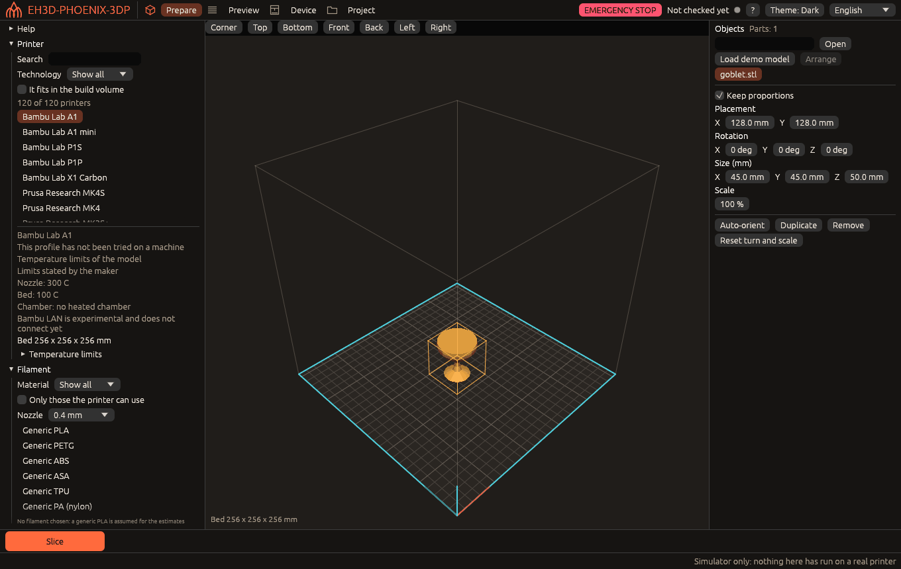
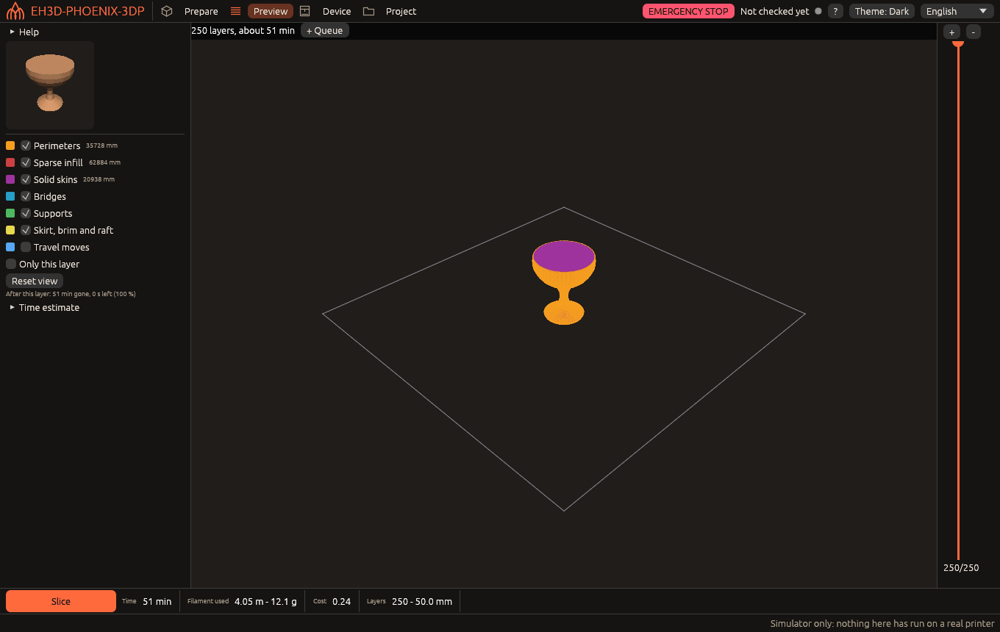
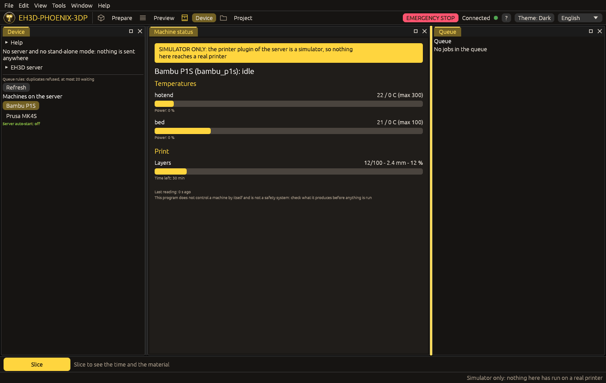
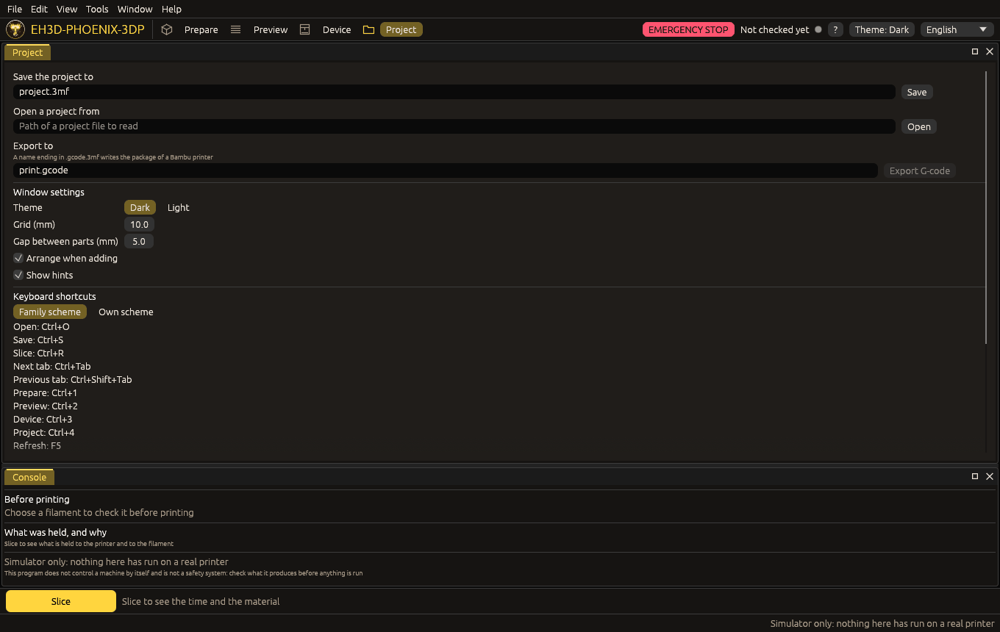
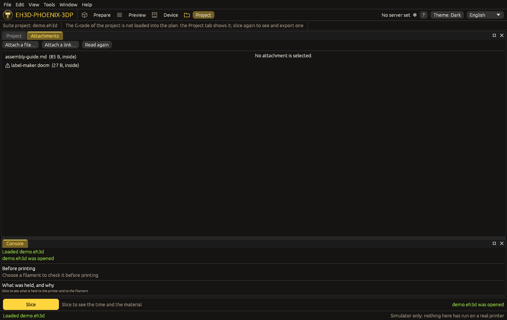
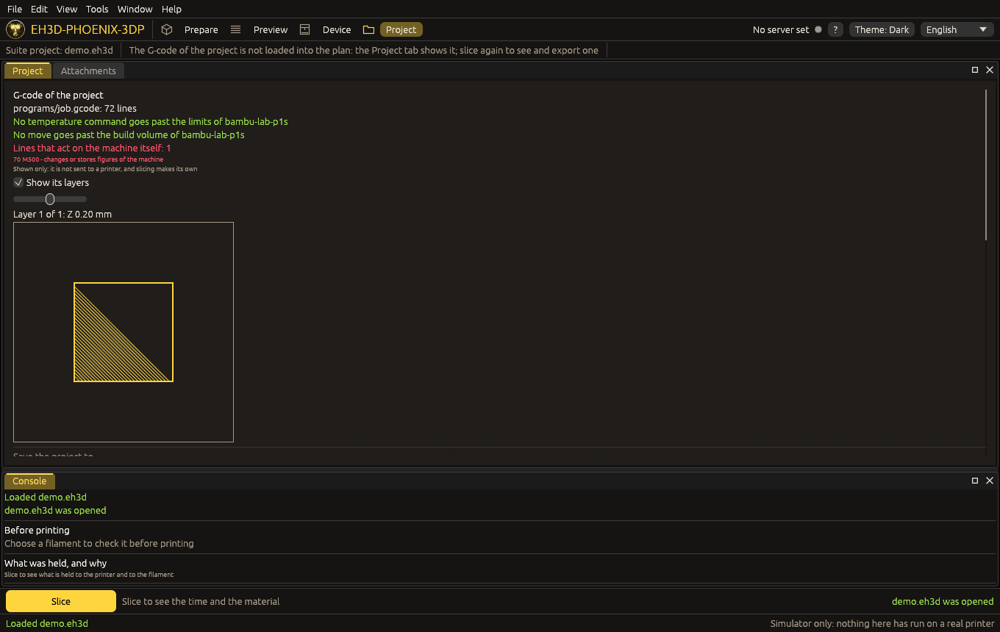

<p align="center">
  
</p>

#  EH3D-PHOENIX-3DP
<p align="center"><a href="README.md">🇺🇸 English</a> | <a href="README_spa.md">🇪🇸 Español</a> | <a href="README_fra.md">🇫🇷 Français</a> | <a href="README_ita.md">🇮🇹 Italiano</a> | <a href="README_deu.md">🇩🇪 Deutsch</a> | <a href="README_zho.md">🇨🇳 中文</a> | <a href="README_jpn.md">🇯🇵 日本語</a> | 🇵🇹 <b>Português</b></p>

### Preparar e enviar impressões 3D: modelos, perfis de impressora, G-code seguro e a ligação às tuas impressoras e ao servidor EH3D

<p align="center">
  
  
  
  
  
  
</p>

---

**Verificação de honestidade - o que funciona mesmo hoje:** um espaço de trabalho Rust com oito bibliotecas e um programa de linha de comandos (`phoenix-3dp`) com 1275 testes que correm num computador. Lê e verifica modelos STL, OBJ e 3MF, tem um catálogo de 120 perfis de impressora feitos com dados públicos (nenhum testado numa máquina), escreve G-code para os dialetos Marlin, Klipper, RepRapFirmware e Bambu com limites de temperatura que recusam um valor em vez de o cortar, e comanda impressoras Moonraker e OctoPrint e o servidor EH3D, mas apenas contra simuladores (em memória e num socket deste computador). Corta um modelo fechado em camadas planas com perímetros, preenchimento retilíneo e peles sólidas (um fatiador pequeno com preenchimento em grelha e giroide, pontes, suportes simples, costuras, largura variável, elevação nas deslocações, skirt, brim ou raft, modo vaso, camadas curtas mais lentas, retração que acompanha a deslocação e uma estimativa do tempo com aceleração; vários materiais por altura com torre de purga, passagem a ferro do topo, avanço de pressão, camadas cuja altura segue a forma, uma primeira camada recolhida contra o pé de elefante e um limite do caudal, mas ainda sem pintura de cores); a janela, a moldura acoplável da suite com cinco áreas de trabalho (compilada com `--features gui`), não foi vista por uma pessoa num ecrã; nada correu numa impressora real.

---

> **Estado de segurança:** este programa não controla uma máquina sozinho e não é um sistema de segurança. O que produz deve ser verificado por uma pessoa antes de se executar seja o que for numa impressora; nada disto correu em hardware real.

> **Nomes de terceiros:** os nomes de fabricantes, modelos e protocolos de impressoras (Bambu Lab, Prusa, Creality, Klipper, Moonraker, OctoPrint, Marlin e outros) pertencem aos seus donos e são usados apenas para dizer de que máquina ou protocolo se fala; este programa não é feito, aprovado nem patrocinado por eles. É escrito a partir de documentação pública e de factos, não do código, dos textos, dos ícones nem dos ficheiros de perfil de nenhum outro fatiador; o nome, a arte e os textos são próprios.


## 📋 Num relance

| | |
|---|---|
| Versão | `0.1.1` |
| Maturidade | Funcional |
| Testes | 1275 |
| Tecnologias | Rust |
| Em hardware real | Por testar: nada disto correu numa impressora, nem sequer numa Bambu Lab A1 ou numa P1S. |

**Ir para:** [Visão geral](#-visão-geral) · [Arquitetura](#-arquitetura) · [Início rápido](#-início-rápido) · [Testes](#-testes) · [Estrutura](#-estrutura-do-repositório) · [Relacionados](#-projetos-relacionados)

## 🚦 Estado do projeto

Cada linha é uma parte deste repositório e a luz diz até onde chega hoje. É escrita com o que o repositório consegue demonstrar (testes, compilações, execuções), não com o que está previsto.

🟢 Feito e verificado · 🟡 Funciona, com limites conhecidos · 🟠 Feito a meio ou ainda por verificar · 🔴 Por fazer ou a não funcionar

| Área | Estado | O que significa aqui |
|---|---|---|
| Núcleo | 🟡 | unidades em nanómetros, a malha e as suas verificações, os limites dos leitores, um pequeno leitor de JSON e um segredo que nunca se imprime; testado no computador com entradas normais e danificadas. |
| Modelos e ficheiros | 🟡 | STL (texto e binário), OBJ e 3MF básico são lidos com limites de tamanho e recusas que dizem o que encontraram; escrevem-se o pacote 3MF próprio, STL binário, OBJ e o ficheiro de G-code; dos projetos 3MF de outros programas leem-se os objetos, as placas e algumas definições (só leitura); verificado com testes de fuzzing, não com uma coleção de ficheiros reais de outros programas. |
| Perfis de impressora | 🟠 | 120 modelos a partir de dados públicos (volume, bicos, dialeto, formas de ligação, limites do fabricante nos primeiros 46, incluindo as Bambu Lab A1 e P1S, e limites prudentes do programa nos restantes, que o dizem; os filamentos da base de dados de materiais de impressão da suite (477, os perfis genéricos e os que os fabricantes publicam) verificados contra a impressora e o bico, sete resinas da mesma base e edições de um perfil que dizem o que mudou); todos dizem `verified = false`, porque nenhum foi testado numa máquina. |
| G-code | 🟡 | escritores para os quatro dialetos com um início e um fim seguros; uma temperatura acima do limite é recusada e nada é escrito; um verificador encontra as linhas de um programa que ultrapassam um limite; nunca executado numa impressora. |
| Controladores de impressora | 🟠 | Moonraker e OctoPrint sobre um transporte, testados apenas contra simuladores dos seus protocolos; o controlador Bambu LAN autónomo lê o estado e pausa, retoma e para uma impressão num canal seguro com o certificado fixado, testado apenas contra uma impressora feita em memória (ainda não existe conector TLS, por isso não liga). |
| Ligação ao servidor | 🟠 | as definições da ligação e um cliente do plugin de impressoras do servidor sobre o cliente comum da suite (início de sessão, renovação, novas tentativas, erros em oito línguas), testado contra um servidor em memória; nunca contra o servidor real. |
| Fatiador | 🟡 | camadas planas de uma malha fechada, perímetros, preenchimento retilíneo, em grelha ou giroide, peles sólidas, pontes, suportes simples, costuras, largura variável, G-code por dialeto, uma pré-visualização por camadas como dados e uma estimativa do tempo com aceleração; verificado com propriedades sobre formas de semente fixa (o plástico depositado é o volume da peça, nada sai da mesa, nenhuma temperatura ultrapassa um limite); nenhuma impressão saiu dele numa impressora. |
| Linha de comandos | 🟡 | `phoenix-3dp` (`printers`, `info`, `check-profile`, `convert`, `filaments`, `resins`, `slice`, `project`, `version`) executa as funções das bibliotecas e imprime o resultado; cada erro volta como mensagem e código de saída diferente de zero. |
| Testes | 🟡 | 1275 testes passam (`cargo test --workspace`), com casos normais, casos-limite, entradas danificadas e uma semente fixa onde há aleatoriedade. |
| Segurança | 🟡 | Rust seguro e simples (`forbid(unsafe_code)`): um limite é uma recusa e nunca um corte; o token nunca se imprime; nada entra em pânico com os ficheiros recebidos; sem revisão independente. |
| Janela | 🟠 | Escrita com `--features gui` como a moldura acoplável da suite, com cinco áreas de trabalho (Preparar, Rever, Executar, Configurar e Compacto) cujos painéis podem ser retirados, repostos, movidos, agrupados em separadores, flutuar e recolher-se, e uma barra de menus: listas de impressoras e filamentos com filtros, o plano por camadas com um cursor, a fila do servidor com um arranque que pede confirmação, uma paragem de emergência, atalhos alteráveis, um modo de imagem (`--shot`), uma vista 3D da mesa com as peças como sólidos sombreados, um painel de peças com orientar automaticamente e organizar, fatiagem em segundo plano com estimativas, limites de temperatura editáveis e um aspeto escuro e um claro; a disposição guarda-se no ficheiro de configuração; a lógica é testada sem ecrã e o README mostra fotografias da janela, tiradas pelo próprio programa num ecrã virtual, e desenhos das áreas de trabalho feitos a partir do modelo; nenhuma pessoa usou a janela num ecrã real. |
| Hardware real | 🔴 | Por testar: nada disto correu numa impressora, nem sequer numa Bambu Lab A1 ou numa P1S. |
| Documentação | 🟡 | README em oito idiomas, o registo de alterações, a pasta `docs/` (arquitetura, roteiro, o que ainda não está feito, o servidor) e as duas imagens desenhadas a partir de `docs/`. |

## 🎯 Visão geral

* **A ideia:** o PHOENIX-3DP é o programa de impressão 3D da família PHOENIX. O servidor EH3D e os seus clientes são o centro da suite: este programa é mais um cliente do servidor, e o modo autónomo, que fala diretamente com uma impressora, é uma opção desligada por omissão.
* **Os modelos** (`p3dp-formats`): STL (texto e binário), OBJ e 3MF básico são lidos com limites de tamanho, de número de triângulos e de conteúdo de um pacote ZIP; o que não se consegue ler é recusado com o nome do que foi encontrado. Escreve STL binário, OBJ, o seu próprio pacote 3MF e ficheiros de G-code. Os projetos guardados como 3MF por outros programas são lidos pelos seus objetos, placas e algumas definições (só leitura, com limites contra pacotes feitos para prejudicar).
* **Os perfis** (`p3dp-profiles`): um catálogo de 120 modelos de impressora, FDM e resina, escrito com factos públicos: volume, bicos, dialeto, formas de ligação, sistema multimaterial e as temperaturas máximas (a cifra do fabricante nos primeiros 46 modelos, os limites prudentes do programa nos restantes, e cada perfil diz quais). Os filamentos (477: os perfis genéricos, que mantêm os seus identificadores antigos como `generic-pla`, e os que os fabricantes publicam) vêm da base de dados de materiais de impressão da suite (`eh3d-printmaterials`), procuram-se por fabricante, material ou nome e são verificados contra a impressora e o bico: um par que não serve é recusado com as razões. Sete resinas genéricas da mesma base (padrão, lavável com água, tenaz, flexível, para fundição, transparente e de alto detalhe) trazem as exposições e a elevação do seu tipo como pontos de partida. Um perfil pode ser editado a partir da linha de comandos: o resultado é verificado por inteiro, um perfil editado deixa de estar `verified`, e um limite de temperatura aumentado acima da cifra do fabricante (a mesa de uma Bambu Lab A1 mini, 80 C, aumentada à mão para 100 C) é permitido e assinalado. Cada perfil diz se foi testado numa máquina; nenhum foi.
* **As impressoras da suite e os seus ficheiros:** `machines` e `machine` mostram o catálogo de impressoras de EH3D-COMMON (Bambu Lab A1, P1P e P1S, três modelos da Creality e dois da Artillery), cada valor com a página do fabricante, com os filamentos e processos de partida; os seus valores prevalecem sobre a tabela nesses modelos e os dois da Artillery são acrescentados, pelo que o programa oferece 122 impressoras. `import` traz as definições de um projeto 3MF ou de um perfil JSON ou INI seu e indica cada chave que aplicou, não aplicou, não usa ou não leu; o valor de uma chave que não usa nunca é mostrado. Nada é enviado para uma impressora.
* **A máquina é respeitada:** `slice` aceita `--process draft|standard|fine|strong` para o bico, respeita a velocidade, a aceleração e o caudal máximos declarados pelo fabricante (uma velocidade acima é recusada e nomeada, nunca cortada; o caudal abranda uma linha sem a afinar) e acrescenta o seu próprio G-code de início e de fim com `--start-gcode` e `--end-gcode`, verificado linha a linha face às temperaturas e ao volume. `fit` diz, sem fatiar, se a peça com a aba ou a jangada cabe (também rodada), o que ultrapassa os limites e o que falta confirmar na página do fabricante. Nada disto foi testado numa impressora.
* **O G-code** (`p3dp-gcode`): escritores para Marlin, Klipper, RepRapFirmware e Bambu, cada um com cabeçalho, início e fim seguros; uma temperatura ou um movimento não permitidos são recusados, nunca cortados. Um verificador lê qualquer programa e encontra as linhas que ultrapassam os limites de um modelo.
* **A ligação** (`p3dp-link`): um trait de controlador, um estado normalizado (quinze estados, temperaturas, trabalho, alertas) e uma lista de comandos; Moonraker e OctoPrint estão implementados sobre um transporte (um HTTP simples escrito com a biblioteca padrão, com limites de tempo e de tamanho, experimentado num socket deste computador) e testados contra um simulador em memória de cada protocolo; o Bambu LAN é o desenho dos seus tópicos e mensagens, marcado como experimental.
* **O servidor** (`p3dp-server-bridge`): as definições `server_address`, `server_token`, `server_machine`, `server_timeout_s`, `server_retries` e `server_mdns`, e um cliente do plugin `printer3d` do servidor sobre o cliente comum da suite (`eh3d-serverclient`): os trabalhos entram na fila e esperam que uma pessoa os inicie, os limites de temperatura são verificados antes de enviar o que quer que seja, e existe a paragem; testado contra um servidor em memória.
* **O fatiador** (`p3dp-slicer`): camadas planas de uma malha fechada, perímetros, preenchimento retilíneo, em grelha ou giroide com peles sólidas, pontes, suportes simples, costuras, largura variável, elevação nas deslocações, passagem a ferro do topo, avanço de pressão, camadas cuja altura segue a forma, uma primeira camada recolhida contra o pé de elefante, um limite do caudal, vários materiais por altura com torre de purga, G-code para os dialetos do programa através do seu escritor e a pré-visualização por camadas como dados, com uma estimativa do tempo que usa a aceleração; recusa, sem nunca cortar, o que não cabe na mesa, ultrapassa um limite de temperatura ou não é uma malha fechada.
* **O visualizador** (`p3dp-viewer`): o modelo do visualizador 3D sem código gráfico: uma câmara orbital com perspetiva, a seleção com um clique e com uma caixa sobre a mesa, o intervalo de camadas e as linhas de um plano para uma placa gráfica. O desenho com wgpu está atrás de uma funcionalidade, desligada por omissão, e nunca foi compilado.
* **Outros ficheiros:** o G-code binário (`bgcode`) e os pacotes abertos de camadas de resina (`.sl1`) leem-se só pelos cabeçalhos, com uma estimativa do tempo de exposição; os formatos fechados das impressoras de resina são recusados com a razão. As miniaturas de um G-code binário são listadas e a maior pode ser extraída (`project FICHEIRO --thumbnail SAÍDA`), e os valores e miniaturas nos comentários de um G-code simples (o filamento usado, o tempo, a altura de camada) leem-se da mesma forma, só do princípio e do fim.
* **Ainda por fazer:** o desenho do visualizador 3D (o seu modelo já existe), a pintura de cores, a ligação Bambu LAN e os outros transportes. O roteiro está em `docs/ROADMAP.md` e o que falta em `docs/NOT_YET.md`.

## 🧩 Papel no EH3D

O EH3D-PHOENIX-3DP é o programa de impressão 3D da família PHOENIX da EH3D Fabrication Suite. Hoje é um conjunto de bibliotecas e uma linha de comandos; a janela compila-se com `--features gui`. O servidor `eh3d-server` e os seus clientes são o centro da suite: as impressoras, a fila e as permissões destinam-se a viver no servidor (aí é o plugin `printer3d` que o serve), e este programa fala com ele através das definições comuns da suite. Ver [docs/SERVER.md](docs/SERVER.md).

## 🏛️ Arquitetura

<p align="center">
  
</p>


Como as partes deste repositório se encaixam: quem o usa, o que contém e de que depende. A imagem é desenhada a partir de `docs/architecture.json` e verificada com o código.

## 🖼️ Capturas de ecrã

Fotografias da janela, tiradas pelo próprio programa com o seu modo de imagem (`--shot --demo`: um modelo e um servidor criados em memória, pelo que nada chega a uma impressora):

<p align="center">
  
</p>

<p align="center">
  
</p>

<p align="center">
  
</p>

<p align="center">
  
</p>

<p align="center">
  
</p>

<p align="center">
  
</p>

<p align="center">
  
</p>

<p align="center">
  
</p>

<p align="center">
  
</p>

<p align="center">
  
</p>

<p align="center">
  
</p>

Desenhos da disposição de fábrica de cada espaço de trabalho, feitos a partir do modelo da janela (`cargo run --example workspace_pictures`): a barra de menus e os grupos de painéis com os seus separadores. As fotografias e os desenhos são renovados pelo fluxo `Window pictures`.

## ✨ Funcionalidades

* **Um limite é uma recusa:** uma temperatura ou um movimento não permitidos são um erro que nomeia o valor e o limite, nunca um valor cortado para caber; os escritores, os controladores e o verificador cumprem-no.
* **Nada arranca sozinho:** os pedidos à fila do servidor dizem `auto_start: false` e pedem confirmação; o G-code direto está desligado por omissão e, ligado, segue linha a linha com os mesmos limites.
* **Um estado para todos os protocolos:** quinze estados normalizados, temperaturas, trabalho e alertas, com o texto original da impressora à parte, de modo que o resto do programa fala uma só língua.
* **Simuladores para os testes:** cada protocolo tem um simulador em memória com falhas a pedido (sem ligação, tempo esgotado, 503), por isso as novas tentativas, as recusas e as paragens testam-se sem rede.
* **Uma janela ao estilo de um laminador:** cinco áreas de trabalho (Preparar, Rever, Executar, Configurar e Compacto) na moldura acoplável da suite; painéis de impressora, filamento e processo; uma vista 3D da mesa com as peças como sólidos sombreados; os números de cada peça (posicionar, rodar, tamanho), orientar automaticamente e organizar; fatiagem em segundo plano com as estimativas em baixo; um aspeto escuro e um claro. Os painéis podem ser retirados, repostos, movidos, agrupados em separadores, flutuar e recolher-se, a disposição guarda-se no ficheiro de configuração e uma barra de menus traz Ficheiro, Editar, Ver, Ferramentas, Janela e Ajuda. A lógica é testada sem ecrã; a janela em si não foi vista por uma pessoa num ecrã.
* **Sala limpa e arte própria:** escrito a partir de protocolos públicos, manuais e factos; sem código, textos, ícones nem ficheiros de perfil de outro fatiador; cada perfil diz `verified = false` até ser testado.
* **Oito idiomas:** os textos do programa e a documentação existem em inglês, espanhol, alemão, francês, italiano, japonês, chinês e português de Portugal.
* **Sem código `unsafe`:** `#![forbid(unsafe_code)]` em cada crate.
* **Do modelo ao ficheiro da impressora:** a peça pode ser rodada, redimensionada e copiada na mesa, podem mudar-se definições soltas, escolher um processo inicial e juntar o seu próprio G-code de início e de fim; o que é limitado pela impressora é dito com o motivo. Para uma impressora Bambu, um nome terminado em `.gcode.3mf` escreve o pacote (G-code, soma de verificação, imagem, valores), que `project` verifica e abre. Nenhuma impressora recebeu um: o fabricante não publica toda a sua estrutura.
* **Projeto da suite (`.eh3d`) com anexos:** um único ficheiro com um ramo para cada programa da suite, do qual este programa escreve apenas `3dp/`: as peças com a sua colocação, as definições de fatiamento, a impressora, o filamento e o G-code do fatiamento. Está em Ficheiro > Projeto da suite e no comando `project`: abrir, guardar, guardar como, importar um modelo ou um programa conservando o original com um relatório, obter um modelo de outro ramo com uma referência que avisa quando a origem muda, e extrair um ramo; antes de uma escrita que retiraria uma assinatura ou mudaria algo não lido aqui, pergunta-se, e não se escreve por cima de um projeto que outro programa tenha guardado entretanto. O painel «Anexos» guarda dentro do ficheiro fichas técnicas, manuais, documentos e outros projetos e mostra-os (páginas PDF com a biblioteca PDFium do pacote, imagens, texto e o texto de documentos de escritório); programas, scripts, ficheiros com macros, arquivos comprimidos e tipos desconhecidos perguntam antes de saírem do projeto, nada é executado e nada é descarregado. O projeto guarda também o seu G-code de início e de fim, que a janela só usa se os assinalar. O G-code de um projeto é mostrado, com as temperaturas comparadas com os limites da impressora (o comando `project open` faz o mesmo), e não é carregado no plano; nada é enviado a uma impressora. Não experimentado no ecrã por uma pessoa. As camadas podem ser desenhadas uma a uma, cada movimento é verificado contra o volume de impressão e os comandos que atuam sobre a própria máquina são listados (também `project layers` e `check-profile --gcode`). Um projeto pode guardar o seu perfil de impressora, que só pode baixar os limites e o volume.
* **Definições de qualidade mais finas:** paredes mais lentas e arrefecidas onde ficam em consola, camadas de interface do suporte, temperaturas da primeira camada, sobreposição do enchimento, a parede exterior primeiro, costura no canto mais vivo, retração só ao cruzar paredes, limpeza durante a retração, pausas antes das camadas escolhidas, marcas de progresso e um comprimento mínimo da saia; estão no ficheiro de definições e na secção «Qualidade» da janela. Todas estão desligadas se não as pedir, salvo as marcas de progresso, e nada foi impresso com nenhuma.

## 🔒 Segurança e proteção

| Ameaça | Defesa |
|---|---|
| Um ficheiro de modelo danificado, cortado ou hostil | os tamanhos verificam-se antes de reservar o que quer que seja; os triângulos, os vértices, a extensão, as entradas de um pacote ZIP e aquilo em que se descomprimem estão limitados, e uma bomba é recusada; os testes de fuzzing cortam ficheiros válidos em cada posição e metem lixo, e nenhum pode entrar em pânico |
| Um pacote com uma surpresa lá dentro (componentes, objetos noutros ficheiros, entidades declaradas) | é nomeada e recusada, nunca saltada; uma entidade XML declarada é um erro |
| Uma temperatura acima do que o modelo permite | recusada com o valor e o limite; nunca cortada para o limite; a mesma regra nos escritores, nos controladores e no verificador |
| Uma linha de G-code direto que salte os limites | desligado por omissão; linha a linha; verificada com os mesmos limites de tudo o resto |
| Um nome de ficheiro ou um id que entra num caminho ou num comando | sem pastas, sem `..`, sem carateres de controlo, só extensões conhecidas, codificação percentual do que vai para um caminho |
| O token do servidor ou a chave de uma impressora num registo ou num ecrã | guardado num tipo que imprime `***`; as definições mostram-se com o token escondido |
| Uma fila que arranque um trabalho sozinha | os pedidos dizem `auto_start: false` e pedem confirmação; se o servidor pode arrancar trabalhos por conta própria é política do servidor |
| Uma rede instável | só se repete onde nada poderia acontecer duas vezes: uma ligação recusada repete-se para qualquer pedido, um tempo esgotado só para os que podem ser reenviados, nunca para um POST |
| Uso inseguro de memória | Rust seguro e simples com `forbid(unsafe_code)` |

**O que não é defendido:** um programa escrito com limpeza não é um programa seguro de executar. Os limites são os que os fabricantes declaram e não foram verificados numa máquina; os controladores só conheceram simuladores; não houve revisão independente. Comunique uma vulnerabilidade em privado (ver [SECURITY.md](SECURITY.md)).

## 🔌 Interfaces

As bibliotecas são `p3dp_core`, `p3dp_formats`, `p3dp_profiles`, `p3dp_gcode`, `p3dp_link`, `p3dp_server_bridge`, `p3dp_slicer` e `p3dp_viewer`; o programa é a biblioteca `eh3d_phoenix_3dp` e a linha de comandos `phoenix-3dp`. Cada comando imprime o resultado na saída padrão e comunica um erro na saída de erros com um código de saída diferente de zero (1 para uma falha do que foi pedido, 2 para um erro no comando). O único acesso à rede é o transporte dos controladores e da ligação ao servidor, e só a um endereço que seja dado.

```text
phoenix-3dp printers [--vendor NAME] [--tech fdm|msla] [--search TEXT]
phoenix-3dp machines [--search TEXT]
phoenix-3dp machine ID [--nozzle MM] [--process draft|standard|fine|strong [--out FILE] [--force]]
phoenix-3dp import FILE.3mf|FILE.json|FILE.ini [--out SETTINGS] [--force]
phoenix-3dp info MODEL [--printer ID]
phoenix-3dp check-profile ID [--gcode FILE]
phoenix-3dp check-profile --file PROFILE [--gcode FILE]
phoenix-3dp check-profile ID|--file PROFILE --set "key=value;key=value" [--save FILE] [--force]
phoenix-3dp convert IN OUT [--printer ID] [--force]
phoenix-3dp filaments [--printer ID] [--nozzle MM] [--hardened]
phoenix-3dp resins [--kind KIND] [--printer ID] [--part-ml ML]
phoenix-3dp fit MODEL --printer ID [--process LEVEL] [--settings FILE] [--set "key=value;key=value"] [--filament ID] [--nozzle MM] [--hardened] [--turn DEG] [--scale PERCENT] [--copies N] [--start-gcode FILE] [--end-gcode FILE]
phoenix-3dp slice MODEL --printer ID [--process LEVEL] [--settings FILE] [--set "key=value;key=value"] [--filament ID] [--nozzle MM] [--hardened] [--turn DEG] [--scale PERCENT] [--copies N] [--start-gcode FILE] [--end-gcode FILE] [--report] [--out FILE.gcode|FILE.gcode.3mf] [--save-settings FILE] [--force]
phoenix-3dp project FILE.3mf|FILE.bgcode|FILE.gcode|FILE.sl1 [--thumbnail FILE] [--extract-gcode FILE] [--force] [--bottom-layers N] [--lift MM] [--light-power MW]
phoenix-3dp project list FILE.eh3d [--json]
phoenix-3dp project save FILE.eh3d [--model MODEL] [--settings FILE] [--printer ID] [--filament ID] [--gcode FILE.gcode] [--start-gcode FILE] [--end-gcode FILE] [--printer-file PROFILE] [--name NAME] [--id ID]
phoenix-3dp project layers FILE.eh3d [--layer N] [--printer ID]
phoenix-3dp project import FILE.eh3d MODEL|FILE.gcode [--printer ID] [--name NAME] [--id ID]
phoenix-3dp project open FILE.eh3d [--into DIR] [--printer ID] | take FILE.eh3d BRANCH NAME [--printer ID] | extract FILE.eh3d BRANCH DIR
phoenix-3dp version
phoenix-3dp gui [SETTINGS] [--open MODEL] [--printer ID] [--shot FILE.png [--window TAB] [--size WxH] [--slice] [--demo] [--peek]]  the window (a build with --features gui)
```

## ⚙️ Configuração

As definições são um ficheiro de linhas `chave = valor` (`--config FICHEIRO`): os limites dos leitores (`limit_*`), a ligação ao servidor (`server_address`, `server_token`, `server_machine`, `server_timeout_s`, `server_retries`, `server_mdns`, `server_max_answer_mib`), `direct_mode` (autónomo, desligado por omissão), `lang` e `default_printer`, os preços (`price_filament_per_kg`, `price_resin_per_litre`, `resin_waste_percent`), o relatório (`report_slowest_layers`, `report_short_layer_s`), a fila (`queue_refuse_duplicates`, `queue_max_waiting`) e até onde se procura num G-code simples (`limit_gcode_head_kib`, `limit_gcode_tail_kib`, `limit_gcode_thumbnails`). Um perfil de impressora é outro ficheiro do mesmo tipo (`examples/my-printer.cfg`). Uma chave desconhecida ou um valor fora do intervalo é um erro que nomeia a sua linha; todos os valores por omissão são prudentes. Ver `examples/phoenix-3dp.cfg`. A janela guarda as suas próprias escolhas no mesmo ficheiro: `theme` (`dark` ou `light`), `grid_mm`, `arrange_gap_mm`, `arrange_on_add`, `ui_hints`, `peek_wall_alpha` (a opacidade das paredes da pré-visualização quando se olha para dentro), a disposição dos painéis em linhas que começam por `dock.` e, para cada impressora cujos limites de temperatura foram alterados, `printer_limits_<id>`. Os limites dos anexos de um projeto são `attachments.max_mb` (o maior ficheiro que se anexa ou se retira, 1024) e `viewer.max_attachment_mb`, `viewer.max_pdf_mb`, `viewer.max_image_mb`, `viewer.max_text_mb`, `viewer.max_office_mb` e `viewer.max_preview_mb` (o que se mostra dentro do programa), cada um um número inteiro de 1 a 4096.

## 🚀 Início rápido

Precisas de uma cadeia de ferramentas Rust estável (1.88 ou posterior). Clona primeiro o EH3D-COMMON ao lado deste repositório: o cliente comum do servidor vem de lá.

```bash
cargo build --release
cargo test --workspace
cargo run --release -- printers --search bambu
cargo run --release -- info examples/cube-20mm.stl --printer bambu-lab-a1
cargo run --release -- check-profile --file examples/my-printer.cfg --gcode examples/job-too-hot.gcode
cargo run --release -- convert examples/cube-20mm.stl cube.3mf --printer prusa-mk4s
cargo run --release --features gui -- gui   # the window
```

## 🧪 Testes

O conjunto tem 1275 testes (`cargo test --workspace`, executados em Windows e Linux na CI), com semente fixa onde há aleatoriedade. Verificam os casos normais, os casos-limite e as entradas danificadas: ficheiros cortados, lixo e cabeçalhos hostis nunca entram em pânico, e nenhuma temperatura de nenhuma impressora do catálogo ultrapassa o seu limite. A CI também executa `cargo fmt --all --check`, `cargo clippy` com avisos como erros e `python -I tools/ci_validate.py`.

## 🏗️ Compilação e publicação

A versão vive em `Cargo.toml` e em `eh3d.project.json`; cada versão tem a sua entrada em [CHANGELOG.md](CHANGELOG.md). `build.bat` / `build.sh` compilam o programa, `test.bat` / `test.sh` executam os testes e `run.bat` / `run.sh` executam-no com uma amostra. As versões publicam-se no GitHub com programas já feitos para Windows (64 e 32 bits), Linux (64 bits) e macOS (Apple silicon e Intel): cada pacote, `phoenix-3dp-<versão>-<sistema>.zip` ou `.tar.gz`, vem com os seus ficheiros `.sha256` e `.sig`. Os pacotes levam junto do programa a biblioteca PDF do visualizador de anexos (PDFium) com as suas licenças e avisos.

## 📂 Estrutura do repositório

<p align="center">
  
</p>

<details>
<summary>Versão em texto da árvore</summary>

```text
EH3D-PHOENIX-3DP/
├── crates/
│   ├── p3dp-core/                               unidades, malha e verificações, limites, JSON, definições
│   ├── p3dp-formats/                            leitores de STL, OBJ, 3MF, projetos, bgcode, comentários de G-code e resina; escritores, ZIP, PNG
│   ├── p3dp-profiles/                           impressoras com factos públicos, filamentos, resinas, o ficheiro de perfil e as suas edições
│   ├── p3dp-gcode/                              escritores de G-code de quatro dialetos, o verificador
│   ├── p3dp-link/                               controladores, estado normalizado, TCP, simuladores, Bambu LAN (bytes do protocolo, sem ligação)
│   ├── p3dp-server-bridge/                      definições da ligação ao servidor, cliente do plugin, regras e quadro da fila
│   ├── p3dp-slicer/                             o fatiador: camadas, perímetros, preenchimento, pontes, suportes, skirt, brim, raft, G-code
│   └── p3dp-viewer/                             o modelo do visualizador 3D: câmara, seleção, camadas, deslocações
├── src/
│   ├── lib.rs                                   a biblioteca do programa: o que usam a linha de comandos e a janela
│   ├── main.rs                                  a linha de comandos e o arranque da janela
│   ├── cli.rs                                   os comandos: printers, info, check-profile, convert, filaments, resins, slice, project, version
│   ├── eh3dfile.rs                              o ramo 3dp/ de um projeto da suite
│   ├── eh3dcli.rs                               os comandos de um projeto da suite
│   ├── gui/suite.rs                             a janela do projeto da suite
│   ├── app_state.rs                             o estado da janela sem janela: separadores, impressora, modelo, relatórios, dispositivo simulado
│   ├── config.rs                                o ficheiro de definições: limites, ligação ao servidor, idioma, impressora por omissão, preços, relatório e fila
│   ├── demo.rs                                  o modelo de demonstração para as imagens: um cálice torneado a partir de alguns raios
│   ├── device.rs                                as impressoras do servidor, a fila e as suas regras, um arranque confirmado, a paragem de emergência
│   ├── i18n.rs                                  os textos do programa nos oito idiomas
│   ├── keys.rs                                  os atalhos de teclado: o esquema da família, um próprio e as alterações
│   ├── lists.rs                                 as listas de impressoras e de filamentos com os seus filtros
│   ├── limits_ui.rs                             editar e guardar os limites de temperatura de uma impressora, com os avisos de uma edição
│   ├── look.rs                                  as cores, a marca e os desenhos da janela e a sua disposição conforme o tamanho
│   ├── objects.rs                               as peças na mesa: posicionar, rodar, dimensionar, orientar, organizar, sobreposições
│   ├── panels.rs                                os painéis, áreas de trabalho e menus da janela como dados
│   ├── preflight.rs                             o que ver antes de imprimir, a partir da base de materiais
│   ├── preview.rs                               fatiar a partir da janela, o cursor de camadas, o plano no ecrã, o relatório
│   ├── project.rs                               o projeto: um modelo e a sua impressora no pacote 3MF próprio
│   ├── report.rs                                as palavras dos relatórios: fatiamento, resina, miniaturas e edições de perfil, nas oito línguas
│   ├── server_ui.rs                             as definições do servidor, o estado da ligação e o início de sessão, sobre o painel da suite
│   ├── shade.rs                                 o aspeto sólido da vista 3D: polígonos sombreados, a mesa, as vistas padrão e a seleção
│   ├── shot.rs                                  o modo de imagem da janela (--shot) e o ficheiro PNG que escreve
│   ├── slice_job.rs                             a fatiagem em segundo plano e a estimativa da barra de progresso
│   ├── studio.rs                                a mesa de trabalho do separador Preparar: peças, câmara, a fatiagem em segundo plano, avisos e estimativas
│   ├── view.rs                                  a câmara orbital que transforma uma malha em linhas para a pré-visualização
│   └── gui.rs                                   a janela (egui, funcionalidade gui): barras, painéis e vista 3D; transmite o que a pessoa faz
├── tests/
│   ├── end_to_end.rs                            testes de um modelo a um programa a uma impressora simulada
│   ├── eh3dfile.rs                              testes do projeto da suite
│   ├── examples.rs                              testes de que os ficheiros de examples/ funcionam com os comandos
│   ├── fuzz.rs                                  testes de fuzzing com semente fixa: ficheiros cortados, danificados e hostis
│   ├── readme.rs                                testes de que os README dizem a verdade: o número de testes e os comandos
│   ├── safety.rs                                testes de que nenhuma temperatura de nenhuma impressora do catálogo ultrapassa o seu limite
│   └── reqs.rs                                  testes do registo de requisitos
├── examples/
│   ├── cube-20mm.stl                            um cubo de 20 mm como STL de texto
│   ├── cube-20mm.obj                            o mesmo cubo como OBJ
│   ├── phoenix-3dp.cfg                          o ficheiro de definições com todas as chaves e o valor por omissão
│   ├── my-printer.cfg                           um perfil de impressora escrito à mão (uma máquina Klipper)
│   ├── job-safe.gcode                           um programa que respeita os limites desse perfil
│   ├── job-too-hot.gcode                        um programa que os ultrapassa em duas linhas
│   ├── start-prime-line.gcode                   um exemplo das suas linhas de início
│   └── end-park.gcode                           um exemplo das suas linhas de fim
├── docs/
│   ├── REQUIREMENTS.md                          o registo de requisitos: estado, evidência e teste de cada um
│   ├── SCOPE.md                                 para que serve, o que não fará e o que nunca decide
│   ├── STATUS.md                                o que existe, o que falta e o que continua em aberto
│   ├── ARCHITECTURE.md                          o programa crate a crate
│   ├── ROADMAP.md                               os nove passos da base a um programa completo
│   ├── NOT_YET.md                               o que ainda não está feito e do que cada parte precisa
│   ├── SERVER.md                                como o programa se alinha com o servidor EH3D
│   ├── architecture.json                        dados da imagem de Arquitetura
│   └── structure.json                           dados da imagem de Estrutura
├── tools/                                       verificação da CI e do README e ferramentas de imagens
├── images/                                      ícone e logótipos, banner, os dois diagramas e as imagens dos espaços de trabalho
├── .github/                                     fluxos de CI e de publicação, modelos de issues e pull requests
├── eh3d.project.json                            manifesto: versão, função, maturidade e comando de compilação
├── Cargo.toml                                   o espaço de trabalho e os seus crates
├── rust-toolchain.toml                          a cadeia de ferramentas Rust fixada
├── CHANGELOG.md                                 o que mudou em cada versão
├── AGENTS.md                                    as regras para quem altera o repositório
├── SECURITY.md SUPPORT.md                       como comunicar uma vulnerabilidade e onde perguntar
└── CONTRIBUTING.md CODE_OF_CONDUCT.md LICENSE   como contribuir, o código de conduta e a licença
```

</details>

## 🗺️ Roteiro e limites conhecidos

**Limites conhecidos hoje**

* O fatiador é pequeno: os suportes são simples (sem árvore; as camadas de interface são só linhas mais juntas), as pontes não estão afinadas, vários materiais só por altura (sem pintura de cores nem desvios das cabeças de um trocador de ferramentas), e nenhuma impressão saiu dele numa impressora.
* Nenhuma impressora foi ligada, nem sequer a Bambu Lab A1 ou a P1S; todos os perfis dizem `verified = false`.
* O leitor de 3MF só aproveita a malha (componentes e a extensão de produção são recusados); os projetos de outros programas são lidos pelos seus objetos, placas e definições e nunca são alterados.
* Os controladores têm um transporte HTTP simples, experimentado só num socket deste computador e com os simuladores; sem TLS nem envio por WebSocket; o Bambu LAN passa pelo servidor, que guarda o TLS com o certificado fixado (experimentado só com o servidor em memória), e o programa não abre nenhum próprio, e a nuvem da Bambu não faz parte dele.
* A janela (cinco áreas de trabalho na moldura acoplável da suite) não foi vista por uma pessoa num ecrã; as imagens do README são desenhos feitos a partir do seu modelo.

**A seguir**

* H1: o desenho do visualizador 3D com wgpu (o seu modelo existe) e a reparação de malhas.
* H2: um cubo de calibração impresso numa máquina real (o preenchimento em grelha e giroide, as costuras, a largura variável, as pontes e os suportes simples estão escritos e testados com formas de semente fixa).
* H3: o editor de perfis com herança e a sincronização dos perfis com o servidor.
* H4 a H6: a altura de camada adaptativa, o resto das definições de qualidade, os suportes em árvore e o preenchimento avançado, e a pintura de cores e as cabeças de um trocador de ferramentas.
* H7: os outros transportes (envio por WebSocket, PrusaLink, Duet), a ligação Bambu LAN direta (o seu TLS é o do servidor).
* H8: perfis com provas de máquinas reais (uma Bambu Lab A1 e uma P1S são as primeiras previstas), calibrações guiadas e uma simulação de colisões. O plano todo está em `docs/ROADMAP.md`.

## 🌍 Idiomas

O README e os textos existem em inglês, espanhol, francês, italiano, alemão, chinês, japonês e português europeu.

## 🔗 Projetos relacionados

* [EH3D-COMMON](https://github.com/JuanenRac/EH3D-COMMON): os crates partilhados, entre eles o cliente comum do servidor
* [EH3D-SERVER](https://github.com/JuanenRac/EH3D-SERVER): o servidor da suite, onde se prevê que vivam as impressoras, a fila e as permissões
* [EH3D-STUDIO](https://github.com/JuanenRac/EH3D-STUDIO): o painel de configuração da suite
* [EH3D-PHOENIX-LASER](https://github.com/JuanenRac/EH3D-PHOENIX-LASER): gravação e corte a laser, o programa irmão da mesma família
* [EH3D-PHOENIX-PNP](https://github.com/JuanenRac/EH3D-PHOENIX-PNP): pick and place, o programa irmão da mesma família
* [EH3D-SUITE-LAUNCHER](https://github.com/JuanenRac/EH3D-SUITE-LAUNCHER): o centro que encontra e arranca os programas da suite

## 📚 Documentação

* [Registo de alterações](CHANGELOG.md)
* [Âmbito](docs/SCOPE.md): para que serve o programa, o que não fará e o que nunca decide.
* [Requisitos](docs/REQUIREMENTS.md): o registo das capacidades, o estado de cada uma e o teste que a mostra.
* [Estado](docs/STATUS.md): o que existe, o que falta e o que continua em aberto.
* [Ainda não](docs/NOT_YET.md): boas ideias que ficam fora desta versão.
* [Regras para alterar o repositório](AGENTS.md): as regras para quem altera o repositório.
* [docs/ARCHITECTURE.md](docs/ARCHITECTURE.md): Arquitetura do programa, crate a crate
* [docs/ROADMAP.md](docs/ROADMAP.md): Roteiro: os nove passos da base a um programa completo
* [docs/SERVER.md](docs/SERVER.md): Como o programa se alinha com o servidor EH3D
* [docs/architecture.json](docs/architecture.json): Dados das duas imagens

## 🤝 Contribuir e comunidade

* Antes de um pull request execute `cargo fmt --all --check`, `cargo clippy --workspace --all-targets -- -D warnings`, `cargo test --workspace` e `python -I tools/ci_validate.py`: tudo tem de passar. Veja [CONTRIBUTING.md](CONTRIBUTING.md) e o [código de conduta](CODE_OF_CONDUCT.md).
* O README existe em oito idiomas: uma alteração ao texto faz-se nos oito ficheiros, e as duas imagens são desenhadas a partir de `docs/architecture.json` e `docs/structure.json` por `tools/make_architecture.py` e `tools/make_structure.py`.
* Comunique uma vulnerabilidade em privado: [SECURITY.md](SECURITY.md). Perguntas, ideias e relatos: electrohobby3d@gmail.com ([SUPPORT.md](SUPPORT.md)).

## 👤 AUTOR

**JuanenRac (Electro Hobby 3D)** · electrohobby3d@gmail.com

## 📜 LICENÇA

Software: GPL-3.0-or-later. Ver [LICENSE](LICENSE). Os projetos de hardware da suite usam a CERN OHL-S.
