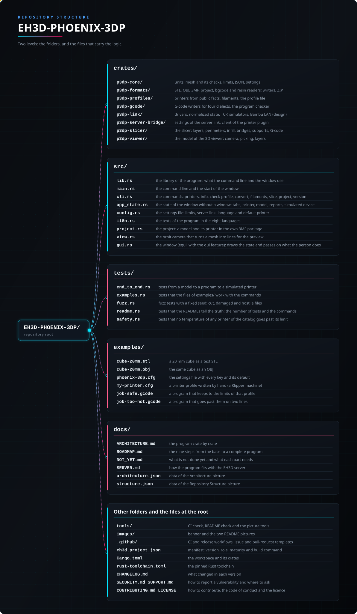

<p align="center">
  
</p>

# EH3D-PHOENIX-3DP
<p align="center"><a href="README.md">🇺🇸 English</a> | 🇪🇸 <b>Español</b> | <a href="README_fra.md">🇫🇷 Français</a> | <a href="README_ita.md">🇮🇹 Italiano</a> | <a href="README_deu.md">🇩🇪 Deutsch</a> | <a href="README_zho.md">🇨🇳 中文</a> | <a href="README_jpn.md">🇯🇵 日本語</a> | <a href="README_por.md">🇵🇹 Português</a></p>

### Prepara y envía impresiones 3D: modelos, perfiles de impresora, G-code seguro y el enlace con tus impresoras y con el servidor EH3D

<p align="center">
  
  
  
  
  
  
</p>

---

**Comprobación de honestidad - lo que funciona hoy de verdad:** un espacio de trabajo Rust con ocho bibliotecas y un programa de línea de comandos (`phoenix-3dp`) con 479 pruebas que se ejecutan en un ordenador. Lee y comprueba modelos STL, OBJ y 3MF, tiene un catálogo de 120 perfiles de impresora hechos con datos públicos (ninguno probado en una máquina), escribe G-code para los dialectos Marlin, Klipper, RepRapFirmware y Bambu con límites de temperatura que rechazan un valor en vez de recortarlo, y maneja impresoras Moonraker y OctoPrint y el servidor EH3D, pero solo contra simuladores (en memoria y en un socket de este ordenador). Lamina un modelo cerrado en capas planas con perímetros, relleno rectilíneo y pieles sólidas (un laminador pequeño con relleno en rejilla y giroide, puentes, soportes sencillos, costuras, ancho variable, elevación al desplazarse, falda, borde o balsa, modo jarrón, capas cortas más lentas, retracción que sigue al desplazamiento y una estimación del tiempo con aceleración; todavía nada para varios materiales); la ventana no se ha compilado ni visto en una pantalla; nada se ha ejecutado en una impresora real.

---

> **Estado de seguridad:** este programa no controla una máquina por sí solo y no es un sistema de seguridad. Lo que produce debe revisarlo una persona antes de ejecutar nada en una impresora; nada de esto se ha ejecutado en hardware real.

> **Nombres de terceros:** los nombres de fabricantes, modelos y protocolos de impresoras (Bambu Lab, Prusa, Creality, Klipper, Moonraker, OctoPrint, Marlin y otros) pertenecen a sus dueños y se usan solo para decir de qué máquina o protocolo se habla; este programa no está hecho, aprobado ni patrocinado por ellos. Se escribe a partir de documentación pública y hechos, no del código, los textos, los iconos ni los ficheros de perfil de ningún otro laminador; su nombre, su arte y sus textos son propios.


## 📋 De un vistazo

| | |
|---|---|
| Versión | `0.0.4` |
| Madurez | Andamiaje |
| Pruebas | 479 |
| Pila tecnológica | Rust |
| En hardware real | Sin probar: nada de esto se ha ejecutado en una impresora, ni siquiera en una Bambu Lab A1 o una P1S. |

**Ir a:** [Resumen](#-resumen) · [Arquitectura](#-arquitectura) · [Inicio rápido](#-inicio-rápido) · [Pruebas](#-pruebas) · [Estructura](#-estructura-del-repositorio) · [Relacionados](#-proyectos-relacionados)

## 🚦 Estado del proyecto

Cada línea es una parte de este repositorio y la luz dice hasta dónde llega hoy. Se escribe con lo que el repositorio puede demostrar (pruebas, compilaciones, ejecuciones), no con lo previsto.

🟢 Hecho y verificado · 🟡 Funciona, con límites conocidos · 🟠 Hecho a medias o sin verificar · 🔴 Sin hacer o sin funcionar

| Área | Estado | Qué significa aquí |
|---|---|---|
| Núcleo | 🟡 | unidades en nanómetros, la malla y sus comprobaciones, los límites de los lectores, un lector JSON pequeño y un secreto que nunca se imprime; probado en un ordenador con entradas normales y dañadas. |
| Modelos y ficheros | 🟡 | STL (texto y binario), OBJ y 3MF básico se leen con límites de tamaño y rechazos que dicen lo que han encontrado; se escriben el paquete 3MF propio, STL binario, OBJ y el fichero de G-code; de los proyectos 3MF de otros programas se leen los objetos, las placas y algunos ajustes (solo lectura); comprobado con pruebas de fuzzing, no con una colección de ficheros reales de otros programas. |
| Perfiles de impresora | 🟠 | 120 modelos con datos públicos (volumen, boquillas, dialecto, formas de conexión, límites del fabricante en los primeros 46, entre ellos la Bambu Lab A1 y la P1S, y los límites prudentes del programa en el resto, que lo dicen; seis filamentos genéricos comprobados contra la impresora y la boquilla); todos dicen `verified = false`, porque ninguno se ha probado en una máquina. |
| G-code | 🟡 | escritores para los cuatro dialectos con un inicio y un final seguros; una temperatura por encima del límite se rechaza y no se escribe nada; un comprobador encuentra las líneas de un programa que superan un límite; nunca ejecutado en una impresora. |
| Controladores de impresora | 🟠 | Moonraker y OctoPrint sobre un transporte, probados solo contra simuladores de sus protocolos; Bambu LAN es un diseño marcado como experimental que no se conecta. |
| Enlace con el servidor | 🟠 | los ajustes del enlace y un cliente del complemento de impresoras del servidor sobre el cliente común de la suite (inicio de sesión, renovación, reintentos, errores en ocho idiomas), probado contra un servidor en memoria; nunca contra el servidor real. |
| Laminador | 🟡 | capas planas de una malla cerrada, perímetros, relleno rectilíneo, en rejilla o giroide, pieles sólidas, puentes, soportes sencillos, costuras, ancho variable, G-code por dialecto, una vista previa por capas como datos y una estimación del tiempo con aceleración; comprobado con propiedades sobre formas de semilla fija (el plástico depositado es el volumen de la pieza, nada sale de la cama, ninguna temperatura supera un límite); ninguna impresión ha salido de él en una impresora. |
| Línea de comandos | 🟡 | `phoenix-3dp` (`printers`, `info`, `check-profile`, `convert`, `filaments`, `slice`, `project`, `version`) ejecuta las funciones de las bibliotecas e imprime el resultado; cada error vuelve como mensaje y un código de salida distinto de cero. |
| Pruebas | 🟡 | 479 pruebas pasan (`cargo test --workspace`), con casos normales, casos límite, entradas dañadas y una semilla fija donde hay azar. |
| Seguridad | 🟡 | Rust seguro y simple (`forbid(unsafe_code)`): un límite es un rechazo y nunca un recorte; el token nunca se imprime; nada entra en pánico con los ficheros que recibe; sin revisión independiente. |
| Ventana | 🔴 | Las cuatro pestañas (Preparar, Vista previa, Dispositivo, Proyecto) están escritas con `--features gui`: listas de impresoras y filamentos con filtros, el plan por capas con un deslizador, la cola del servidor con un inicio que pide confirmación, una parada de emergencia, atajos configurables y un modo de imagen (`--shot`); la lógica se prueba sin pantalla, pero la ventana todavía no se ha compilado ni visto en una pantalla. |
| Hardware real | 🔴 | Sin probar: nada de esto se ha ejecutado en una impresora, ni siquiera en una Bambu Lab A1 o una P1S. |
| Documentación | 🟡 | README en ocho idiomas, el registro de cambios, la carpeta `docs/` (arquitectura, hoja de ruta, lo que aún no está hecho, el servidor) y las dos imágenes dibujadas desde `docs/`. |

## 🎯 Resumen

* **La idea:** PHOENIX-3DP es el programa de impresión 3D de la familia PHOENIX. El servidor EH3D y sus clientes son el centro de la suite: este programa es un cliente más del servidor, y el modo autónomo que habla directamente con una impresora es una opción apagada por defecto.
* **Los modelos** (`p3dp-formats`): STL (texto y binario), OBJ y 3MF básico se leen con límites de tamaño, de número de triángulos y de contenido de un paquete ZIP; lo que no se puede leer se rechaza con el nombre de lo encontrado. Escribe STL binario, OBJ, su propio paquete 3MF y ficheros de G-code. Los proyectos guardados como 3MF por otros programas se leen por sus objetos, placas y algunos ajustes (solo lectura, con límites contra paquetes hechos para dañar).
* **Los perfiles** (`p3dp-profiles`): un catálogo de 120 modelos de impresora, FDM y resina, escrito con hechos públicos: volumen, boquillas, dialecto, formas de conexión, sistema multimaterial y las temperaturas máximas (la cifra del fabricante en los primeros 46 modelos y los límites prudentes del programa en los demás, y cada perfil dice cuál). Seis filamentos genéricos (PLA, PETG, ABS, ASA, TPU y PA) se comprueban contra la impresora y la boquilla: una pareja que no encaja se rechaza con las razones. Cada perfil dice si se ha probado en una máquina; ninguno lo ha sido.
* **El G-code** (`p3dp-gcode`): escritores para Marlin, Klipper, RepRapFirmware y Bambu, cada uno con una cabecera, un inicio y un final seguros; una temperatura o un movimiento no permitidos se rechazan, nunca se recortan. Un comprobador lee cualquier programa y encuentra las líneas que superan los límites de un modelo.
* **El enlace** (`p3dp-link`): un trait de controlador, un estado normalizado (quince estados, temperaturas, trabajo, alertas) y una lista de órdenes; Moonraker y OctoPrint están implementados sobre un transporte (uno HTTP simple, escrito con la biblioteca estándar y con límites de tiempo y tamaño, probado contra un socket de este ordenador) y probados contra un simulador en memoria de cada protocolo; Bambu LAN es el diseño de sus temas y mensajes, marcado como experimental.
* **El servidor** (`p3dp-server-bridge`): los ajustes `server_address`, `server_token`, `server_machine`, `server_timeout_s`, `server_retries` y `server_mdns`, y un cliente del complemento `printer3d` del servidor sobre el cliente común de la suite (`eh3d-serverclient`): los trabajos entran en la cola y esperan a que una persona los inicie, los límites de temperatura se comprueban antes de enviar nada, y existe la parada; probado contra un servidor en memoria.
* **El laminador** (`p3dp-slicer`): capas planas de una malla cerrada, perímetros, relleno rectilíneo, en rejilla o giroide con pieles sólidas, puentes, soportes sencillos, costuras, ancho variable, elevación al desplazarse, G-code para los dialectos del programa a través de su escritor y la vista previa por capas como datos, con una estimación del tiempo que usa la aceleración; rechaza, nunca recorta, lo que no cabe en la cama, supera un límite de temperatura o no es una malla cerrada.
* **El visor** (`p3dp-viewer`): el modelo del visor 3D sin código gráfico: una cámara orbital con perspectiva, selección con un clic y con un recuadro sobre la cama, el rango de capas y las líneas de un plan para una tarjeta gráfica. El dibujo con wgpu está tras una característica, desactivada por defecto, y nunca se ha compilado.
* **Otros archivos:** el G-code binario (`bgcode`) y los paquetes abiertos de capas de resina (`.sl1`) se leen solo por sus cabeceras, con una estimación del tiempo de exposición; los formatos cerrados de impresoras de resina se rechazan con la razón.
* **Aún sin hacer:** el dibujo del visor 3D (su modelo ya existe), un laminador para varios materiales, el enlace Bambu LAN y los demás transportes. La hoja de ruta está en `docs/ROADMAP.md` y lo que falta en `docs/NOT_YET.md`.

## 🧩 Papel en EH3D

EH3D-PHOENIX-3DP es el programa de impresión 3D de la familia PHOENIX de la EH3D Fabrication Suite. Hoy es un conjunto de bibliotecas y una línea de comandos; la ventana se compila con `--features gui`. El servidor `eh3d-server` y sus clientes son el centro de la suite: las impresoras, la cola y los permisos están pensados para vivir en el servidor (allí lo sirve el complemento `printer3d`), y este programa habla con él con los ajustes comunes de la suite. Véase [docs/SERVER.md](docs/SERVER.md).

## 🏛️ Arquitectura

<p align="center">
  
</p>


Cómo encajan las partes de este repositorio: quién lo usa, qué contiene y de qué depende. La imagen se dibuja desde `docs/architecture.json` y se comprueba con el código.

## ✨ Funciones

* **Un límite es un rechazo:** una temperatura o un movimiento no permitidos son un error que nombra el valor y el límite, nunca un valor recortado para que quepa; los escritores, los controladores y el comprobador lo cumplen.
* **Nada arranca solo:** las peticiones a la cola del servidor dicen `auto_start: false` y piden confirmación; el G-code directo está apagado por defecto y, encendido, va línea a línea con los mismos límites.
* **Un estado para todos los protocolos:** quince estados normalizados, temperaturas, trabajo y alertas, con el texto original de la impresora aparte, de modo que el resto del programa habla un solo idioma.
* **Simuladores para las pruebas:** cada protocolo tiene un simulador en memoria con fallos a demanda (sin conexión, tiempo agotado, 503), así que reintentos, rechazos y paradas se prueban sin red.
* **Sala limpia y arte propio:** escrito con protocolos públicos, manuales y hechos; sin código, textos, iconos ni ficheros de perfil de otro laminador; cada perfil dice `verified = false` hasta que se prueba.
* **Ocho idiomas:** los textos del programa y la documentación existen en inglés, español, alemán, francés, italiano, japonés, chino y portugués de Portugal.
* **Sin código `unsafe`:** `#![forbid(unsafe_code)]` en cada crate.

## 🔒 Seguridad y protección

| Amenaza | Defensa |
|---|---|
| Un fichero de modelo dañado, cortado u hostil | los tamaños se comprueban antes de reservar nada; los triángulos, los vértices, la extensión, las entradas de un paquete ZIP y lo que se descomprimen están limitados, y una bomba se rechaza; las pruebas de fuzzing cortan ficheros válidos en cada posición y meten basura, y ninguna debe entrar en pánico |
| Un paquete con una sorpresa dentro (componentes, objetos en otros ficheros, entidades declaradas) | se nombra y se rechaza, nunca se salta; una entidad XML declarada es un error |
| Una temperatura por encima de lo que permite el modelo | se rechaza con el valor y el límite; nunca se recorta al límite; la misma regla en los escritores, los controladores y el comprobador |
| Una línea de G-code directo que se salte los límites | apagado por defecto; línea a línea; comprobada con los mismos límites que todo lo demás |
| Un nombre de fichero o un id que entra en una ruta o una orden | sin carpetas, sin `..`, sin caracteres de control, solo extensiones conocidas, codificación porcentual de lo que va a una ruta |
| El token del servidor o la clave de una impresora en un registro o en una pantalla | guardado en un tipo que imprime `***`; los ajustes se muestran con el token oculto |
| Una cola que arranque un trabajo por sí sola | las peticiones dicen `auto_start: false` y piden confirmación; que el servidor pueda arrancar trabajos por su cuenta es política del servidor |
| Una red inestable | solo se reintenta donde nada podría ocurrir dos veces: una conexión rechazada se reintenta para cualquier petición, un tiempo agotado solo para las que pueden enviarse otra vez, nunca para un POST |
| Uso inseguro de memoria | Rust seguro y simple con `forbid(unsafe_code)` |

**Lo que no se defiende:** un programa escrito con limpieza no es un programa seguro de ejecutar. Los límites son los que declaran los fabricantes y no se han comprobado en una máquina; los controladores solo han conocido simuladores; no ha habido revisión independiente. Informa de una vulnerabilidad en privado (véase [SECURITY.md](SECURITY.md)).

## 🔌 Interfaces

Las bibliotecas son `p3dp_core`, `p3dp_formats`, `p3dp_profiles`, `p3dp_gcode`, `p3dp_link`, `p3dp_server_bridge`, `p3dp_slicer` y `p3dp_viewer`; el programa es la biblioteca `eh3d_phoenix_3dp` y la línea de comandos `phoenix-3dp`. Cada orden imprime su resultado por la salida estándar y notifica un error por la salida de errores con un código de salida distinto de cero (1 si falla lo pedido, 2 si la orden está mal escrita). El único acceso a la red es el transporte de los controladores y del enlace con el servidor, y solo a una dirección que se da.

```text
phoenix-3dp printers [--vendor NAME] [--tech fdm|msla] [--search TEXT]
phoenix-3dp info MODEL [--printer ID]
phoenix-3dp check-profile ID [--gcode FILE]
phoenix-3dp check-profile --file PROFILE [--gcode FILE]
phoenix-3dp convert IN OUT [--printer ID] [--force]
phoenix-3dp filaments [--printer ID] [--nozzle MM] [--hardened]
phoenix-3dp slice MODEL --printer ID [--settings FILE] [--filament ID] [--nozzle MM] [--hardened] [--out FILE.gcode] [--force]
phoenix-3dp project FILE.3mf|FILE.bgcode|FILE.sl1 [--bottom-layers N] [--lift MM] [--light-power MW]
phoenix-3dp version
phoenix-3dp gui [SETTINGS] [--shot FILE.png]                       the window (a build with --features gui)
```

## ⚙️ Configuración

Los ajustes son un fichero de líneas `clave = valor` (`--config FICHERO`): los límites de los lectores (`limit_*`), el enlace con el servidor (`server_address`, `server_token`, `server_machine`, `server_timeout_s`, `server_retries`, `server_mdns`, `server_max_answer_mib`), `direct_mode` (autónomo, apagado por defecto), `lang` y `default_printer`. Un perfil de impresora es otro fichero del mismo tipo (`examples/my-printer.cfg`). Una clave desconocida o un valor fuera de rango es un error que nombra su línea; todos los valores por defecto son conservadores. Véase `examples/phoenix-3dp.cfg`.

## 🚀 Inicio rápido

Necesitas una cadena de herramientas de Rust estable (1.88 o posterior). Clona antes EH3D-COMMON junto a este repositorio: de allí se toma el cliente común del servidor.

```bash
cargo build --release
cargo test --workspace
cargo run --release -- printers --search bambu
cargo run --release -- info examples/cube-20mm.stl --printer bambu-lab-a1
cargo run --release -- check-profile --file examples/my-printer.cfg --gcode examples/job-too-hot.gcode
cargo run --release -- convert examples/cube-20mm.stl cube.3mf --printer prusa-mk4s
cargo run --release --features gui -- gui   # the window
```

## 🧪 Pruebas

La suite tiene 479 pruebas (`cargo test --workspace`, ejecutadas en Windows y Linux en la CI), con semilla fija donde hay azar. Comprueban los casos normales, los casos límite y las entradas dañadas: ficheros cortados, basura y cabeceras hostiles nunca entran en pánico, y ninguna temperatura de ninguna impresora del catálogo supera su límite. La CI también ejecuta `cargo fmt --all --check`, `cargo clippy` con advertencias como errores y `python -I tools/ci_validate.py`.

## 🏗️ Compilación y publicación

La versión vive en `Cargo.toml` y en `eh3d.project.json`; cada versión tiene su entrada en [CHANGELOG.md](CHANGELOG.md). `build.bat` / `build.sh` compilan el programa, `test.bat` / `test.sh` ejecutan las pruebas y `run.bat` / `run.sh` lo ejecutan con una muestra. Las versiones se publican en GitHub. Todavía no se ha publicado ninguna.

## 📂 Estructura del repositorio

<p align="center">
  
</p>

<details>
<summary>Versión en texto del árbol</summary>

```text
EH3D-PHOENIX-3DP/
├── crates/
│   ├── p3dp-core/                               unidades, malla y sus comprobaciones, límites, JSON, ajustes
│   ├── p3dp-formats/                            lectores de STL, OBJ, 3MF, proyectos, bgcode y resina; escritores, ZIP, PNG, control de resina
│   ├── p3dp-profiles/                           impresoras con hechos públicos, filamentos, el archivo de perfil
│   ├── p3dp-gcode/                              escritores de G-code de cuatro dialectos, el comprobador
│   ├── p3dp-link/                               controladores, estado normalizado, TCP, simuladores, Bambu LAN (bytes del protocolo, sin conexión)
│   ├── p3dp-server-bridge/                      ajustes del enlace con el servidor, cliente del complemento
│   ├── p3dp-slicer/                             el laminador: capas, perímetros, relleno, puentes, soportes, falda, borde, balsa, G-code
│   └── p3dp-viewer/                             el modelo del visor 3D: cámara, selección, capas
├── src/
│   ├── lib.rs                                   la biblioteca del programa: lo que usan la línea de comandos y la ventana
│   ├── main.rs                                  la línea de comandos y el arranque de la ventana
│   ├── cli.rs                                   las órdenes: printers, info, check-profile, convert, filaments, slice, project, version
│   ├── app_state.rs                             el estado de la ventana sin ventana: pestañas, impresora, modelo, informes, dispositivo simulado
│   ├── config.rs                                el fichero de ajustes: límites, enlace con el servidor, idioma e impresora por defecto
│   ├── device.rs                                las impresoras del servidor, la cola, un inicio que pide confirmación, la parada de emergencia
│   ├── i18n.rs                                  los textos del programa en los ocho idiomas
│   ├── keys.rs                                  los atajos de teclado: el esquema de la familia, uno propio y los cambios
│   ├── lists.rs                                 las listas de impresoras y de filamentos con sus filtros
│   ├── look.rs                                  los colores, la marca y los dibujos de la ventana y su disposición según el tamaño
│   ├── preview.rs                               laminar desde la ventana, el deslizador de capas y las líneas del plan en pantalla
│   ├── project.rs                               el proyecto: un modelo y su impresora en el paquete 3MF propio
│   ├── server_ui.rs                             los ajustes del servidor, el estado del enlace y el inicio de sesión, sobre el panel de la suite
│   ├── shot.rs                                  el modo de imagen de la ventana (--shot) y el fichero PNG que escribe
│   ├── view.rs                                  la cámara orbital que convierte una malla en líneas para la vista previa
│   └── gui.rs                                   la ventana (egui, con la característica gui): dibuja el estado y transmite lo que hace la persona
├── tests/
│   ├── end_to_end.rs                            pruebas de un modelo a un programa a una impresora simulada
│   ├── examples.rs                              pruebas de que los ficheros de examples/ funcionan con las órdenes
│   ├── fuzz.rs                                  pruebas de fuzzing con semilla fija: ficheros cortados, dañados y hostiles
│   ├── readme.rs                                pruebas de que los README dicen la verdad: el número de pruebas y las órdenes
│   └── safety.rs                                pruebas de que ninguna temperatura de ninguna impresora del catálogo supera su límite
├── examples/
│   ├── cube-20mm.stl                            un cubo de 20 mm como STL de texto
│   ├── cube-20mm.obj                            el mismo cubo como OBJ
│   ├── phoenix-3dp.cfg                          el fichero de ajustes con todas las claves y su valor por defecto
│   ├── my-printer.cfg                           un perfil de impresora escrito a mano (una máquina Klipper)
│   ├── job-safe.gcode                           un programa que respeta los límites de ese perfil
│   └── job-too-hot.gcode                        un programa que los supera en dos líneas
├── docs/
│   ├── ARCHITECTURE.md                          el programa crate a crate
│   ├── ROADMAP.md                               los nueve pasos de la base a un programa completo
│   ├── NOT_YET.md                               lo que aún no está hecho y lo que necesita cada parte
│   ├── SERVER.md                                cómo encaja el programa con el servidor EH3D
│   ├── architecture.json                        datos de la imagen de Arquitectura
│   └── structure.json                           datos de la imagen de Estructura
├── tools/                                       comprobación del CI y del README y herramientas de imágenes
├── images/                                      banner y las dos imágenes del README
├── .github/                                     flujos de CI y de publicación, plantillas de incidencias y de pull requests
├── eh3d.project.json                            manifiesto: versión, función, madurez y orden de compilación
├── Cargo.toml                                   el espacio de trabajo y sus crates
├── rust-toolchain.toml                          la cadena de herramientas de Rust fijada
├── CHANGELOG.md                                 qué cambió en cada versión
├── SECURITY.md SUPPORT.md                       cómo informar de una vulnerabilidad y dónde preguntar
└── CONTRIBUTING.md CODE_OF_CONDUCT.md LICENSE   cómo contribuir, el código de conducta y la licencia
```

</details>

## 🗺️ Hoja de ruta y límites conocidos

**Límites conocidos hoy**

* El laminador es pequeño: los soportes son sencillos (sin árbol ni capas de interfaz), los puentes no están afinados, no hay nada para varios materiales, y ninguna impresión ha salido de él en una impresora.
* No se ha conectado ninguna impresora, ni siquiera la Bambu Lab A1 o la P1S; todos los perfiles dicen `verified = false`.
* El lector de 3MF toma solo la malla (los componentes y la extensión de producción se rechazan); los proyectos de otros programas se leen por sus objetos, placas y ajustes y nunca se modifican.
* Los controladores tienen un transporte HTTP simple, probado solo contra un socket de este ordenador y los simuladores; sin TLS ni envío por WebSocket; Bambu LAN es un diseño que no se conecta, y la nube de Bambu no forma parte de él.
* La ventana no se ha compilado ni visto en una pantalla.

**Siguiente**

* H1: geometría de mallas y un visor 3D propio.
* H2: un cubo de calibración impreso en una máquina real (el relleno en rejilla y giroide, las costuras, el ancho variable, los puentes y los soportes sencillos están escritos y probados con formas de semilla fija).
* H3: el editor de perfiles y la ventana base.
* H7: los demás transportes (envío por WebSocket, PrusaLink, Duet) y el enlace Bambu LAN.
* H8: probarlo en una Bambu Lab A1 y una P1S y marcar como verificados los perfiles que funcionen. Todo el plan está en `docs/ROADMAP.md`.

## 🌍 Idiomas

El README y los textos existen en inglés, español, francés, italiano, alemán, chino, japonés y portugués de Portugal.

## 🔗 Proyectos relacionados

* [EH3D-COMMON](https://github.com/JuanenRac/EH3D-COMMON): los crates compartidos, entre ellos el cliente común del servidor
* [EH3D-SERVER](https://github.com/JuanenRac/EH3D-SERVER): el servidor de la suite, donde se prevé que vivan las impresoras, la cola y los permisos
* [EH3D-STUDIO](https://github.com/JuanenRac/EH3D-STUDIO): el panel de configuración de la suite
* [EH3D-PHOENIX-LASER](https://github.com/JuanenRac/EH3D-PHOENIX-LASER): grabado y corte láser, el programa hermano de la misma familia
* [EH3D-PHOENIX-PNP](https://github.com/JuanenRac/EH3D-PHOENIX-PNP): pick and place, el programa hermano de la misma familia
* [EH3D-SUITE-LAUNCHER](https://github.com/JuanenRac/EH3D-SUITE-LAUNCHER): el centro que encuentra y arranca los programas de la suite

## 📚 Documentación

* [Registro de cambios](CHANGELOG.md)
* [docs/ARCHITECTURE.md](docs/ARCHITECTURE.md): Arquitectura del programa, crate a crate
* [docs/ROADMAP.md](docs/ROADMAP.md): Hoja de ruta: los nueve pasos de la base a un programa completo
* [docs/NOT_YET.md](docs/NOT_YET.md): Lo que aún no está hecho y lo que necesita cada parte que falta
* [docs/SERVER.md](docs/SERVER.md): Cómo encaja el programa con el servidor EH3D
* [docs/architecture.json](docs/architecture.json): Datos de las dos imágenes

## 🤝 Contribuir y comunidad

* Antes de una pull request ejecute `cargo fmt --all --check`, `cargo clippy --workspace --all-targets -- -D warnings`, `cargo test --workspace` y `python -I tools/ci_validate.py`: todo debe pasar. Véanse [CONTRIBUTING.md](CONTRIBUTING.md) y el [código de conducta](CODE_OF_CONDUCT.md).
* El README existe en ocho idiomas: un cambio de texto se hace en los ocho ficheros, y las dos imágenes se dibujan desde `docs/architecture.json` y `docs/structure.json` con `tools/make_architecture.py` y `tools/make_structure.py`.
* Informe de una vulnerabilidad en privado: [SECURITY.md](SECURITY.md). Preguntas, ideas e informes: electrohobby3d@gmail.com ([SUPPORT.md](SUPPORT.md)).

## 👤 AUTOR

**JuanenRac (Electro Hobby 3D)** · electrohobby3d@gmail.com

## 📜 LICENCIA

Software: GPL-3.0-or-later. Véase [LICENSE](LICENSE). Los diseños de hardware de la suite usan CERN OHL-S.
