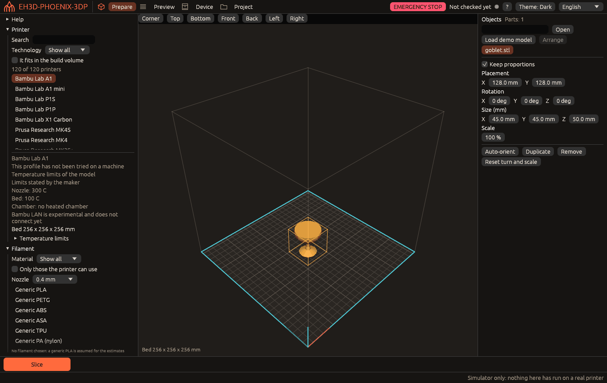
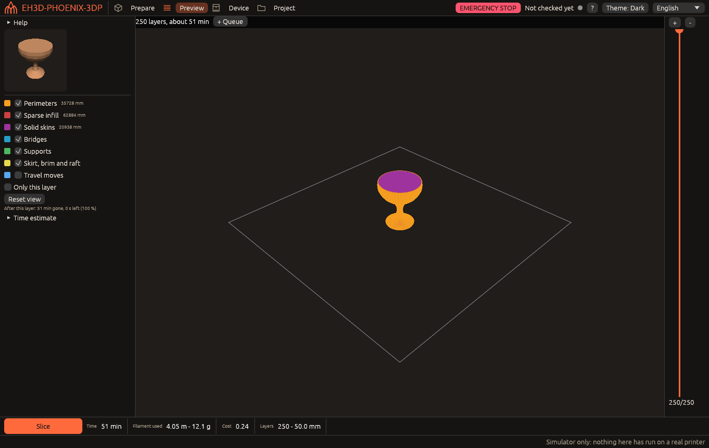
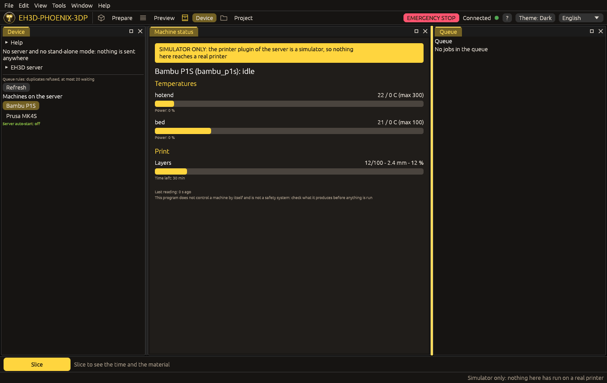
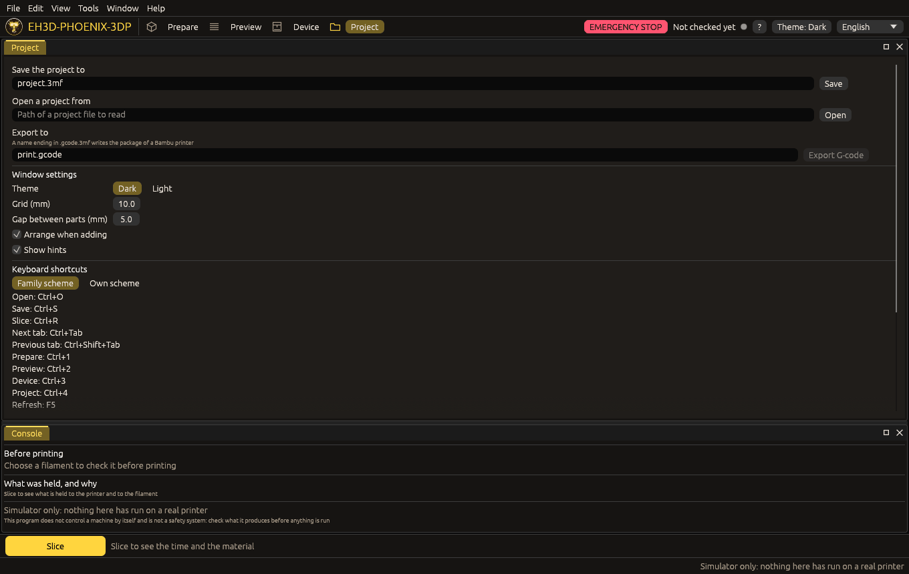
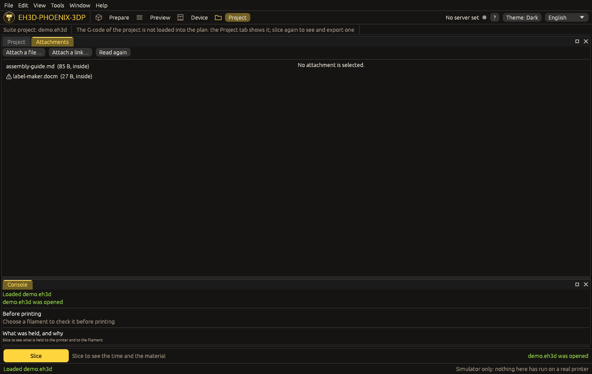
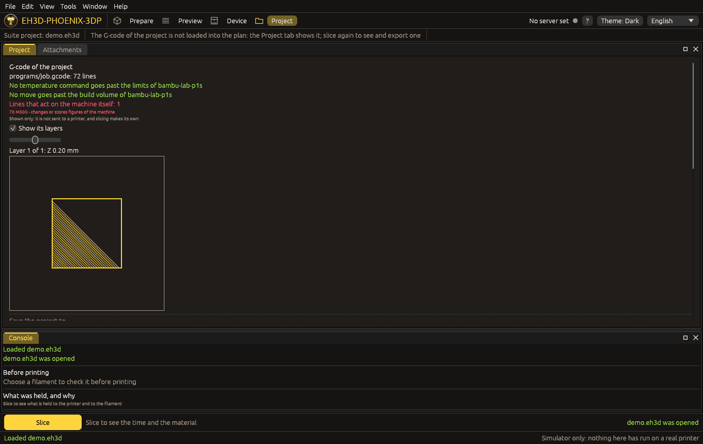

<p align="center">
  
</p>

#  EH3D-PHOENIX-3DP
<p align="center"><a href="README.md">🇺🇸 English</a> | <a href="README_spa.md">🇪🇸 Español</a> | <a href="README_fra.md">🇫🇷 Français</a> | <a href="README_ita.md">🇮🇹 Italiano</a> | <a href="README_deu.md">🇩🇪 Deutsch</a> | 🇨🇳 <b>中文</b> | <a href="README_jpn.md">🇯🇵 日本語</a> | <a href="README_por.md">🇵🇹 Português</a></p>

### 准备并发送 3D 打印：模型、打印机配置、安全的 G 代码，以及与你的打印机和 EH3D 服务器的连接

<p align="center">
  
  
  
  
  
  
</p>

---

**诚实检查 - 今天真正能运行的内容：** 一个由八个库和一个命令行程序（`phoenix-3dp`）组成的 Rust 工作区，带有 1275 个可在电脑上运行的测试。它读取并检查 STL、OBJ 和 3MF 模型，包含一个由公开数据建立的 120 个打印机配置的目录（没有一个在机器上试过），为 Marlin、Klipper、RepRapFirmware 和 Bambu 方言写出 G 代码，温度上限会拒绝超限的值而不是截断它，并能操作 Moonraker 和 OctoPrint 打印机以及 EH3D 服务器，但仅限模拟器（内存中的，以及本机的套接字）。它能把封闭模型切成平整的层，生成外壁、直线填充和实心表层（一个小型切片器，有网格和螺旋体填充、桥接、简易支撑、接缝、可变线宽、移动时抬升、裙边/帽檐/筏板、花瓶模式、短层降速、随移动距离变化的回抽，以及带加速度的时间估算；已有按高度划分的多材料（带清洗塔）、顶面熨平、压力提前、高度随形状变化的层、为防象脚而内缩的首层和流量上限，但尚无颜色涂绘）；窗口（套件的可停靠框架，有五个工作区，用 `--features gui` 构建）还没有人在屏幕上看过；没有任何内容在真实打印机上运行过。

---

> **安全状态：** 本程序不会单独控制机器，也不是安全系统。它的输出必须先由人检查，然后才能在打印机上运行；这里的任何内容都没有在真实硬件上运行过。

> **第三方名称：** 打印机厂商、型号和协议的名称（Bambu Lab、Prusa、Creality、Klipper、Moonraker、OctoPrint、Marlin 等）归其所有者所有，这里只用来说明指的是哪台机器或哪种协议；本程序不是由它们制作、认可或赞助的。它依据公开文档和事实编写，没有使用任何其他切片软件的代码、文字、图标或配置文件；名称、图形和文字均为自有。


## 📋 速览

| | |
|---|---|
| 版本 | `0.1.1` |
| 成熟度 | 可用 |
| 测试 | 1275 |
| 技术栈 | Rust |
| 真实硬件 | 未试验：这里的任何内容都没有在打印机上运行过，包括 Bambu Lab A1 和 P1S。 |

**跳转到：** [概述](#-概述) · [架构](#-架构) · [快速开始](#-快速开始) · [测试](#-测试) · [结构](#-仓库结构) · [相关项目](#-相关项目)

## 🚦 项目状态

每一行是本仓库的一个部分，灯号表示它今天做到了哪一步。内容依据仓库能够展示的证据（测试、构建、运行），而不是计划。

🟢 已完成并验证 · 🟡 可用，有已知限制 · 🟠 部分完成或尚未验证 · 🔴 未完成或不可用

| 领域 | 状态 | 在这里的含义 |
|---|---|---|
| 核心 | 🟡 | 以纳米为单位的长度、网格及其检查、读取器的上限、一个小型 JSON 读取器和一个绝不会打印出来的机密值；已在电脑上用正常和损坏的输入测试。 |
| 模型和文件 | 🟡 | 读取 STL（文本和二进制）、OBJ 和基础 3MF，带有大小限制，遇到不支持的内容会指明并拒绝；写出自有的 3MF 包、二进制 STL、OBJ 和 G 代码文件；其他程序的 3MF 项目会读取其中的对象、构建板和部分设置（只读）；已用模糊测试检查，没有用其他程序的真实文件集合检查。 |
| 打印机配置 | 🟠 | 由公开数据建立的 120 个型号（打印空间、喷嘴、方言、连接方式、前 46 个型号为厂商标称的上限（包括 Bambu Lab A1 和 P1S），其余为程序的保守上限，各配置会注明是哪一种；套件打印材料数据库中的耗材（477 种，包括通用配置和厂商公布的配置）会对照打印机和喷嘴检查，另有同一数据库的七种树脂，编辑配置时会说明改了什么）；没有一个在机器上试过，所以全部标为 `verified = false`。 |
| G 代码 | 🟡 | 四种方言的写出器，带有安全的开头和结尾；超过上限的温度会被拒绝且不写入任何内容；检查器能找出程序中超限的行；从未在打印机上运行过。 |
| 打印机驱动 | 🟠 | Moonraker 和 OctoPrint 通过传输层工作，只用它们协议的模拟器试过；独立的 Bambu LAN 驱动通过固定了证书的安全通道读取状态并暂停、恢复、停止打印，只用内存中做出的打印机试过（尚无 TLS 连接器，所以不会真正连接）。 |
| 服务器连接 | 🟠 | 连接的设置，以及建立在套件通用客户端（登录、续期、重试、八种语言的错误信息）之上的服务器打印机插件客户端，已针对内存中的服务器试过；从未对真实服务器试过。 |
| 切片器 | 🟡 | 封闭网格的平整层、外壁、直线、网格或螺旋体填充、实心表层、桥接、简易支撑、接缝、可变线宽、按方言生成的 G 代码、以数据形式提供的逐层预览，以及带加速度的时间估算；已用固定种子形状上的性质测试检查（挤出的塑料量等于零件体积，没有任何内容超出热床，没有温度超过上限）；还没有用它在打印机上打印过。 |
| 命令行 | 🟡 | `phoenix-3dp`（`printers`、`info`、`check-profile`、`convert`、`filaments`、`resins`、`slice`、`project`、`version`）运行库中的函数并打印结果；每个错误都以消息和非零退出码返回。 |
| 测试 | 🟡 | 1275 个测试通过（`cargo test --workspace`），包含正常情况、边界情况、损坏的输入，涉及随机的地方使用固定种子。 |
| 安全 | 🟡 | 纯安全 Rust（`forbid(unsafe_code)`）：上限是拒绝而不是截断；令牌绝不打印；收到的文件不会引发 panic；没有独立审查。 |
| 窗口 | 🟠 | 用 `--features gui` 写成，作为套件的可停靠框架，有五个工作区（准备、检查、运行、配置和紧凑），其面板可取下、放回、移动、组成标签页、浮动和折叠，另有菜单栏：带筛选的打印机和耗材列表、带滑块的分层方案、需要确认才能开始的服务器队列、紧急停止、可修改的快捷键、图片模式（`--shot`）、以着色实体显示零件的热床 3D 视图、带自动摆放方向和排列的零件面板、带预估的后台切片、可编辑的温度上限以及深色和浅色外观；布局保存在设置文件中；逻辑已在无屏幕下测试，README 展示了程序自身在虚拟屏幕上拍摄的窗口照片，以及由模型生成的工作区示意图；还没有人在真实屏幕上使用过这个窗口。 |
| 真实硬件 | 🔴 | 未试验：这里的任何内容都没有在打印机上运行过，包括 Bambu Lab A1 和 P1S。 |
| 文档 | 🟡 | 八种语言的 README、变更日志、`docs/` 文件夹（架构、路线图、尚未完成的内容、服务器）以及由 `docs/` 绘制的两张图。 |

## 🎯 概述

* **理念：** PHOENIX-3DP 是 PHOENIX 家族中的 3D 打印程序。EH3D 服务器及其客户端是整个套件的中心：本程序只是服务器的又一个客户端，直接与打印机通信的独立模式是默认关闭的选项。
* **模型**（`p3dp-formats`）：读取 STL（文本和二进制）、OBJ 和基础 3MF，对大小、三角形数量和 ZIP 包内容设有限制；读不了的内容会带着所发现内容的名称被拒绝。可写出二进制 STL、OBJ、自有的 3MF 包和 G 代码文件。其他程序保存为 3MF 的项目，会读取其中的对象、构建板和部分设置（只读，并设有防范恶意包的限制）。
* **配置**（`p3dp-profiles`）：一个包含 120 款打印机（FDM 和树脂）的目录，依据公开事实编写：打印空间、喷嘴、方言、连接方式、多材料系统，以及最高温度（前 46 个型号为厂商标称值，其余为程序的保守上限，每个配置都会注明是哪一种）。耗材（477 种：保留 `generic-pla` 等旧标识的通用配置，以及厂商公布的配置）来自套件的打印材料数据库（`eh3d-printmaterials`），可按厂商、材料或名称搜索，并会对照打印机和喷嘴检查：不合适的组合会连同原因一起被拒绝。同一数据库的七种通用树脂（标准、水洗、坚韧、柔性、可铸造、透明和高精度）自带各自类型的曝光和抬升值作为起点。配置可以在命令行中编辑：结果会作为整体检查，编辑过的配置不再是 `verified`，把温度上限提高到厂商标称值之上（Bambu Lab A1 mini 的热床 80 C 手动提高到 100 C）是允许的，并会给出提示。每个配置都会说明是否在机器上试过；目前没有一个试过。
* **套件打印机与你自己的文件：** `machines` 和 `machine` 显示 EH3D-COMMON 的打印机目录（Bambu Lab A1、P1P 和 P1S、三款 Creality、两款 Artillery），每项数值都附厂商页面，并给出起步耗材和工艺；这些机型以目录数值为准，并新增两款 Artillery，因此本程序提供 122 台打印机。`import` 导入 3MF 项目或你自己的 JSON、INI 配置中的设置，并逐一说明已应用、未应用、未使用或未读取的键；未使用键的值绝不显示。不会向任何打印机发送内容。
* **遵守机器限制：** `slice` 支持按喷嘴选用 `--process draft|standard|fine|strong`，遵守厂商标称的最大速度、加速度和流量（超速会被拒绝并指明，绝不削减；流量限制只减慢线条而不使其变细），并可用 `--start-gcode` 和 `--end-gcode` 加入你自己的起始和结束 G-code，逐行按温度和打印体积检查。`fit` 无需切片即可说明带裙边或底筏的零件能否放下（含旋转后）、哪些超出限制、哪些仍需在厂商页面核实。以上均未在打印机上试验过。
* **G 代码**（`p3dp-gcode`）：Marlin、Klipper、RepRapFirmware 和 Bambu 的写出器，各自带有安全的文件头、开头和结尾；不允许的温度或移动会被拒绝，绝不截断。检查器可读取任何程序，找出超过型号上限的行。
* **连接**（`p3dp-link`）：一个驱动 trait、一套规范化状态（十五种状态、温度、作业、警报）和一份命令列表；Moonraker 和 OctoPrint 基于传输层实现（仅用标准库编写的普通 HTTP，带时间和大小限制，已在本机套接字上试过），并针对各协议的内存模拟器测试；Bambu LAN 是其主题和消息的设计，标为实验性。
* **服务器**（`p3dp-server-bridge`）：设置项 `server_address`、`server_token`、`server_machine`、`server_timeout_s`、`server_retries` 和 `server_mdns`，以及建立在套件通用客户端（`eh3d-serverclient`）之上的服务器 `printer3d` 插件客户端：作业进入队列并等待有人启动，温度上限在发送任何内容之前检查，并提供停止；已用内存中的服务器测试。
* **切片器**（`p3dp-slicer`）：封闭网格的平整层、外壁、带实心表层的直线、网格或螺旋体填充、桥接、简易支撑、接缝、可变线宽、移动时抬升、顶面熨平、压力提前、高度随形状变化的层、为防象脚而内缩的首层、流量上限、按高度划分的多材料（带清洗塔）、通过程序的写出器生成各方言的 G 代码，以及以数据形式提供的逐层预览和使用加速度的时间估算；放不进热床、超过温度上限或不是封闭网格的内容会被拒绝，绝不截断。
* **查看器**（`p3dp-viewer`）：不含图形代码的 3D 查看器模型：透视的环绕相机、在热床上的点击选择和框选、层的范围，以及供显卡使用的计划线条。用 wgpu 绘制的部分在默认关闭的功能之后，从未构建过。
* **其他文件：** 二进制 G 代码（`bgcode`）和开放的树脂层包（`.sl1`）只读取文件头，并给出曝光时间估算；树脂打印机的封闭格式会连同原因一起被拒绝。二进制 G 代码的缩略图会被列出，最大的一张可以取出（`project 文件 --thumbnail 输出`）；普通 G 代码注释中的数值和缩略图（用丝量、时间、层高）也以同样方式读取，只读开头和结尾。
* **尚未完成：** 3D 查看器的绘制（其模型已有）、颜色涂绘、Bambu LAN 连接以及其他传输层。路线图在 `docs/ROADMAP.md`，缺少的内容在 `docs/NOT_YET.md`。

## 🧩 在 EH3D 中的角色

EH3D-PHOENIX-3DP 是 EH3D Fabrication Suite 中 PHOENIX 家族的 3D 打印程序。目前它是一组库加一个命令行；窗口用 `--features gui` 构建。服务器 `eh3d-server` 及其客户端是套件的中心：打印机、队列和权限预计放在服务器里（由那里的 `printer3d` 插件负责），本程序通过套件通用的设置与它通信。参见 [docs/SERVER.md](docs/SERVER.md)。

## 🏛️ 架构

<p align="center">
  
</p>


本仓库各部分如何配合：谁使用它、它包含什么、它依赖什么。图由 `docs/architecture.json` 绘制并与代码核对。

## 🖼️ 屏幕截图

窗口的照片，由程序自身的截图模式拍摄（`--shot --demo`：模型和服务器都在内存中生成，因此不会连到打印机）：

<p align="center">
  
</p>

<p align="center">
  
</p>

<p align="center">
  
</p>

<p align="center">
  
</p>

<p align="center">
  
</p>

<p align="center">
  
</p>

<p align="center">
  
</p>

<p align="center">
  
</p>

<p align="center">
  
</p>

<p align="center">
  
</p>

<p align="center">
  
</p>

各工作区出厂布局的示意图，由窗口的模型绘制（`cargo run --example workspace_pictures`）：菜单栏以及带标签页的面板组。照片和示意图由工作流 `Window pictures` 更新。

## ✨ 功能

* **上限就是拒绝：** 不允许的温度或移动是一个指明数值和上限的错误，绝不会被截断到上限；写出器、驱动和检查器都遵守。
* **不会自行开始：** 发往服务器队列的请求带有 `auto_start: false` 并要求确认；原始 G 代码默认关闭，开启后也按同样的上限逐行处理。
* **所有协议一种状态：** 十五种规范化状态、温度、作业和警报，打印机的原始文本单独保存，使程序其余部分只说一种语言。
* **测试用模拟器：** 每个协议都有可按需制造故障（无连接、超时、503）的内存模拟器，因此重试、拒绝和关机都无需网络即可测试。
* **类似切片软件的窗口：** 套件可停靠框架中的五个工作区（准备、检查、运行、配置和紧凑）；打印机、耗材和工艺面板；以着色实体显示零件的热床 3D 视图；每个零件的数值（位置、旋转、尺寸）、自动摆放方向和排列；后台切片，预估值显示在底部；深色和浅色两种外观。面板可取下、放回、移动、组成标签页、浮动和折叠，布局保存在设置文件中，菜单栏有文件、编辑、视图、工具、窗口和帮助。逻辑已在无屏幕下测试；窗口本身还没有人在屏幕上看过。
* **净室与自有图形：** 依据公开协议、手册和事实编写；不使用其他切片软件的代码、文字、图标或配置文件；在试用之前每个配置都标为 `verified = false`。
* **八种语言：** 程序文字和文档提供英语、西班牙语、德语、法语、意大利语、日语、中文和葡萄牙（葡萄牙）语版本。
* **没有 unsafe 代码：** 每个 crate 都有 `#![forbid(unsafe_code)]`。
* **从模型到打印机文件：** 零件可在热床上旋转、缩放和复制，可单独修改设置、选择起始工艺并加入您自己的起始和结束 G-code；因打印机而限制的内容会连同原因一起说明。对 Bambu 打印机，以 `.gcode.3mf` 结尾的名称会写出打包文件（G-code、校验和、图片、数据），`project` 可检查并打开它。尚未交给任何打印机：厂商未公开其完整结构。
* **带附件的套件项目（`.eh3d`）：** 一个文件为套件中的每个程序各留一个分支，本程序只写入 `3dp/`：零件及其摆放、切片设置、打印机、耗材和切片得到的 G 代码。可在“文件 > 套件项目”和 `project` 命令中打开、保存、另存为、导入模型或程序（保留原件并附报告）、从其他分支取用模型（带引用，来源变化时会提示）以及提取分支；会移除签名或改动此处未读取内容的写入会先询问；期间被其他程序保存过的项目不会被覆盖。“附件”面板把数据手册、说明书、文档和其他项目保存在文件内并显示它们（用随包附带的 PDFium 库显示 PDF 页面，显示图片、文本以及办公文档的文字）；程序、脚本、带宏的文件、压缩包和未知类型在离开项目前会先询问，不运行任何内容，也不下载任何内容。项目还会保存您自己的起始和结束 G 代码，窗口仅在您勾选后使用。项目中的 G 代码会显示出来，其温度与打印机上限进行比对（`project open` 命令同样如此），但不会载入切片计划，也不会向打印机发送任何内容。尚未有人在屏幕上试用过。各层可以逐层绘制，每个移动都与打印空间比对，直接改动机器本身的指令会列出（`project layers` 和 `check-profile --gcode` 也一样）。项目可以保存您的打印机配置，它只能降低限值和打印空间。
* **更细的质量设置：**悬垂外壁降速并开风扇、支撑界面层、首层温度、填充重叠、先打印外壁、接缝放在最尖的角、仅跨越外壁时回抽、回抽时擦嘴、在指定层前暂停、进度标记、裙边最小长度；它们在设置文件和窗口的“质量”一栏中。除进度标记外，不指定就全部关闭，并且都没有实际打印过。

## 🔒 安全与防护

| 威胁 | 防御 |
|---|---|
| 损坏、被截断或恶意的模型文件 | 分配任何内存之前先检查大小；三角形、顶点、范围、ZIP 包的条目数及其解压后的大小都有上限，压缩炸弹会被拒绝；模糊测试在每个位置截断有效文件并输入乱码，任何情况都不得 panic |
| 内部藏有意外内容的包（组件、其他文件中的对象、声明的实体） | 会指明并拒绝，绝不跳过；声明的 XML 实体是错误 |
| 超过型号允许的温度 | 连同数值和上限一起被拒绝；绝不截断到上限；写出器、驱动和检查器遵守同一规则 |
| 绕过上限的原始 G 代码行 | 默认关闭；逐行处理；与其他一切使用相同的上限检查 |
| 进入路径或命令的文件名或标识 | 不允许文件夹、`..`、控制字符，只接受已知扩展名，进入路径的内容做百分号编码 |
| 日志或屏幕上的服务器令牌或打印机密钥 | 保存在会打印 `***` 的类型中；显示设置时令牌被隐藏 |
| 自行启动作业的队列 | 请求带有 `auto_start: false` 并要求确认；服务器能否自行启动作业是服务器的策略 |
| 不稳定的网络 | 只在不会发生两次的地方重试：连接被拒绝时任何请求都会重试，超时仅对可以重发的请求重试，POST 绝不重试 |
| 不安全的内存使用 | 使用 `forbid(unsafe_code)` 的纯安全 Rust |

**不在防护范围内的内容：** 写得干净的程序不等于可以放心运行的程序。上限是厂商标称的值，没有在机器上核对过；驱动只接触过模拟器；没有经过独立审查。请私下报告漏洞（见 [SECURITY.md](SECURITY.md)）。

## 🔌 接口

库有 `p3dp_core`、`p3dp_formats`、`p3dp_profiles`、`p3dp_gcode`、`p3dp_link`、`p3dp_server_bridge`、`p3dp_slicer` 和 `p3dp_viewer`；程序是库 `eh3d_phoenix_3dp` 和命令行 `phoenix-3dp`。每个命令把结果打印到标准输出，并把错误连同非零退出码报告到标准错误（所请求的操作失败为 1，命令写错为 2）。唯一的网络访问是驱动和服务器连接的传输层，且只访问给定的地址。

```text
phoenix-3dp printers [--vendor NAME] [--tech fdm|msla] [--search TEXT]
phoenix-3dp machines [--search TEXT]
phoenix-3dp machine ID [--nozzle MM] [--process draft|standard|fine|strong [--out FILE] [--force]]
phoenix-3dp import FILE.3mf|FILE.json|FILE.ini [--out SETTINGS] [--force]
phoenix-3dp info MODEL [--printer ID]
phoenix-3dp check-profile ID [--gcode FILE]
phoenix-3dp check-profile --file PROFILE [--gcode FILE]
phoenix-3dp check-profile ID|--file PROFILE --set "key=value;key=value" [--save FILE] [--force]
phoenix-3dp convert IN OUT [--printer ID] [--force]
phoenix-3dp filaments [--printer ID] [--nozzle MM] [--hardened]
phoenix-3dp resins [--kind KIND] [--printer ID] [--part-ml ML]
phoenix-3dp fit MODEL --printer ID [--process LEVEL] [--settings FILE] [--set "key=value;key=value"] [--filament ID] [--nozzle MM] [--hardened] [--turn DEG] [--scale PERCENT] [--copies N] [--start-gcode FILE] [--end-gcode FILE]
phoenix-3dp slice MODEL --printer ID [--process LEVEL] [--settings FILE] [--set "key=value;key=value"] [--filament ID] [--nozzle MM] [--hardened] [--turn DEG] [--scale PERCENT] [--copies N] [--start-gcode FILE] [--end-gcode FILE] [--report] [--out FILE.gcode|FILE.gcode.3mf] [--save-settings FILE] [--force]
phoenix-3dp project FILE.3mf|FILE.bgcode|FILE.gcode|FILE.sl1 [--thumbnail FILE] [--extract-gcode FILE] [--force] [--bottom-layers N] [--lift MM] [--light-power MW]
phoenix-3dp project list FILE.eh3d [--json]
phoenix-3dp project save FILE.eh3d [--model MODEL] [--settings FILE] [--printer ID] [--filament ID] [--gcode FILE.gcode] [--start-gcode FILE] [--end-gcode FILE] [--printer-file PROFILE] [--name NAME] [--id ID]
phoenix-3dp project layers FILE.eh3d [--layer N] [--printer ID]
phoenix-3dp project import FILE.eh3d MODEL|FILE.gcode [--printer ID] [--name NAME] [--id ID]
phoenix-3dp project open FILE.eh3d [--into DIR] [--printer ID] | take FILE.eh3d BRANCH NAME [--printer ID] | extract FILE.eh3d BRANCH DIR
phoenix-3dp version
phoenix-3dp gui [SETTINGS] [--open MODEL] [--printer ID] [--shot FILE.png [--window TAB] [--size WxH] [--slice] [--demo] [--peek]]  the window (a build with --features gui)
```

## ⚙️ 配置

设置是一个由 `键 = 值` 行组成的文件（`--config 文件`）：读取器上限（`limit_*`）、与服务器的连接（`server_address`、`server_token`、`server_machine`、`server_timeout_s`、`server_retries`、`server_mdns`、`server_max_answer_mib`）、`direct_mode`（独立模式，默认关闭）、`lang`、`default_printer`、价格(`price_filament_per_kg`, `price_resin_per_litre`, `resin_waste_percent`)、报告(`report_slowest_layers`, `report_short_layer_s`)、队列(`queue_refuse_duplicates`, `queue_max_waiting`)以及普通 G 代码的搜索范围(`limit_gcode_head_kib`, `limit_gcode_tail_kib`, `limit_gcode_thumbnails`)。打印机配置是同类的另一个文件（`examples/my-printer.cfg`）。未知的键或超出范围的值都是会指明所在行的错误；所有默认值都偏保守。参见 `examples/phoenix-3dp.cfg`。窗口把自己的选择保存在同一个文件中：`theme`（`dark` 或 `light`）、`grid_mm`、`arrange_gap_mm`、`arrange_on_add`、`ui_hints`、`peek_wall_alpha`（向内看时预览中壁的不透明度）、以 `dock.` 开头的行中保存的面板布局，以及每台更改过温度上限的打印机的 `printer_limits_<id>`。 项目附件的上限为 `attachments.max_mb`（可附加或取出的最大文件，1024）以及 `viewer.max_attachment_mb`、`viewer.max_pdf_mb`、`viewer.max_image_mb`、`viewer.max_text_mb`、`viewer.max_office_mb` 和 `viewer.max_preview_mb`（程序内显示的范围），均为 1 到 4096 的整数。

## 🚀 快速开始

需要稳定版 Rust 工具链（1.88 或更新）。请先在本仓库旁边克隆 EH3D-COMMON：服务器的通用客户端来自那里。

```bash
cargo build --release
cargo test --workspace
cargo run --release -- printers --search bambu
cargo run --release -- info examples/cube-20mm.stl --printer bambu-lab-a1
cargo run --release -- check-profile --file examples/my-printer.cfg --gcode examples/job-too-hot.gcode
cargo run --release -- convert examples/cube-20mm.stl cube.3mf --printer prusa-mk4s
cargo run --release --features gui -- gui   # the window
```

## 🧪 测试

测试套件有 1275 个测试（`cargo test --workspace`，CI 中在 Windows 和 Linux 上运行），涉及随机的地方使用固定种子。它们检查正常情况、边界情况和损坏的输入：被截断的文件、乱码和恶意文件头绝不会 panic，目录中任何打印机的温度都不会超过其上限。CI 还会运行 `cargo fmt --all --check`、把警告当作错误的 `cargo clippy` 以及 `python -I tools/ci_validate.py`。

## 🏗️ 构建与发布

版本记录在 `Cargo.toml` 和 `eh3d.project.json` 中，每个版本在 [CHANGELOG.md](CHANGELOG.md) 中都有条目。`build.bat` / `build.sh` 构建程序，`test.bat` / `test.sh` 运行测试，`run.bat` / `run.sh` 带示例运行。发布版本会放在 GitHub 上，并提供适用于 Windows（64 位和 32 位）、Linux（64 位）和 macOS（Apple 芯片和 Intel）的现成程序：每个软件包 `phoenix-3dp-<版本>-<系统>.zip` 或 `.tar.gz` 都附带其 `.sha256` 和 `.sig` 文件。 软件包在程序旁附带附件查看器的 PDF 库（PDFium）及其许可证和声明。

## 📂 仓库结构

<p align="center">
  
</p>

<details>
<summary>目录树的文本版</summary>

```text
EH3D-PHOENIX-3DP/
├── crates/
│   ├── p3dp-core/                               单位、网格及检查、上限、JSON、设置
│   ├── p3dp-formats/                            STL、OBJ、3MF、项目、bgcode、G-code 注释和树脂的读取器；写出器、ZIP、PNG
│   ├── p3dp-profiles/                           依据公开事实的打印机、耗材、树脂、配置文件及其编辑
│   ├── p3dp-gcode/                              四种方言的 G 代码写出器和检查器
│   ├── p3dp-link/                               驱动、规范化状态、TCP、模拟器、Bambu LAN（协议字节，不建立连接）
│   ├── p3dp-server-bridge/                      服务器连接设置、插件客户端、队列规则和看板
│   ├── p3dp-slicer/                             切片器：层、外壁、填充、桥接、支撑、裙边、帽檐、筏板、G-code
│   └── p3dp-viewer/                             3D 查看器的模型：相机、选择、层、空走
├── src/
│   ├── lib.rs                                   程序的库：命令行和窗口使用的部分
│   ├── main.rs                                  命令行和窗口的启动
│   ├── cli.rs                                   命令：printers、info、check-profile、convert、filaments、resins、slice、project、version
│   ├── eh3dfile.rs                              套件项目的 3dp/ 分支
│   ├── eh3dcli.rs                               套件项目的命令
│   ├── gui/suite.rs                             套件项目的窗口
│   ├── app_state.rs                             无窗口的窗口状态：标签页、打印机、模型、报告、模拟设备
│   ├── config.rs                                设置文件：上限、服务器连接、语言、默认打印机、价格、报告和队列
│   ├── demo.rs                                  用于截图的演示模型：由几个半径旋转而成的高脚杯
│   ├── device.rs                                服务器的打印机、队列及其规则、需确认的开始、紧急停止
│   ├── i18n.rs                                  程序的八种语言文字
│   ├── keys.rs                                  键盘快捷键：系列通用方案、自定义方案和修改
│   ├── lists.rs                                 打印机和耗材列表及其筛选
│   ├── limits_ui.rs                             编辑并保存打印机的温度上限，以及编辑时的警告
│   ├── look.rs                                  窗口的颜色、标志、图案及按大小的布局
│   ├── objects.rs                               热床上的零件：放置、旋转、缩放、自动摆放方向、排列、重叠
│   ├── panels.rs                                以数据形式保存窗口的面板、工作区和菜单
│   ├── preflight.rs                             打印前要检查的事项（来自材料数据库）
│   ├── preview.rs                               在窗口中切片、层滑块、屏幕上的方案、报告
│   ├── project.rs                               项目：模型及其打印机，保存在自有的 3MF 包中
│   ├── report.rs                                报告的文字：切片、树脂、缩略图和配置编辑（八种语言）
│   ├── server_ui.rs                             服务器设置、连接状态和登录，基于套件的共用面板
│   ├── shade.rs                                 3D 视图的实体外观：着色多边形、热床、标准视图和拾取
│   ├── shot.rs                                  窗口的图片模式（--shot）及其写出的 PNG 文件
│   ├── slice_job.rs                             后台切片和进度条的估算
│   ├── studio.rs                                “准备”标签页的工作台：零件、相机、后台切片、警告和预估
│   ├── view.rs                                  把网格变成预览线条的轨道相机
│   └── gui.rs                                   窗口（egui，gui 特性）：工具栏、面板、3D 视图和操作传达
├── tests/
│   ├── end_to_end.rs                            从模型到程序再到模拟打印机的测试
│   ├── eh3dfile.rs                              套件项目的测试
│   ├── examples.rs                              测试 examples/ 中的文件能配合命令使用
│   ├── fuzz.rs                                  固定种子的模糊测试：截断、损坏和恶意文件
│   ├── readme.rs                                测试 README 所述属实：测试数量和命令
│   ├── safety.rs                                测试目录中任何打印机的温度都不会超过其上限
│   └── reqs.rs                                  需求登记表的测试
├── examples/
│   ├── cube-20mm.stl                            20 毫米立方体（文本 STL）
│   ├── cube-20mm.obj                            同一个立方体（OBJ）
│   ├── phoenix-3dp.cfg                          含所有键及其默认值的设置文件
│   ├── my-printer.cfg                           手写的打印机配置（一台 Klipper 机器）
│   ├── job-safe.gcode                           遵守该配置上限的程序
│   ├── job-too-hot.gcode                        有两行超过上限的程序
│   ├── start-prime-line.gcode                   自定义起始行示例
│   └── end-park.gcode                           自定义结束行示例
├── docs/
│   ├── REQUIREMENTS.md                          需求登记表：每项的状态、证据和测试
│   ├── SCOPE.md                                 用途、不做什么以及永远不由它决定的事
│   ├── STATUS.md                                已有的、缺少的和仍未决定的
│   ├── ARCHITECTURE.md                          按 crate 说明程序
│   ├── ROADMAP.md                               从基础到完整程序的九个步骤
│   ├── NOT_YET.md                               尚未完成的内容及各部分的需求
│   ├── SERVER.md                                程序如何与 EH3D 服务器配合
│   ├── architecture.json                        架构图数据
│   └── structure.json                           结构图数据
├── tools/                                       CI 检查、README 检查和图片工具
├── images/                                      图标和徽标、横幅图、两张示意图和工作区图片
├── .github/                                     CI 与发布工作流、议题和拉取请求模板
├── eh3d.project.json                            清单：版本、角色、成熟度和构建命令
├── Cargo.toml                                   工作区及其 crate
├── rust-toolchain.toml                          固定的 Rust 工具链
├── CHANGELOG.md                                 每个版本的变更
├── AGENTS.md                                    修改本仓库的人需要遵守的规则
├── SECURITY.md SUPPORT.md                       如何报告漏洞以及在哪里提问
└── CONTRIBUTING.md CODE_OF_CONDUCT.md LICENSE   如何贡献、行为准则和许可证
```

</details>

## 🗺️ 路线图与已知限制

**目前已知的限制**

* 切片器很小：支撑是简易的（没有树状支撑，界面层只是排得更密的线），桥接没有调校，多材料仅按高度切换（没有颜色涂绘，也没有换刀头的偏移），也没有用它在打印机上打印过。
* 还没有连接过任何打印机，包括 Bambu Lab A1 和 P1S；每个配置都标为 `verified = false`。
* 3MF 读取器只取网格（组件和生产扩展会被拒绝）；其他程序的项目只读取其对象、构建板和设置，绝不修改。
* 驱动有一个普通 HTTP 传输层，只在本机套接字和模拟器上试过；没有 TLS，也没有 WebSocket 推送；Bambu LAN 经由服务器进行，服务器持有固定证书的 TLS（仅在内存中的服务器上试过），程序自身不打开 TLS，Bambu 云不在其范围内。
* 窗口（套件可停靠框架中的五个工作区）还没有人在屏幕上看过；README 中的图片是由其模型生成的示意图。

**下一步**

* H1：用 wgpu 绘制 3D 查看器（其模型已有）和网格修复。
* H2：在真机上打印的校准立方体（网格和螺旋体填充、接缝、可变线宽、桥接和简易支撑已编写，并用固定种子的形状测试过）。
* H3：带继承的配置编辑器，以及配置与服务器的同步。
* H4 至 H6：自适应层高、其余质量设置、树状支撑和高级填充，以及颜色涂绘和换刀头。
* H7：其他传输层（WebSocket 推送、PrusaLink、Duet）、直接的 Bambu LAN 连接（其 TLS 由服务器提供）。
* H8：有真实机器证据的配置（Bambu Lab A1 和 P1S 是计划中的首批）、引导式校准和碰撞模拟。完整计划见 `docs/ROADMAP.md`。

## 🌍 语言

README 和文本提供英语、西班牙语、法语、意大利语、德语、汉语、日语和欧洲葡萄牙语版本。

## 🔗 相关项目

* [EH3D-COMMON](https://github.com/JuanenRac/EH3D-COMMON): 共享的 crate，其中包括服务器的通用客户端
* [EH3D-SERVER](https://github.com/JuanenRac/EH3D-SERVER): 套件的服务器，打印机、队列和权限预计放在这里
* [EH3D-STUDIO](https://github.com/JuanenRac/EH3D-STUDIO): 套件的配置面板
* [EH3D-PHOENIX-LASER](https://github.com/JuanenRac/EH3D-PHOENIX-LASER): 激光雕刻和切割，同一家族的姊妹程序
* [EH3D-PHOENIX-PNP](https://github.com/JuanenRac/EH3D-PHOENIX-PNP): 贴片机（拾取与放置），同一家族的姊妹程序
* [EH3D-SUITE-LAUNCHER](https://github.com/JuanenRac/EH3D-SUITE-LAUNCHER): 查找并启动套件中各程序的中心

## 📚 文档

* [变更日志](CHANGELOG.md)
* [范围](docs/SCOPE.md)： 程序的用途、不做什么，以及永远不由它决定的事。
* [需求](docs/REQUIREMENTS.md)： 功能登记表、每项的状态以及证明它的测试。
* [状态](docs/STATUS.md)： 已有的、缺少的和仍未决定的。
* [暂不包含](docs/NOT_YET.md)： 本版本暂不包含的好想法。
* [修改仓库的规则](AGENTS.md)： 修改本仓库的人需要遵守的规则。
* [docs/ARCHITECTURE.md](docs/ARCHITECTURE.md): 程序架构，按 crate 说明
* [docs/ROADMAP.md](docs/ROADMAP.md): 路线图：从基础到完整程序的九个步骤
* [docs/SERVER.md](docs/SERVER.md): 程序如何与 EH3D 服务器配合
* [docs/architecture.json](docs/architecture.json): 两张图的数据

## 🤝 参与贡献与社区

* 提交拉取请求前请运行 `cargo fmt --all --check`、`cargo clippy --workspace --all-targets -- -D warnings`、`cargo test --workspace` 和 `python -I tools/ci_validate.py`：必须全部通过。见 [CONTRIBUTING.md](CONTRIBUTING.md) 和[行为准则](CODE_OF_CONDUCT.md)。
* README 有八种语言：修改文字要在八个文件中同时进行，两张图由 `tools/make_architecture.py` 和 `tools/make_structure.py` 根据 `docs/architecture.json` 和 `docs/structure.json` 绘制。
* 请私下报告漏洞：[SECURITY.md](SECURITY.md)。问题、想法和报告：electrohobby3d@gmail.com（[SUPPORT.md](SUPPORT.md)）。

## 👤 作者

**JuanenRac (Electro Hobby 3D)** · electrohobby3d@gmail.com

## 📜 许可证

软件：GPL-3.0-or-later。见 [LICENSE](LICENSE)。套件的硬件设计使用 CERN OHL-S。
